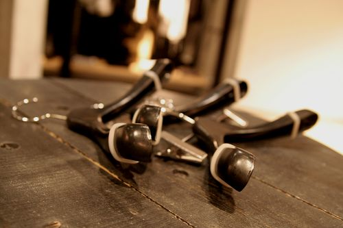
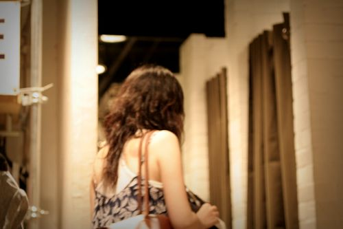
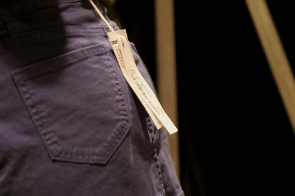
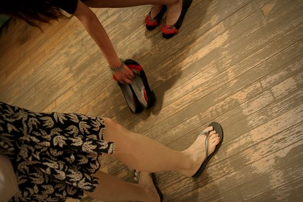
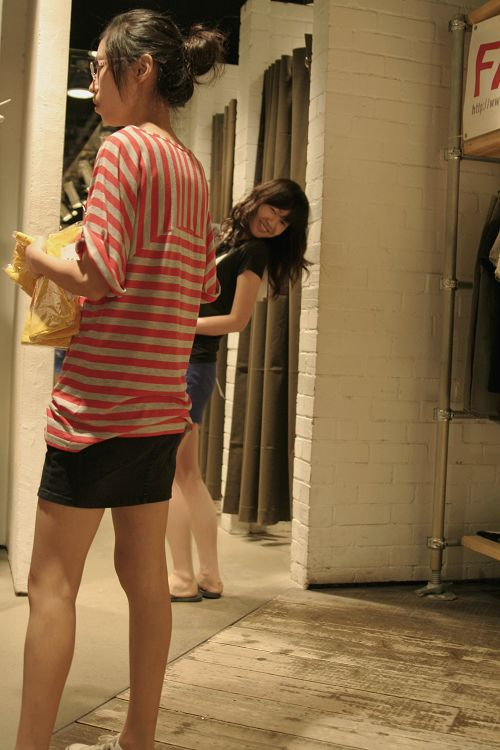
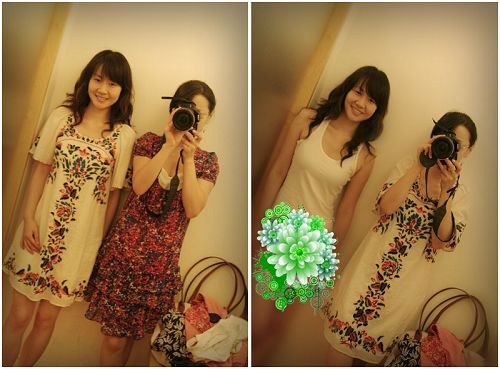

# 丧失购物欲

当心态发生变化后，对于事物的审美与需求也会随之发生变化。比如早几年比较喜欢的IZZUE，如今奇怪对它怎么没有兴趣了？连Sherry也奇怪：“你好象没有购物欲啊？”在这么没有购物欲的状况下，我还是在曾经喜欢的西班牙品牌ADOLFO DOMINGUEZ那里买到两件满意衣衫及SISLEY衣服若干。  
  
   
   
   
   
   
   
  
  
国内French Connection UK的货品永远不是我的STYLE，不过非常适合甜美的Sherry，比如她今天逛街穿的上面那件藏青色吊带裙。  

---

## 评论（12）

**小梨子** · 2009-08-09

其实我觉得品牌有时也变的很快。有些真是女大十八变有越变越丑的。

**邃** · 2009-08-09

在某个年龄段喜欢某种类型和某种牌子的衣服都不是刻意的，可是最害怕的就是对过去的挚爱陌生。  
ZARA上个月打折了一个月，败了几件回来。  
目前很喜欢他们家的衣服！

**Christina** · 2009-08-09

ZARA的衣服看上去还不错，洗一水就不同了。只买过它家一双鞋和一顶草编帽子，那个编帽子的草制作时药水处理不当现在已经发臭。。。。

**[少爷](http://jennyshaoye.blogbus.com/)** · 2009-08-10

不好意思,想说SHERRY好甜的

**itsmin** · 2009-08-10

哎呀，好好的美女照片偏要加上一朵花，真可惜。实在要加，放上几片叶子就好了么；+）

**Christina** · 2009-08-10

花和叶子有什么不同的意义吗？

**itsmin** · 2009-08-10

嗯。地位不一样。而且，好像这种花的叶子小一点。

**陈问** · 2009-08-10

Sherry的蓝色吊带裙，深得我心~

**Christina** · 2009-08-11

还有卖的，不过是黑色的底色，藏青色没有啦~

**Sherry** · 2009-08-11

问，可以去水游城看看有没藏青色的。 ：）

**大姜炖去** · 2009-08-11

sherry笑的很妩媚  
最后两张就像是你在变魔术，  
衣服从她身上变到你身上

**lilian** · 2009-08-13

已经很久没特意去逛街了，都是顺路逛，顺便买，每次都象做贼似地匆匆忙忙……但愿它不要改变我仅有的一点点生活乐趣~~

