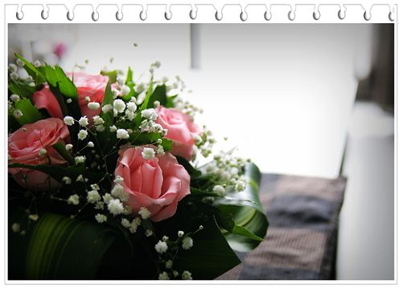
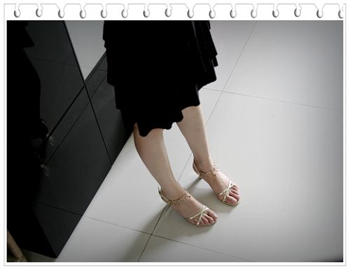

# 社会主义的春天。。。

上午工会送来一盆粉红色玫瑰花束，及200元现金，去年的生日礼物是玩具熊。很喜欢今年的鲜花，有种鲜活的美好感受，老板年轻些到底是不一样啊！鲜花里插着一张老板签名的卡片，据说那上面的祝福是特别订做的。  
  
中午下班带着它回家，路过别的办公室开心地朝里面的女同事们秀了一下，女孩子们兴奋地大叫：“哎呀，生日过完了啊。”的确，送鲜花是从8月开始哦~  
  
有人感叹社会主义好，说：“我们资本主义才无情，员工得自己在生日当天拿着200元发票去报帐。”这有什么啊？在上海外企的同学月公积金4000，是我的3倍，得到实惠是真的。那个。。。那个在外企工作的邻居时常翘班在家，而这位感叹的女士下午3点多发短信来：“一天都在怠工，没心情干活，提前下班没有高兴感，回家是无奈的选择。”对忙得两眼模糊的人说这些。。。SIGH。。。可是。。。可是。。。可是美国的资本主义社会未婚先孕，同事们会真诚地为坐月子的妈妈轮流送晚饭哦。。。看到这个故事我的眼珠子要掉出来了，为美国人民的宽容！如果在资本主义社会谈情说爱，工作在社会主义制度下，会不会更快乐呢？  
  
在[**Hi BaiDu**](http://hi.baidu.com/wswangyue1014)的blog上看到这个**http://photooftheday**。  
  
这个人。  
从1979到1997。18年。pola相机。每天一张照片。  
第一张是1979年3月31日，最后一张是1997年10月25日。后头的就没了。   
因为，1997年10月25日那天，拍照片那人死在病床上。   
他的朋友把他生前拍的照片整理了出来，放在网上。  
有意思。  
  
送这首汪峰的新歌[**“春天里”**](http://photos.ah.cn/sammy/chuntianli.mp3)给各位，及每年留言一次的茶友。  
如果有一天我老无所依  
请把我留在在这春天里  
如果有一天我悄然离去  
请把我埋在这春天里  
  
   
   
   

---

## 评论（20）

**jiajialing** · 2009-08-14

鲜花配美人，生日快乐姐姐:) hehehe。。。。

**itsmin** · 2009-08-14

鲜花会让生日变得不同。。。Happy birthday lah!

**喜刷刷** · 2009-08-14

今天到处都温情四溢的啊，无论资本主义还是社会主义。链子比花花更好看～

**[nokia2100™](http://nokia2100.blogbus.com/)** · 2009-08-14

如鲜花般盛开在春风里——又一个每年留言一次的茶友的生日祝福。

**quinn** · 2009-08-14

你的生日是8.15吧？ 呵，生日快乐   
8.15也是我身份证上的生日

**XN227** · 2009-08-14

美丽的姑娘，生日快乐，愿你开启更多美丽的日子

**[三月四月](http://11)** · 2009-08-14

唉，我是5月，没挨上

**zq** · 2009-08-14

提前祝茶妹妹生日快乐！天天快乐！享受生活每一天！

**lilian** · 2009-08-14

现金加鲜花，该送的祝福送到了，想买啥就自己买去，公司想得可真周到呀！

**[joanna](http://yanmer.cn/blog)** · 2009-08-14

生日快乐。瘦了

**lusfe** · 2009-08-14

公积金4000的好日子过去了，现在南京的公积金有最高限，平均工资高限的3倍，去年就开始实行了。

**[山树](http://shanshu.blogbus.com/)** · 2009-08-14

真不错！  
喜欢你今天的一身衣服，有种知性美。

**鸟人** · 2009-08-14

茶姐,生日快乐~~

**Cindy** · 2009-08-14

今天的衣服很赞！

**Anyayaya** · 2009-08-15

正点生日快乐！找你呢，查你的短信！

**大姜炖去** · 2009-08-15

生日快乐，茶姐^-^

**陈 问** · 2009-08-15

我还在上海，祝你生日快乐 你这一天看上去真是容光焕发！

**EnriqueSun** · 2009-08-15

生日快乐  
懂生活的女子

**[selina](http://selinatea.blogbus.com/)** · 2009-08-16

倒数第二张 感觉很好诶

**Michelle** · 2009-08-16

happy birth month. socialist institution maybe already somewhere in the west, just the totally different story from China.

