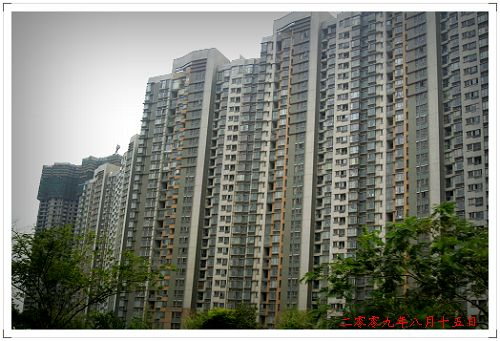
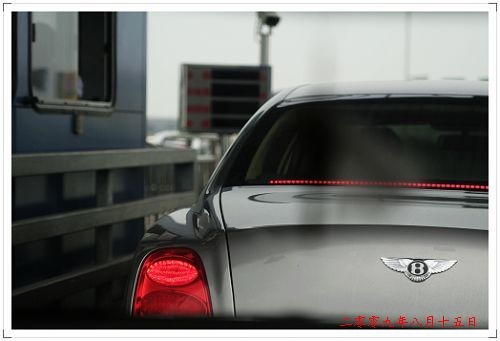
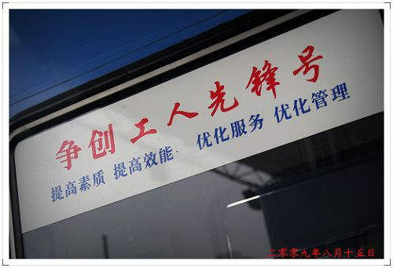
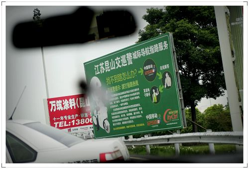
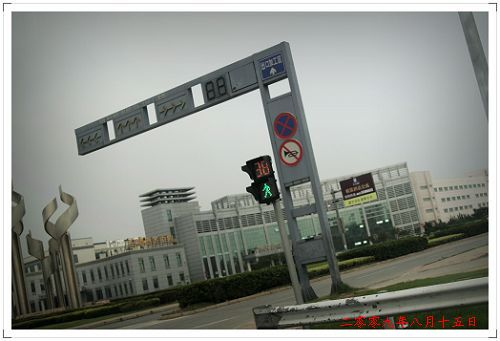
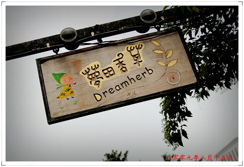
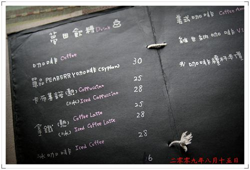
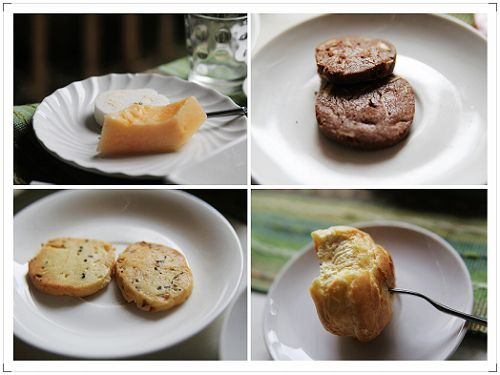
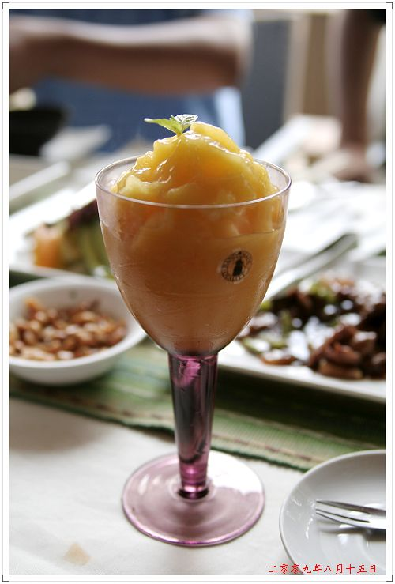
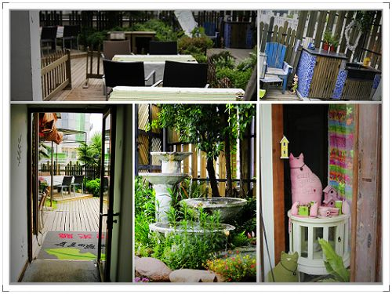

# @昆山

快到昆山遇到这堵城墙般的商品楼，真壮观。  
很实在的围着高速公路。  
  
  
收费站里的宾利让大家精神抖擞。   
  
  
社会主义的标语四处可见。  
  
  
南京高速下来也学了这套“向警察叔叔问路”的免费服务。  
  
  
十字路口乍一看，找不到交通信号灯，原来在这样的标杆上，特别不明显。  
  
  
昆山黄河北路的“梦田香草”休闲餐厅，即使是下午两点多钟喝下午茶的客人也不少。既有趣又有点小情调的地方，从主菜到甜品到饮料做得还算精致。  
  
  
黑色皱纹纸上手写的点单名，用朴素的棉线穿起来的菜单。  
  
  
梦田香草所有的糕点都是自家制作，左上角那只白色的甜品是蛋糕+冰淇淋，右小角是只巨大的奶油烤芙，口味不错滴说~  
  
  
芒果冰沙的口味与starbucks的不相上下，不过18元一份。  
  
  
刚走进去就可以看到许多猫咪装饰，绿意葱葱的小庭院，这里居然还举办过婚礼哦~  
  
  
天气没那么冷但也热不死人，本打算穿件森林色彩的裹胸连衣裙，考虑到露天体育场可能会有成批的蚊子，最终还是选择了牛仔裤+体恤+[**金属光泽的透明中袖小夹克**](http://item.taobao.com/auction/item_detail-db2-d84d70a02ab412a6c88ec6a2e697f464.htm)+拖鞋，非常推荐一下这件小夹克，百搭款，可以将平庸改装出酷感。在一位[**茶友开的淘宝店中购买**](http://shop35376000.taobao.com/)，价格便宜到只有69元，质量还不错哦。如果你正好去看一场比较酷又摇滚的演唱会或者晚上泡吧，如果你的职业允许，那么白天你也可以穿得很拽！还有这件[**蛇皮纹的小夹克**](http://item.taobao.com/auction/item_detail-0db2-5c8e6a73dab8be65b7d0364c0475f188.htm)。。。恩。。。也很酷滴。  
   

---

## 评论（19）

**[三月四月](http://11)** · 2009-08-17

这个小馆子，让我想起鼓浪屿上的咖啡屋们

**[薇安](http://bulaoge.com/?vivianxu)** · 2009-08-17

等看演唱会报道

**Michael** · 2009-08-17

CIAO CIAO

**Edward** · 2009-08-17

Hey, that’s my hometown. Great to see those pics. When are you coming to Australia by the way?

**Christina** · 2009-08-17

今年应该不会去了。

**HANK** · 2009-08-17

not coming?! I will not be here next year……  
Anyway, can meet you in NJ then. kaka..

**Christina** · 2009-08-17

啊？我是很想去的，就是你们忙，没人给我带路。  
HANK，有空联系我。

**lilian** · 2009-08-17

嘻嘻,透明黑夹克,我已经让同事帮我拍下啦,等着收货~~

**候鸟** · 2009-08-17

茶穿这件衣服真漂亮，茶推荐的小店就是不才的我的店~~呵呵，感谢茶，感谢lilian，感谢大家，感谢CCTV，感谢CHANLV。。。。。

**[shanshu](http://shanshu.blogbus.com/)** · 2009-08-17

梦田香草的甜点确实好吃。李公堤边上也有一家。我们经常去吃下午茶。  
不过甜点饼干之类的单买很贵。有时候也会小奢侈一下下。

**karen** · 2009-08-17

HI,Christina,我喜欢你的眼镜～　嘿嘿，能告诉我什么牌子的么？

**兔子田** · 2009-08-17

前戏中，等高潮。  
话说候鸟同学给个你店的链接嘛~

**[joanna](http://yanmer.cn/blog)** · 2009-08-17

看见商机罗，赞助茶衣服，以后可以挣钱了，双赢双赢哈……\*\_\*

**候鸟** · 2009-08-17

呵呵，茶做了连接的。看到了吗？

http://shop35376000.taobao.com/

**兔子田** · 2009-08-17

收到。

**喜刷刷** · 2009-08-17

这是我看到的最安静的你～好象有点累的样子

**[虹蝶碧苓](http://blog.sina.com.cn/u/1270848347)** · 2009-08-17

耳环复古又特酷，是什么图样？记得好象之前看过，但没这么大似的。

**Christina** · 2009-08-17

耳环是ELLE的，专柜有卖。

**shuwua** · 2009-08-20

喜欢你的神态。最后一张看起来好小的。

