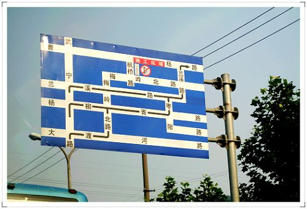
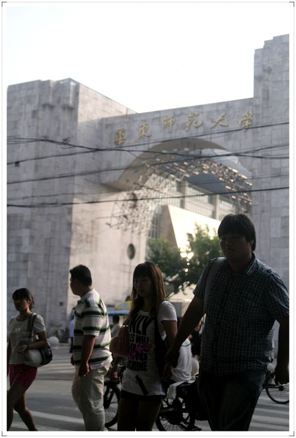
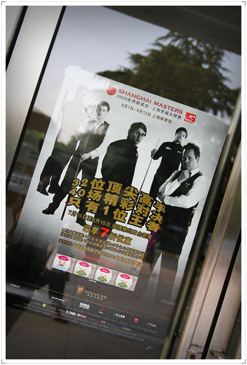

# 进入上海

看到这块迷宫一般路标，就知道上海到了。  
  
  
。。。节假日除外，也就是说外地车在周六、周日是可以上高架的，对吧？  
可是驾驶员同志还是穿行于三步一岗五步一哨的马路，得以拍到这张照片，应该是某人学习中文的学校吧？！  
  
  
介个斯诺克大师赛将于9.7.到9.13期间进行，喜欢的铜子们可以看清楚上面的订票电话吗？  

---

## 评论（3）

**喜刷刷** · 2009-08-17

怕去上海。

**dfgsd** · 2009-08-17

已阅！

**冈本** · 2009-11-25

我的母校。华东师范大学~~~~

