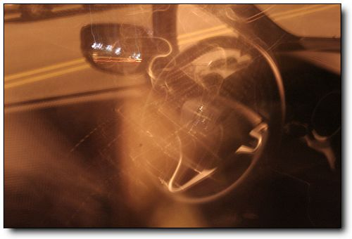
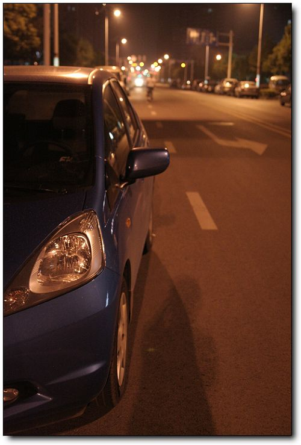

# 牛掰的手动档

   
  
  
朋友将新买的车丢给我开磨合期，啊哦！我的脑海里立刻闪过《速度与激情》里唰唰唰几秒内换5个档的镜头。。。  
  
从驾校出来一天手动挡都没开过的我，起初很兴奋，渐渐就被巨大的挫折感压垮，压垮！路上熄火无数，因为排量小的缘故，半联动点反应很微弱。不幸地是遭遇许多坡道起步，totally忘记该如何操作。努力想啊想啊，想起老师教的找到半联动再放手刹。。。自己也觉搞笑的是，常常先看仪表盘再看档位，接下来再决定换哪个档。死脑筋？！按照驾校的规定一档一档进，一档一档降，非把自己逼死不成。更别说驾校不允许的空挡滑行喽。当然。。。死过的脑筋很快复活。。。就象你学会骑自行车，50年里你再没骑过它，但50年后你只需要熟悉10分钟就可以让自行车飕飕地跑到街上去。开手动档车也是一样。  
  
想想。。。女叔马赫原来都是虚的，能把手动档开成自动档那么拽才是本事，什么时候能在小街小巷里不熄火？为开这辆车我得常常穿上平底鞋，两个月，还有时间征服它。在市区1.5排量的车作为代步工具完全可以胜任，每百公里油耗才6点几，体型小，容易钻容易停车，空调有力道，就是里面的材料可能不环保，窗户关上一会儿我的喉咙就有压抑感，环境允许基本开着窗户。还有一点，轻易不要把车给你自己之外的人开，自己的车永远只有自己最爱惜，并且车对主人的驾驶习惯是有记忆的，呵呵~

---

## 评论（20）

**jeneffer77** · 2009-08-19

呵呵，开手动档的车是很不一样。特别是开柴油手动档，那才叫一个肉。很能理解你的感受。半坡起步的时候最难，特别在车后面还有人紧跟着你，特紧张，一不小心手刹放下，离合制动没有掌握好车子就向后滑。不过我有个小窍门，开始起步的时候，离合稍抬，感觉车子向前冲的时候就踩油门，离合不要立刻松开，车子向前走了后再松离合就好了。  
enjoy 你的手动档吧。人家都说开手动档的车才能体会开车的快乐。

**aimda** · 2009-08-19

新车空气污染严重，注意自我保护呀。

**jiajialing** · 2009-08-19

坡道起步，我的强项。。。。

**[Jansfer](http://jansfer.com)** · 2009-08-19

这是哪一款？好像是大众的？

**mandy** · 2009-08-19

前天亲戚结婚征用我的车，给我一辆手动档开开，我曾经开过三年的手动，自己很有信心，但是上车后我突然记忆消失，坐在车里不知如何发动，嘴里不停说着：踩离合器.松手刹.给油门，十分钟都没敢动，当时真想厚脸皮请路边什么司机帮个忙倒出来：（，我连推车的心的有了~~那个窘啊~~

**Anyayaya** · 2009-08-19

给你开磨合期是拿你当活性炭啊 ：P

**Christina** · 2009-08-19

的确，一上去就会想到先踩哪个再踩哪个，然后该怎么样。不过我比你胆子大，总之能开起来。

最窘的是坡道或者十字路口熄火，车子倒溜。。。心理素质不好就开始慌，完全没有思维了，全乱了，什么离合、油门统统乱了。

倒，活性碳？！太形象了！不过人家出差2个月，车子要做首保，所以就帮忙磨合、磨合一下喽~

**开心王** · 2009-08-19

新飞度啊

**[薇安](http://bulaoge.com/?vivianxu)** · 2009-08-19

我家车就是手动档的，习惯了。。。。。也开的顺溜了

**喜刷刷** · 2009-08-19

你对朋友真是没的说。

**lusfe** · 2009-08-19

可怜的小飞度，哈哈哈

**朝九晚五** · 2009-08-19

买几包活性炭放在车里,否则太伤了……

**[Jansfer](http://jansfer.com)** · 2009-08-19

认真看了一下，方向盘上确实有个H。误会了。

**[Jansfer](http://jansfer.com)** · 2009-08-19

放些茶叶就不错。

**陈问** · 2009-08-19

我一直以为你开手动挡来着，细细。反正这个练手，很快你就能开得一样好了

**[shao ye](http://jennyshaoye.blogbus.com/)** · 2009-08-19

把手动档开成自动档——I CAN!

**Christina** · 2009-08-19

今天中午开得就不错，一次熄火也没有，操控很协调！

**兔子田** · 2009-08-20

我家车是手动挡的，所以我开自动挡的别扭~  
看来，一切都是习惯。

**yezi** · 2009-08-20

超爱手动挡 :)

**ucd** · 2009-08-20

坡起，给新手的主意就是轰油门，放心，发动机不会坏的。。然后离合慢慢起来就是了。手闸根本不用。

