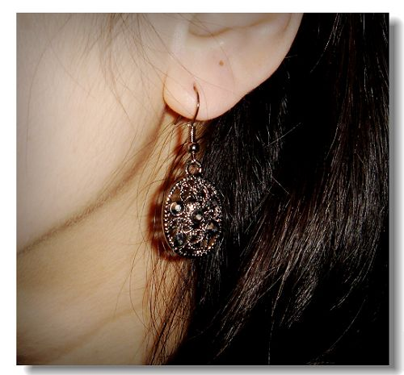
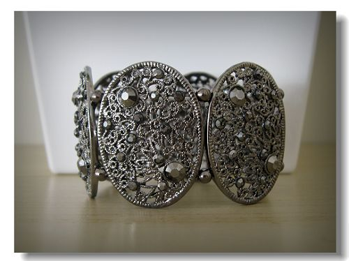

# 耳@环@

Helen传来戴着耳环的照片，前些时候说想穿耳洞，真的穿了，还买了配套的手镯。想起自己02年穿耳洞后戴着耳环的新鲜与快乐感与她现在一样一样。这个居住在“世界上最孤独的城市”的家伙有着与年龄不相符的坦诚与单纯，她说：“来吧，到我这里休假吧，我肯定做好向导....”据说PERTH的街道很归整，不容易走错路，而整个城市沿天鹅河东西走向的4条大路和与之交叉的南北走向的大路而构成，道路中间夹杂着大片绿地。看到一则小故事：20世纪为了给美国宇航员导航，PERTH人全城彻夜亮灯，为空中的宇宙飞船作航标，因此PERTH也曾被称作“灯光之城”。  
  
每天上班浑浑噩噩，沉。。。甸甸的，下班急急忙忙赶回去买菜做饭，日复一日，有时候觉得再也受不了了，真想抛下现在的生活背着包跑出去流浪。[**Maggie**](http://bigsurprise.blogbus.com/index_1.html)一个人29号去柬埔寨，她说烦不了了，就是要出去转转，反正还有假期，回来还可以再走。柬埔寨之行总有些悲壮感，那个地方安全吗？去年到今年我都没有真正休过假，除了计划性差之外，也没心情。Stephen Arroyo认为：人是肉体、情绪体、心智体与灵性这四个层次的综合体，任何一个层次若被忽视或得不到滋养，就会产生反动；若想活出平衡的生活，就必须留意自己的主要需求是什么。晚上睡觉的时候我在想和她一起旅行，去哪里都可以，因为她不仅有趣又简单而且英文很棒！  
   
  
  
已故设计大师Yves Saint Laurent曾说：“什么是漂亮女人？那就是着黑色筒裙、黑色高领衫，臂弯里挽着心爱男人的女人。”  

---

## 评论（5）

**lilian** · 2009-08-20

哇，这对耳环MS跟我的一对很象，不过材质更好些。我也想要有一个简单有趣又英语特棒的旅游搭子～

**[shao ye](http://jennyshaoye.blogbus.com/)** · 2009-08-20

wow, will you go to Australia? all the best with your application

**[山树](http://shanshu.blogbus.com/)** · 2009-08-20

这耳环好看。

**喜刷刷** · 2009-08-20

人简单，思索的过程较短，做决定才快，呵呵～

**Christina** · 2009-08-21

不到澳大利亚，是欧洲。

