# 热情的读者

周末刚刚开始，夜晚变得很high，为什么呢？  
  
首先三个女人一起吃饭，怎么邀请[**问问**](http://mosquito511.blogbus.com/)她都不来，然后我们威胁着要去她家小区贴标语，在她家门口蹲点，可能实在受不了我们几个疯子，她说你们来我家吧~然后三个人象高中生一样兴奋异常，端起咖啡就撤，搞得跟一帮追星族似的。真感觉象憋了很久，所有的热情都在这个夜晚释放出来。忽然想到上个周末关在笼子的猪。。。  
  
问问的家真的好温馨，色调、家具以及摆设的搭配是那么舒服。。。舒服。。。（最近喜欢这样表达）和她这个人很协调，象一块童话田，一个世外桃源，女伴们超喜欢她家的装修风格，还有那个四方的阳台。打搅他们到11点才走，一定被我们这群疯子吓坏了，请谅解忠实读者的热情，要是可以真想在那个美好的地方再停留一会儿。  
  
转战问问家的路上，热情的人总显得有些傻，其实俺们大多数时间都是矜持的模范，周末谁还在乎你傻不傻呢？卸下伪装吧！  
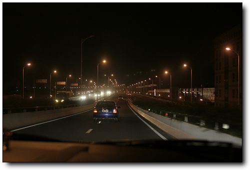  
  
因为客人来，狗狗们得到了好吃的零食。  
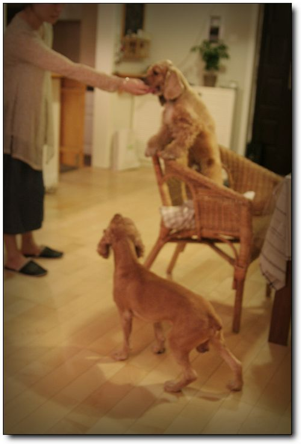  
  
脾气古怪的外外，超严肃。想望美食的表情才这么可爱的~  
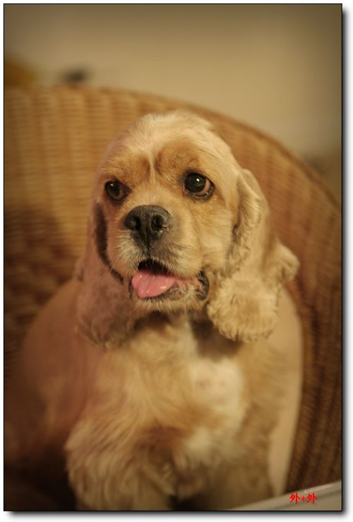  
  
目不转睛地盯着餐桌上的零食。  
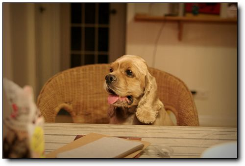  
  
仍然很热烈地望着桌上的那袋饼干。  
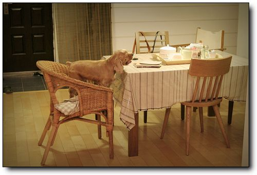  
  
哈，饼干就在不远处，但只能望着望着不停地望着啊。  
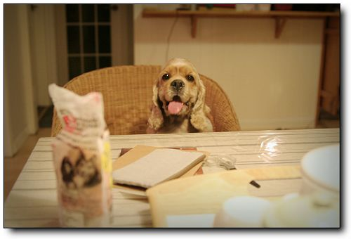  
  
一对有才男女与一对性格完全相反的可卡生活在童话田园里。  
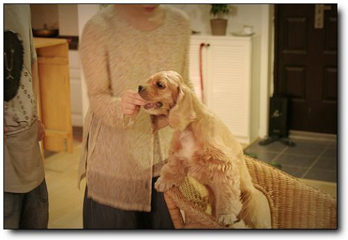  
  
我最喜欢的是ZAKKEY，因为它的眼神很打动我。虽然它被剔成了光猪，还是很帅哦，忍不住要温柔地抚摩抚摩再抚摩（再次这样表达），不幸地是从我怀里挣脱跌落在地上的声音很。。。。它渴望从主人那里再得到一块美味的饼干。  
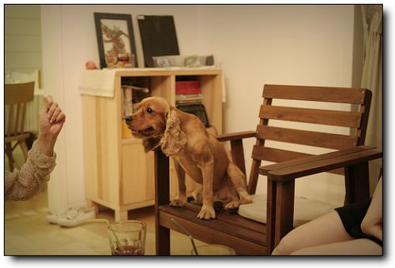  
  
可爱吧，和人亲近的狗狗最可爱。  
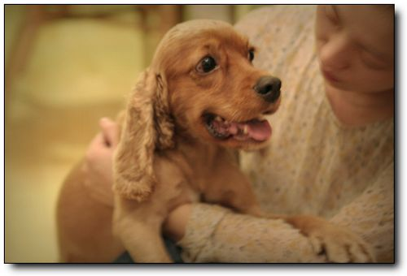  
  
狗狗和主人的感情都凝聚在眼神里了。  
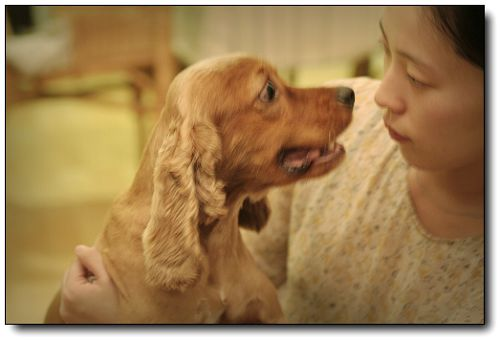  
  
\*\*\*\*\*\*\*\*\*\*\*\*\*\*\*\*\*\*\*\*\*很HIGH的夜晚\*\*\*\*\*\*\*\*\*\*\*\*\*\*\*\*\*\*\*  
走路去1912的COSTA喝咖啡。  
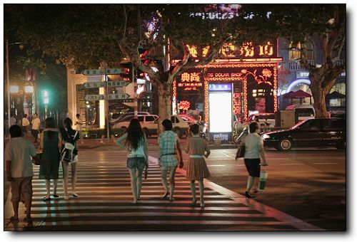   
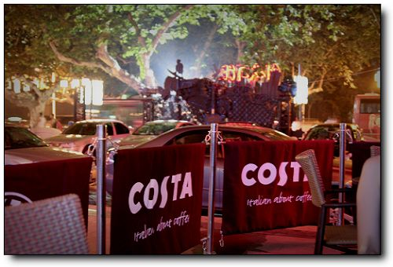  
  
在我的威逼下MAGGIE接过电话继续骚扰问问，出来吧，来吧，不来去你家小区贴标语，蹲小马扎。。。这威胁也太有创意了吧？谁让[**MAGGIE**](http://bigsurprise.blogbus.com/index_1.html)是个又认真又有意思的女人呢！  
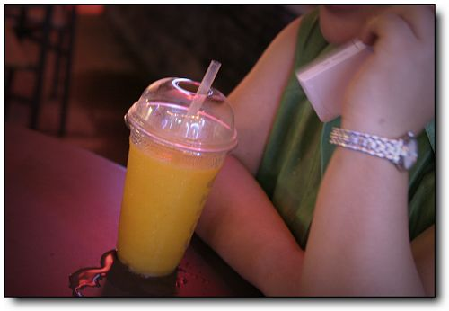  
  
她，晚上大多数时候都不在状态哦~但得知可以去见问问，眼睛里才闪出光彩来。  

---

## 评论（14）

**喜刷刷** · 2009-08-22

过瘾～

**Sherry** · 2009-08-22

对我们的突然造访，问问落落大方，照顾周到。她的家收拾地十分精致舒服，每一样物品都透着她的用心，没有任何多余碍眼的东西，赞~

**陈问** · 2009-08-22

喝了咖啡的女人，就是不一样啊不一样……  
还有，贵的镜头，到底是不一样啊不一样……

**[山树](http://shanshu.blogbus.com/)** · 2009-08-22

看来你很喜欢COSTA的咖啡，这个店的出镜率很高

**搖滾明星** · 2009-08-22

那家“典尚”的照片好像衡山路上的一家bar啊

**Christina** · 2009-08-22

很喜欢COSTA的咖啡？南京如果可以找到更好的咖啡，我也会去尝试一下的。  
有关镜头，问问就不要嘌我来~

**shuwua** · 2009-08-23

看了这些照片，基本可以画问问家的户型图了，你们照得真全面。

**喜刷刷** · 2009-08-23

那天的裙子很好看，所有的细节都很到位，怎么不上片片～

**Christina** · 2009-08-23

她家大着呢,几张照片反映不了户型图啊～实在的人总是拍不好朦胧照，呵呵。

**陈问** · 2009-08-23

家里图这个色调茶有没有调过？偏黄呀……

**Christina** · 2009-08-24

不调颜色更黄，晚上在灯光下拍出来的效果大多数都偏黄的，你试试呢？

**lilian** · 2009-08-24

北欧风格？喜欢~~

**Ivy** · 2009-08-25

很羡慕你有一群亲密的女伴。我的朋友们都被生活的现实弄得有点忙于应付。很少有机会做一些轻松的事，哪怕就是聊天，也都是对生活的无奈。搞的我也性质缺缺。大家真的要学学欣赏生活， 享受生活。

祝你旅游快乐。

**lilian** · 2009-08-25

深有同感~~

