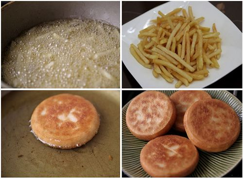

# 星期一忙乱

上午忙完交货的事情，下午忙签证材料。申请表是给小人国用的，需要填写的留白非常小非常小，手写下来面积总是不够，为保持页面美观改用打字机，小的缩小间距，稍微大点儿的放宽间距。接着复印材料，向总经理请假，下班前预定了明晚及后天的火车票，这才算完成80%。剩下机票、酒店的预订单还要去别人那儿拿。烦是烦了点，不过准备的过程蛮有意思的，星期三送签。对，提前啦，所以今天有点抓狂。忙完这一切，打了个电话给女友，听到电话那边欢快的声音，哪里象是去参加葬礼的啊？！  
  
上周末就做了一顿饭，炸薯条和煎素菜饼，外加一个娃娃菜粉丝汤。素菜饼还剩三个，说明口味一般化。买回来是冻的，可以微波炉加热，也可以用油煎了吃，很方便。  

---

## 评论（5）

**喜刷刷** · 2009-08-25

那个表格填好再打印出来肯定感觉更好，签证官一定满意的。真佩服你半天时间可以准备好这一切，大概也只有狮子座才能做到。总觉得，就算累，也值得。一切顺利！

**Christina** · 2009-08-25

姐姐，是打字机。

**[shao ye](http://jennyshaoye.blogbus.com/)** · 2009-08-25

参加葬礼? to a foreign country?

**Christina** · 2009-08-25

是到其他城市参加葬礼~  
要是去国外参加葬礼，还真是感情深地不行的关系哦。

**Michael** · 2009-08-26

DIY自游行吗?

