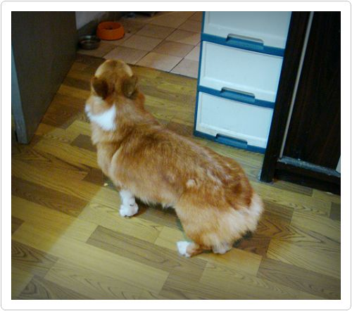
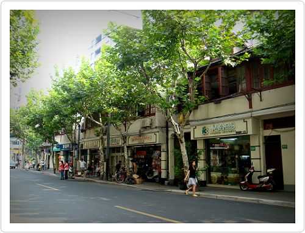
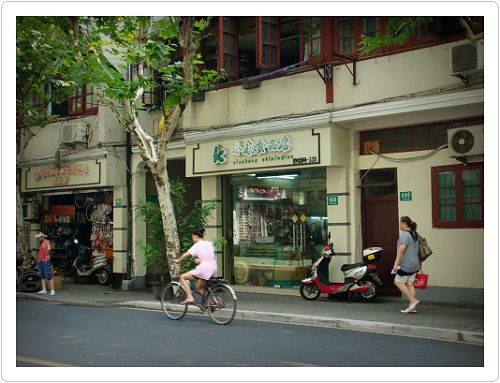
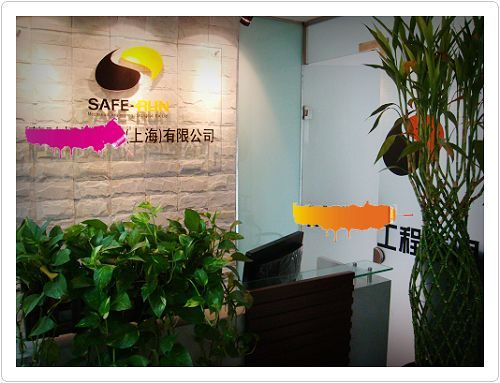
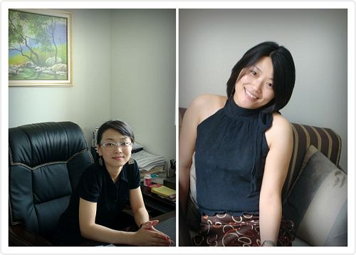
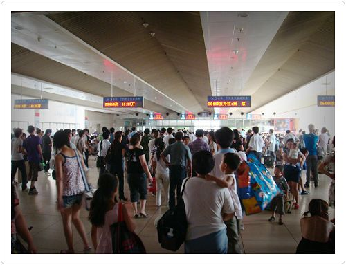
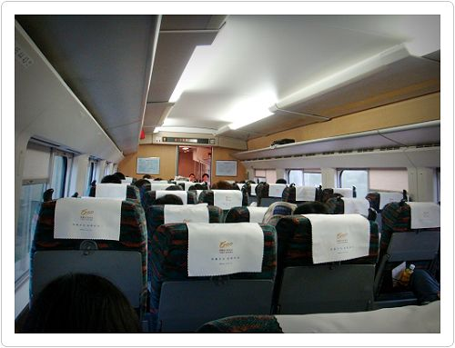
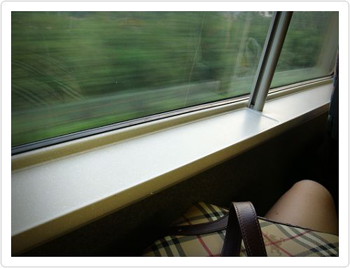
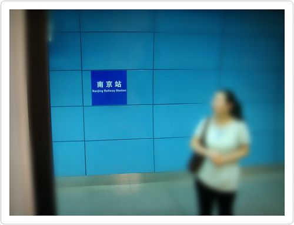

# 这一天

到上海的晚上Angie还在业务应酬，不得已打车过去，作为她的好朋友，作为她家族的公司，俺们俩有义务卖力的唱歌卖力的喝酒卖力到午夜过后，洗完澡睡下呢喃几句。。。醒来便已是早晨。  
  
听见Toby一会儿走到水盆处喝点水，一会儿走到食盆处吃几粒狗粮，一会儿在阳台上啃会儿骨头，总之听见它来来回回的走，就干这三件事。它的小爪子敲击在地板上哒哒哒哒的声音从未停止过，为什么不一次性把每件事都干完呢？你这只威尔士柯基犬小坏蛋！Luke等我起床的方式是假寐，一旦我的脚落进拖鞋，它便迅速起身。Toby见着我在我脸上亲热地一阵狂舔，只要别半夜厚脸皮跳上我们的床就好。  
  
  
这是08年年初大雪纷飞的夜晚[**给Toby拍的微笑照**](http://photo.lifetea.org/v/travel/shanghai/2008-JAN-26-27/Jan-26-27-2008+130.jpg.html)。那次他最闹腾，大半个晚上从我这头跑去Angie那头，反反复复进行夜间马拉松运动。反反复复跳上床要和我们睡一起，那时它还有啃拖鞋的习惯，我们睡觉前会将拖鞋搁床头柜上以防不测。它被主人拎到笼子上受惩罚时还面带笑容，不能跟它急了，这个小二皮脸。  
  
这样的街景在早晨的时候最迷人，街边的小商店杂货铺，阳光在树叶里投下细碎的影子，很有生活着的感觉。但是我只喜欢春秋季节里这样的早晨，夏天还是。。。算了吧，等了好久才等到一辆空的出租车，匆匆赶到领馆迟到20多分钟。  
  
  
  
从领馆回到Angie公司还没到中午，虽然送签时遇到个青皮妹妹拉着三尺多长的脸，极度缺乏爱抚内分泌失调状。这种会双语的领馆中方工作人员收收材料收收费，在资源如此浪费的前提下，能指望她对计划哈皮的人表达出怎样的好脸色呢？我这厢理解哒~  
  
  
坐在她舅舅的大班椅上我只是凭一小段一小段的故事感受这位先生辉煌与没落的过往，事实上这次才有了贯穿起来的认知。这位先生86年个人已创下百万资产，九十年代初在香港、马来西亚等地开设多间分公司，98年企业在加拿大上市。。。他当年提携的几人如今都是几千万身价。而我目前所在的集团在当年他的企业面前就是个小弟弟级别。更传奇的是98年之后的10年劫难。。。如今再次从头开始。。。离开后我还是禁不住落泪。。。难怪那位在英国著名律师事务所的大律师也想多一些与先生交流的机会，我也希望能比今天多一些沟通的时间，回头看看周围多的是自鸣得意的井底之蛙，真需要多些机会认识世界之大之黑暗。反正这位当年的风云人物未来15年一定会出传记，等着看吧。据说这位先生以前的办公室象总统套间一样富丽堂皇豪华极致。  
  
  
上海最让我受不了的是人象蝗虫一样成群成群的，候车室根本没有地方坐，能找个人少的角落也不容易。  
   
  
短途动车真比长途动车体面许多，没有逃荒的感觉，安静，空气里难得有方便面味儿，卫生间配有卷纸也干净很多。瞧瞧行李架就知道这真的是短途动车哦。某天新闻里写南京到上海的火车将再次提速，约一小时左右便可到达彼地。  
  
  
回南京的路上我一直在睡觉，过了镇江才醒，镜子里的睫毛液已经糊到下眼睑上，收拾收拾蓬头垢面的妆容，期待快点回到那个舒适的家。  
  
  
选择火车出行的另一个体验是乘地铁，仿佛从封闭环境融入朝气腾腾的大生活。记得南京地铁刚通行那会儿，为了体验这座城市的新事物[**特地买了票从A站乘到B站，还留了影，**](http://lifetea.org/article/416/)至今仍然保留着那枚宝蓝色圆形塑料的地铁票，呵呵，对的，我偷带出来一枚。  

---

## 评论（17）

**Michael** · 2009-08-26

你那个地铁票,当年熊猫中标的时候还来我们厂问过我们怎么做的呢.

**Asura** · 2009-08-26

哈喽~ 要去玩了吗？祝你玩得愉快：）

**Christina** · 2009-08-26

第一楼不是做印刷的吗？

**陈问** · 2009-08-26

上海真是让人又爱又恨的地方 全部搞定？

**Christina** · 2009-08-26

两周后才知道签证是否能签出。嘿嘿~  
的确上海是个让人又爱又恨的地方！

**喜刷刷** · 2009-08-26

呵呵，原来还干了很多别的事～

**[三月四月](http://11)** · 2009-08-27

威尔士柯基犬!我很喜欢这个品种！好可爱的

**Michael** · 2009-08-27

印刷也包括智能卡系列啊. 你那个小纽扣里实际是一个接触IC卡.老实说,不是很先进,只是做了一个异形,看起来不错.好一点的叫非接触IC,就是有多少米的距离, 卡一但进入这个距离就触发(开门什么的). 当然这也是根据需要来使用的. 在熊猫进标的那个年代,接触式IC就已经是很好的技术了.

祝LZ顺利下签!

**Christina** · 2009-08-27

当时这个标给你中了的话，发财啦~

**lilian** · 2009-08-27

真是神速呀，昨天还在计划出行，今天已经送签了。准备国庆节出发吗？

**[山树](http://shanshu.blogbus.com/)** · 2009-08-27

签证都办好啦？  
祝你旅途顺利。

**Anyayaya** · 2009-08-27

那个标说不定我还中了呢…hehehe说来话长。。。

**mandy** · 2009-08-27

青皮妹妹拉着三尺多长的脸，极度缺乏爱抚内分泌失调状。这种会双语的领馆中方工作人员收收材料收收费，在资源如此浪费的前提下，能指望她对计划哈皮的人表达出怎样的好脸色呢？~~哈哈~~伶牙俐齿~~~我喜欢这段话

**[shao ye](http://jennyshaoye.blogbus.com/)** · 2009-08-27

Nanjing tube is very clean. I hope that I can test it next year:)

**Michelle** · 2009-08-27

中国的企业“传奇”都躲不开一个权字，越大的涉水越深。希望有机会看到“传奇”的出版，如果那时候气氛够和谐的话…

**Christina** · 2009-08-27

Michelle真的冰雪聪明，不过他80年代起家还真没靠权字支持，做大了总有人闻风而来啊~

**Michelle** · 2009-08-28

如果能有真正的私企业者的素质，发展阶段迫于环境束缚借了权也能成为社会进步的中流砥柱，比如辅助促进NGO。为权力照顾不到或者“照顾太多”的弱势群体营建一个个避风港。

