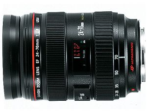
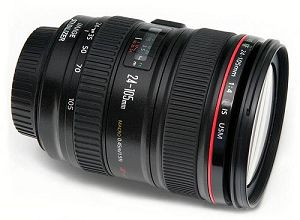

# 选择.难

人最好只有一种选择，选择多了无从下手。  
  
比如现在我是给原先的350D配个EF 24-70mm f/2.8L USM的canon镜头呢，还是直接上5D II+EF 24-70mm f/2.8L USM？或者先上5D II借个EF 24-70mm f/2.8L USM的头旅行的时候用？如果是第一种方案，会不会有小马拉大车的感觉？直接上5D II是不是有必要？据说这只镜头是佳能变焦镜头的中坚，自2002年发布以来，在135镜头领域没有任何一枚其它镜头能与之匹敌，所具备的性能满足了最严苛摄影者的一切要求。  
  
  
  
另一款镜头的选择是EF 24-105mm f/4L IS USM。24到105mm涵盖了从广角到中焦最长用的焦段，摄影者在很多情况下仅携带这一枚镜头就能完成全部的拍摄工作。它最受欢迎的重要因素在于IS影像稳定器。但我很想知道这个头是否能象24-70mm那样更好的表达人像效果？  
  
  
  
看了几天的网上评测，不想陷入器材党的行列，我只希望在原有画质的基础上能有明显的提高。研究一圈下来，感到又困又乏，仍然不能确定。如果拿不到签证，我就啥也不想直接上5D II和EF 24-70mm f/2.8L USM，爱惜自己的情绪，爱惜自己的情绪啊！

---

## 评论（16）

**喜刷刷** · 2009-08-27

都说器材的升级没有止境，够用就行，不过，我还是觉得5D II好。真是见不得好东西啊～

**喜刷刷** · 2009-08-27

又问了数码达人eico，她不推荐无敌兔，说现在性价比不高，她建议旧机配新头，那个镜头她说很好。我觉得她的建议会理性一些。

**令狐不放冲** · 2009-08-27

自己用的当然买最好的

**Weiqiang** · 2009-08-28

上头，再上闪光灯和三脚架

**[Jansfer](http://jansfer.com)** · 2009-08-28

羡慕，我现在就想要一部入门的单反先玩玩。

**rain** · 2009-08-28

5DII的高ISO表现很好。所以24-105的很适合。当然70的也很好。从性价比上还是105.

**[眼镜](http://ksiyou.blogbus.com)** · 2009-08-28

成像靠镜头，功能在机身。有一个好镜头即使在你的350D上，也可以呈现完美的画质。特别是在光线不足的情况下，又不想让闪光灯破坏现场光影的氛围，2.8的光圈要比防抖功能效果好的多，建议还是24-70.今后有条件再换机身。

**Christina** · 2009-08-28

我有一只腾龙的2.8定光圈的中焦段镜头，表现不差，CANON 24-70购入的话，机身不换，和腾龙头是不是重复了？

**大姜炖去** · 2009-08-28

如果拿不到签证，我就啥也不想直接上5D II和EF 24-70mm f/2.8L USM，爱惜自己的情绪，爱惜自己的情绪啊

呵呵，最关键的带上自己的好心情

**Michael** · 2009-08-28

机身是跟不上的,每年说不定都有更新. 选最新的机身也没必要. 镜头好用就行,而且镜头相对比较保值. 出门旅游如果怕重可以用“一镜走天下”,但这类头的质量都很一般.

**[薇安](http://bulaoge.com/?vivianxu)** · 2009-08-28

是好难选择，24-70是F2.8，24-105是F4的。要么舍焦段，要么舍光圈。用在350d上的话105也可以算小长焦了，用在5d上的话，70端只能相当于50焦段，就是标准焦段。Christina应该根据自己现有的镜头选择，如果你已经有2.8光圈的镜头，却缺少长焦的话，就直接上25-105吧。况且旅行拍风景的话，F4应该够用，主要都是白天拍摄嘛。只是24-105缺少了广角端，不知Christina 是否有带广角镜头？

**Christina** · 2009-08-28

我有只12-24的广角头。还是倾向佳能24-70，价格不降反升，有收藏价值的经典镜头。

**[山树](http://shanshu.blogbus.com/)** · 2009-08-29

我有一支24-70的，24-105的最大光圈F4.0，所以我更喜欢24-70的。我正在纠结，我去山西时带哪个镜头。现在有一支17-40的。

**[小胖丁](http://www.limeis.com/)** · 2009-08-29

如果买5D2就选24-105  
如果是350D就选24-70  
70端在350D上用相当于105端在5D2上用了  
5D2高ISO表现很好,所以晚上不怕最大光圈只有F4  
如果是350D的话,最大光圈2.8用起来可以舒服很多

**manshow** · 2009-08-29

尼康和索尼蔡司24—70.均比佳能那支要好；  
直接上24—70吧，那个光圈在弱光下很实用的；  
或者干脆上两个定焦吧

**youmingjin** · 2009-08-31

佳能就是这样折腾人的，要是有一个24-105 2.8L的头，估计大家就不再纠结了。。。。哎

