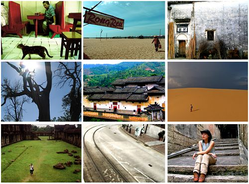
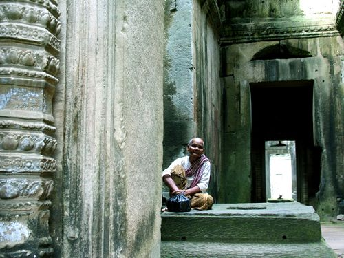
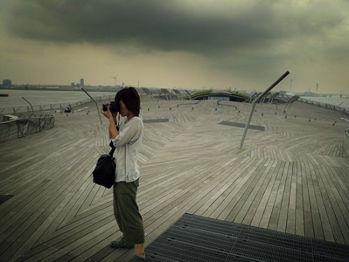
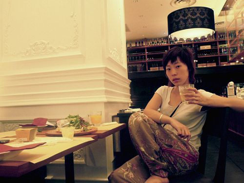

# 有关摄影的思考

每每旅行前对摄影最用心，比如[**06年去塞班**](http://photo.lifetea.org/v/travel/saipan/)立刻从傻瓜机换成单反，说明书在飞机上看的，而说明书永久被遗漏在飞机上。当时在塞班的酒店里就开始PS，原件被完全P掉了。每一时期的审美、PS想法、使用机器的技术以及思想、心态一定是会不断变化的，过了一年渐渐知道应该留下所有的原件照片以备后用。  
  
我当然不想只成为一个熟练的相机操作工，而是希望通过摄影表达内心与观点，以及记录生活细节，拍摄令我感到愉悦。不过拍的大多是到此一游照，如果2002年的照片按现在审美编辑？如果2009年的照片按2020年的审美编辑？我，象大多数人一样对过去的稚嫩持有不屑与逃避，甚至想用一只油漆刷将过去全部刷成白色或黑色，只要过去不再出现。当然这种想法也是幼稚的，那么我还需要将6、7年间所有的照片按照2009年的我的想法重新编辑归档吗？  
  
这两天陆续翻看[**“问 问”**](http://mosquito511.blogbus.com/)的相册，不知道该说什么好，她的摄影就象她的文字，绝不多余，也不热情似火，总是淡淡地点到为止，而看的人情绪却不断累积不断延伸。偶尔我也能创作出类似的作品，当然这是我所欣赏的，但就象我这个人一样时常欢快时常沉重，摄影也经常处于不稳定状态。最重要的是在研究如何使用好手中相机的同时，我们是否需要为自己规划统一的摄影风格，哪怕仅仅持续一段时间？  
  
以下是从问问的相册转载的...我喜欢的照片。  
它们打动我，开启了我内心本身存在的某些东西，然而这之前自己却不曾发觉过：  
  
  
在所有摄影里我最爱看人像摄影，大概与我喜欢研究人的心理有关，看摄影里的人与看大街上的人，形形色色的表情，那些表情下面掩盖着内心，可以想象出许多丰富的故事。最最受不了所谓风景大片，除了风景感受不到任何东西，就象一个华丽的LV，空洞与空虚。  
  
  
被问问这张照片吸引的原因是她脚下的木栈板，及其身后翻卷着的云彩，灰色的画面色调。那个栈板据说是世界上著名建筑之一，在横滨，栈板下面是个码头。我个人感觉她一两年内的照片整体色彩比较浓郁压抑，今年BLOG上的照片却清淡许多，这是一个明显的变化。  
  
  
看到问问这张第一感觉是惊艳......巴西日裔、Lisa Ono，Bossa Nova，微醺的red wine，咖啡馆里的香醇气息，窃窃私语地巴黎小酒馆，下午茶等等。她的表情、花色裤子与盘腿的坐姿，叛逆的柔柔地透着矜持与精致。这些丰富的场景，表情里的各种人物通过这张照片塞满了我的想象。超爱这张~  

---

## 评论（16）

**喜刷刷** · 2009-08-28

呵呵，以文会友＋看图识人，有乐趣～

**Sherry** · 2009-08-28

关注“问问”相册。。

**partridge berry** · 2009-08-28

So such literary,love them.

**Michelle** · 2009-08-28

有人文有层次的照片在说话

**搖滾明星** · 2009-08-28

最后一張確實很好。

**[shao ye](http://jennyshaoye.blogbus.com/)** · 2009-08-28

I should work hard to catch up:)

**陈问** · 2009-08-28

我无人知晓的破相册被你挖掘了啊

**Cindy** · 2009-08-29

亲爱的茶，谢谢你把问问的BLOG介绍给大家，我刚刚去她那儿偷窥了一下，只几眼，就爱上了。。。好的文字和图片，可以点亮人的心灯：）

**AM** · 2009-08-29

最后一张的氛围被摄出来了，具有一定的层次感※她的面孔和气质有日本女孩儿的味道，我也爱这张☆

**[空错](http://www.kongcuo.com)** · 2009-08-29

非常同意你思考中对“通过摄影表达内心与观点，以及记录生活细节”的理解。  
但是“最最受不了所谓风景大片，除了风景感受不到任何东西，就象一个华丽的LV，空洞与空虚”说明你还不太理解自然，不懂自然无法欣赏自然之美。

**[很喜欢片子传递的感觉](http://www.bpker.com)** · 2009-08-29

片子能表达内心，才有震撼力. ~行走的鱼

**Butterfly effect** · 2009-08-30

有十分却能用七分表达的智慧，谢谢茶介绍她让我们认识。

**Patric** · 2009-08-30

Perfect feeling äÇ

**晓凡** · 2009-08-30

文字和摄影都很喜欢的，完全被她融化，问问是神仙姐姐下凡吗？

**Ann** · 2009-08-31

喜欢片子风格。。。可否问此女博客地址。。。谢谢

**Christina** · 2009-08-31

点击文中“有颜色的字体”，即可打开连接。

这是她的博客地址：  
http://mosquito511.blogbus.com/

