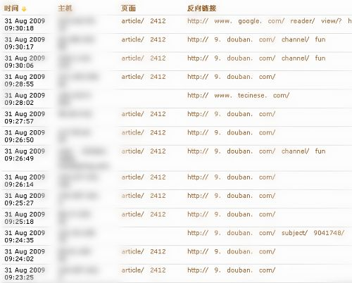

# 豆瓣.九点.趣味

  
  
整个周末到现在，中国茶反向连接被豆瓣的网址铺满整个界面，日日夜夜，占到访问量的95%，好奇地点过去查看，是[**douban 九点 趣味**](http://9.douban.com/channel/fun)，推荐茶上一篇[**《有关摄影的思考》**](http://9.douban.com/site/entry/110846153/)的blog。对豆瓣拥有庞大的用户量早有耳闻，在精力有限之下仅能用心照顾好一个中国茶，所以暂时没在豆瓣注册。感谢豆瓣编辑厚爱及[**订阅中国茶的豆瓣用户**](http://9.douban.com/site/entry/110846153/voters)，有些用户俨然是熟悉的老茶客了，anyway,have fun~  
  

---

## 评论（3）

**quinn** · 2009-08-31

呵，中国茶现在好有人气啊，赞一个

**[少爷](http://jennyshaoye.blogbus.com/)** · 2009-09-01

反向链接啥意思?

**Christina** · 2009-09-01

A网页中有一个链接指向B网页，那么A网页就是B网页的反向链接！

特别强调：   
反向链接是网页和网页之间的关系，不是网站与网站之间的关系。网站内部各个网页之间的链接叫内部链接，其他网站给你网站的网页做的反向链接，叫外部链接。不管外部链接还是内部链接，都是反向链接，对搜索排名都是有影响的。

