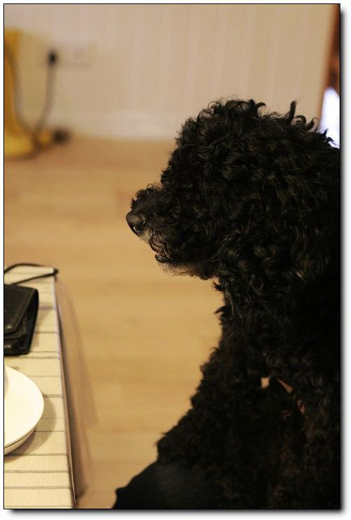
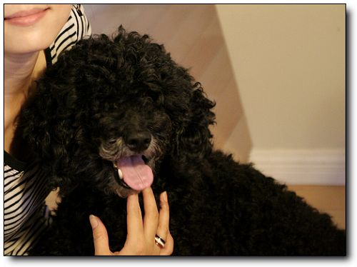
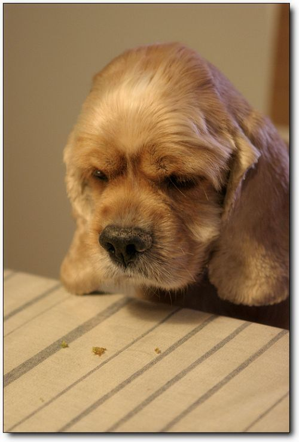
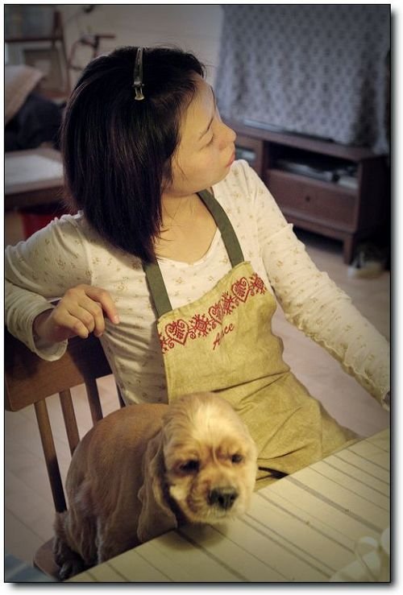
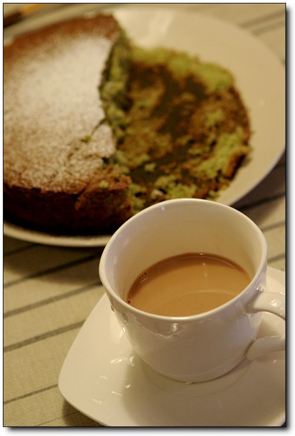
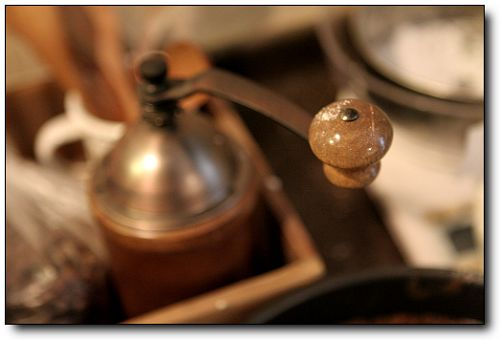
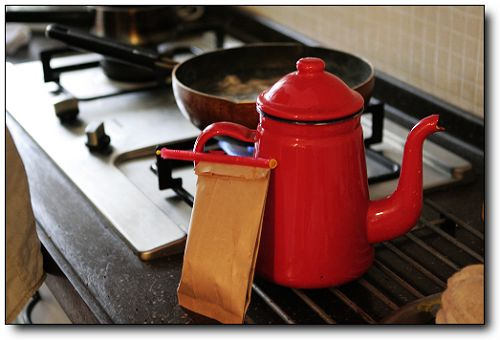
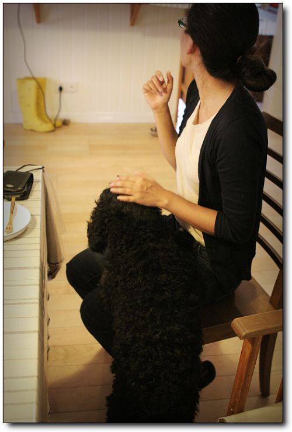
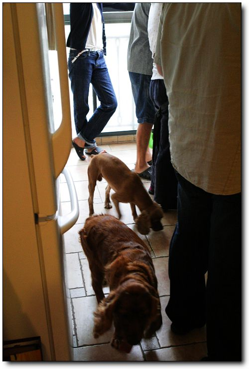

# 开心...不开心？

中午炒了两个好菜，很开心；  
上周买了一双美鞋，很开心；  
周末拥有一只镜头，很开心；  
带Luke去社交，不开心。  
  
它在人家家里画了两次地图、投了一次炸弹，大有占地为王之势！还和12岁的老爷爷打架。社交的它，完全变成另外一只狗，让我崩溃，面红耳赤、无地自容。想起它满脑子都是疯狂的炸弹气味儿~  
  
试\*\*镜  
这只黑糊糊一片的12岁老爷爷，如果不笑的话，判断不出五官具体的位置，呵呵~  
  
  
笑得好开心，完全找不到眼睛啦；  
  
  
桌上的一点蛋糕渣让外外驻足凝神好久，即使春情荡漾的的可卡小姐站边上也没有美食这样令它倾心；  
  
  
外外伸长脖子努力想与问问烤制的抹茶蛋糕靠近一点，再靠近一点，吃是外外毕生的追求与信仰，老爷爷和小伙子在桌子下面打架也影响不了它；  
  
  
问问做的[**“抹茶乡村蛋糕”**](http://zhidao.baidu.com/question/17587706.html?si=1)与口味类似[**“丝袜奶茶”**](http://baike.baidu.com/view/278282.htm)的[**阿萨姆奶茶**](http://zhidao.baidu.com/question/53551525.html?si=1)，贤惠啊~  
  
  
这家稀奇陌生的东西真多。  
   
   
  
12岁的米罗象一条温暖的皮草围巾；  
   
  
人很忙，狗狗也很忙。  

---

## 评论（16）

**候鸟** · 2009-08-31

估计拍风景能够看得出效果。不过，这双蛇皮纹的鞋子，真好看！

**[薇安](http://bulaoge.com/?vivianxu)** · 2009-08-31

试试日光下的人物？

**开心王** · 2009-08-31

好严重的暗角。应该不是镜头本身问题。350D本来就是DX格式的，用FX的镜头不会有这么多的暗角。P上去的话就没意思了。

**Christina** · 2009-08-31

哎呀，的确是P上去的，为了压暗光线，呵呵~  
那我该怎么P呢？南京连续四天都是下雨天+阴天。学习中…

**mandy** · 2009-08-31

圆头鞋穿起来一定很舒服吧。看你们一直在讨论着镜头，我是OUT了~~~：（

**Christina** · 2009-08-31

不要OUT，我也不懂，讨论讨论就懂啦：P

**[三月四月](http://11)** · 2009-08-31

这鞋是我喜欢的风格~~~~看着心里都舒服

**xi shuashua** · 2009-08-31

I miss luke very much~~~

**Christina** · 2009-08-31

呵呵~在柬埔寨开心吗？

**xi shuashua** · 2009-08-31

Crazy in the heavy rain~~~

**陈问** · 2009-08-31

狗儿们都非常传神，还有那和米罗合影的下巴，也很美

**[少爷](http://jennyshaoye.blogbus.com/)** · 2009-09-01

这样的社交活动有益主人和狗狗的身心健康:)

**[三月四月](http://11)** · 2009-09-01

那张凝视着面包屑的照片实在经典啊

**Christina** · 2009-09-01

哈哈~估计给外外做一雕像，这表情就可以代表了。见着吃的，它就一直这么盯着，谁也不能靠近它盯着的食物，包括人！一靠近就开始呼了~

**[薇安](http://bulaoge.com/?vivianxu)** · 2009-09-01

昨天刚翻了很多问问的博客，今天就看到你去问问家作客啦，哈哈

**shuwua** · 2009-09-01

外外是老天赐给问问的童话主人公，他在认真书写自己的传奇！

