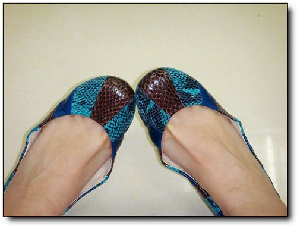

# 生活就象一只小马达。

这两天都没吃早饭，每每到了中午想尽花样用最快速度炒两好菜，然后吃得走不动路。从办公室到家完全没有糕点的踪影，皆因周末没去超市采购。生活就象一只小马达，得马不停蹄的奔忙，才不会有饿的时候。  
  
午饭在水游城的土大力，与做慈善环保工作的[**shuwua**](http://shuwua1.blogbus.com/)，日系生活的[**问问**](http://mosquito511.blogbus.com/)以及能识别各种植物花卉且能用画笔勾勒出摸样的[**旗旗**](http://freshqi.blogbus.com/)，一起吃的韩国菜。和女性朋友相处的快乐一点儿不压于恋爱的快乐，而我对人或物的爱憎是很原始的。  
  
饭后逛MUJI。。。忽然意识到自己今天浑身上下没一件属环保范畴的物件。。。以前看MUJI是劳保用品的代名词，而她们改变了我对MUJI的看法，现在我会认为MUJI是一种生活方式的倡导与象征！  
  
每个人的内心深藏着各种各样的细胞，不同交往对象会挖掘并壮大对应的那部分细胞，亦灿烂亦理智亦纯真亦质朴。而她们就象一个新大陆等着我去体会去学习，今天的好心情是上帝给我的恩赐，一起说说话喝喝茶，太开心了！可惜shuwua晚上回北京，欢迎不久再回南京相聚！  
  

---

## 评论（9）

**陈问** · 2009-09-02

劳保用品 ……你伤了我们的心

**Christina** · 2009-09-02

哈哈哈哈~~~现在不这么认为啦~

**旗旗** · 2009-09-02

哈哈哈劳保用品  
中午只顾着吃，晚饭只啃片面包就饱了～

**Sherry** · 2009-09-02

又是水游城。。-\_-b

**陈问** · 2009-09-02

我定的，实在想不出其它。真没创意啊

**shwua** · 2009-09-03

到北京了。先问声好，去上班了。回头再聊！

**朝九晚五** · 2009-09-03

全是女的…..阴气太重

**候鸟** · 2009-09-03

好漂亮的脚

**灰子** · 2009-09-08

脚，鞋，好美～

