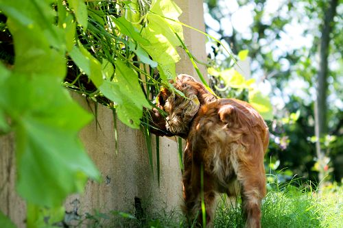
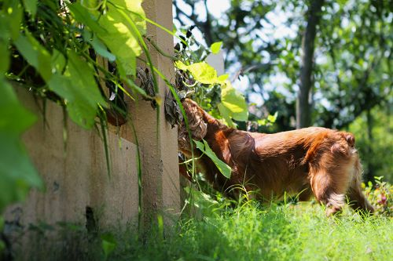
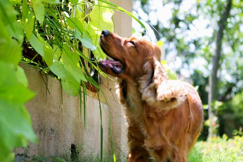
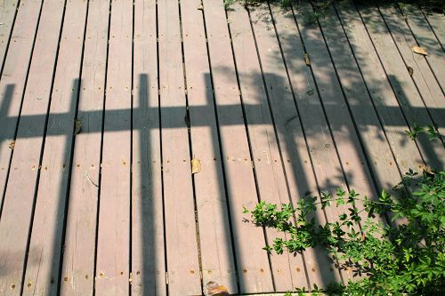
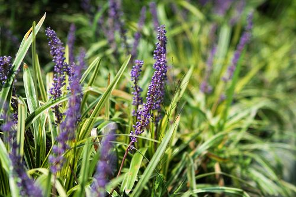
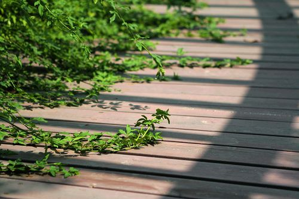
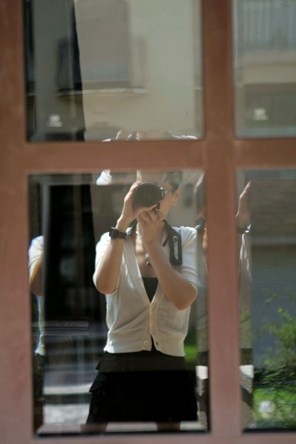

# 初秋

放晴的中午赶紧端起相机去园子里试试新镜头，初秋的色彩已经单调地只剩下绿色和紫色。端着相机跟在LUKE后面，看着它活跃地钻草丛，四处画地图，感受着阳光里轻轻的凉意，说不出的酸涩。  
  
听说父亲卖掉心爱的百灵鸟，只留下会说话的八哥。从我懂事起父亲就开始养百灵，每年的春天购进几只雏鸟，在它们成年后留下会唱歌的好苗子，其余转手卖掉。然后播放各种声音给它们听。百灵们跟着学唱，有时听见它们发出鸡的声音，或是喵喵喵的猫叫声，甭提多诧异了！百灵们的住所大得可以站进去一个少年，父亲为它们精心准备裹了鸡蛋的小米、白白胖胖地面包虫以及外面捉的蚂蚱。几十年如一日照顾着他喜爱的百灵鸟，如今他自己主动卖了它们，近日常常眼泪涟涟。想到这些喉头一阵紧缩，我父母都是太自觉的人，从来不愿给别人添麻烦，哪怕是自己的儿女，父亲这么做的确是因为自己年纪大了。  
  
   
   
   
   
   
   

---

## 评论（15）

**aimda** · 2009-09-03

第一张没仔细看，以为LUKE上树了呢？新镜头不错。

**陈问** · 2009-09-03

不错呀，luke的屁股毛象一团毛线，哈

**也唏嘘** · 2009-09-03

怎么改名字了呢？以前的名字不就挺好的么。  
　　这篇小品写得十分有味，平静中透出些许苦涩。就像寒风中摇曳于枝头的那颗孤零零的红果。  
　　在平淡的生活中，其实，我们时时刻刻都在感悟。曾以为因世态的摔打而变得麻木的我们，说不准在不经意间会因某一件小事而伤感，而感动。  
　　亲情，血浓于水，骨肉相连。默默地为你付出，默默地为你牵挂。哪怕是一个眼神，一个动作，一个背影，却有时让我们温暖无比，有时让我们泗涕横飞。  
　　你对于细节的描叙很细腻，特征也抓得很准，因此十分的感人！希望你多写点这样的东西。  
　　新镜头色彩很通透，焦外成像也不错，是50的定焦头吗？

**也唏嘘** · 2009-09-03

有一错别字，应为50定焦头。

**[shao ye](http://jennyshaoye.blogbus.com/)** · 2009-09-03

very nice photos. Like to see happy Luke

**shuwua** · 2009-09-03

今天这篇文字有点伤感。

**陈问** · 2009-09-03

真心的感触，总是能打动人

**Christina** · 2009-09-03

我父亲今年73岁了，尤其最近卖掉百灵鸟，怎能让人不感伤。不是50 ，是24-70的头。

**也唏嘘** · 2009-09-04

24－70可是牛头！成像效果相当的好，刚买的吗？现在可正是狂涨的时候，要多掏不少的米呀。呵呵。上面那张自拍片子不是这个新头吧，感觉应该比片子里的威猛一些。

**lilian** · 2009-09-04

想起我老爸……

**Christina** · 2009-09-04

自拍片也是新头。

**mandy** · 2009-09-04

喜欢今天的这组照片，特别是4.5.6.~~为什么要卖了百灵鸟，老人家对什么东西都是有感情的，相信他一定很舍不得滴~~~

**Christina** · 2009-09-04

当然舍不得，但年纪大了，担心万一。。。鸟儿们怎么办？

**andy** · 2009-09-04

有個問題，luke為什么沒有尾巴？

**Christina** · 2009-09-04

这是打猎的时候走在前面驱赶鸟的犬，尾巴上的长毛易被杂草和树枝勾住。所以传统作法就是这种犬从小就断尾。

