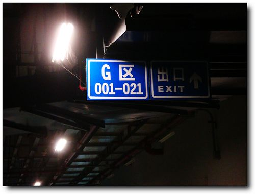
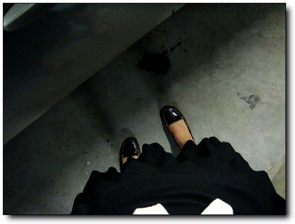
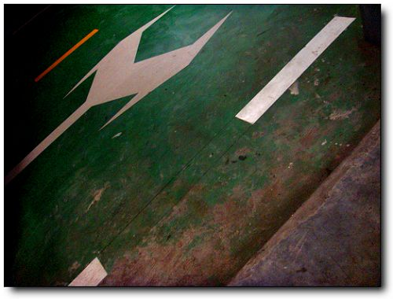
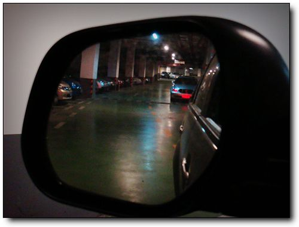

# 买来买去的困惑

一友韩国归来打算入手数码单反相机，于是向她推荐500D及自己的两只镜头。沟通到最后她问：“那你的350D呢？”这个。。。如果现在转手岂不是必须上新机身吗？那个无敌兔已经恢复到刚上市价位。为了给被我误解为全画幅的7D腾出价格空间，JS们卖的不是相机卖的是寂寞啊。。。我说我研究一下再答复你。  
  
这次见过SHUWUA，以及她拍的许多好片，当她从环保包里掏出一个掌上相机，并告知其中某些照片为LEICA创作。。。那只老重的新镜头还没在我手里捂热，此状况出现多少让人有些震动。果真牛头狗头都不重要，重要的是相机后面的那个头？！可我已上了贼船，这过程总要经历了才能达到云淡风轻吧！？  
  
*SONY T300拍摄*  
   
   
   

---

## 评论（4）

**violawang** · 2009-09-04

500D好像有点过曝吧  
但尼康的人像始终不尽人意  
我在出了D80后又陷入了CN抉择  
真是既生N何生C啊

**Christina** · 2009-09-04

C拍人像应该比N有优势，对吗？  
欧洲用C的多，国内用N的多。

**候鸟** · 2009-09-04

我觉得尼康拍起来有色差，像油画一样，拍风景总觉得拍出来比风景还美，拍蓝天那个蓝啊，快要慑人魂魄了。佳能就感觉真实多了。

**[JC Li](http://jcli.blogbus.com)** · 2009-09-04

7D不是全副，是个首席太监机。

哪家机器都不是完美的，还是用RAW格式拍，后期处理以满足自己的审美要求吧。

