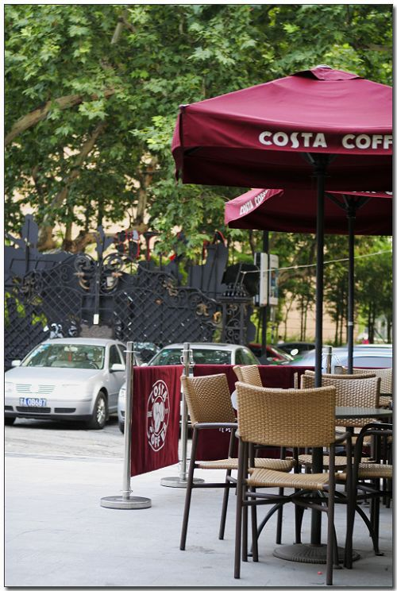
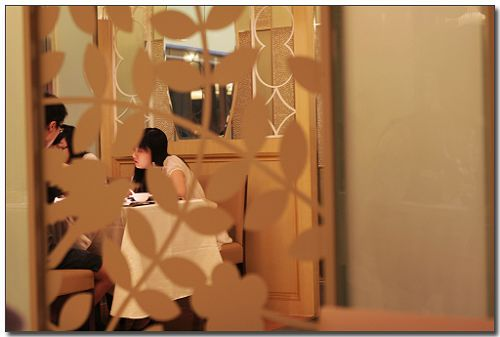
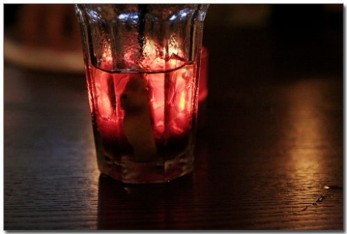
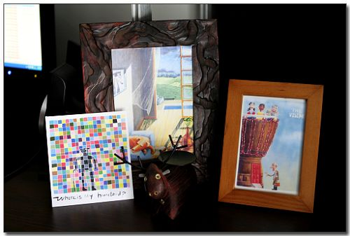

# Divided By Night

这一周是真正的社交周。  
  
起初在问问家聚会，接下来迎送[**shuwua**](http://shuwua1.blogbus.com/)，周四迎来到南京开会的[**文心**](http://blog.timetide.net/)。不过每天晚饭后会看一部电影，这周印象深刻的是1965年法国6个导演拍摄的有关巴黎的短片，好老的镜头，但感觉片中呈现出的巴黎及巴黎人更真实。  
  
昨天下午从1912的COSTA开始到创意集市、京采餐厅，晚饭后转战甘熙故居，凌晨一点多还在爱尔兰吧里聊啊聊啊，上帝也会佩服我们几个话佬的精力吧？就连上帝也不会拒绝可以让TA常常微笑的人啊！。。。中午起来看照片，黑眼袋非常吓人地显露在数码照片里，这一周本应遭受经前综合症的折磨，可是。。。可是就这么不知不觉地在友情的快乐中度过了。多希望我和我的朋友们，人生可以象这一周一样，常常被快乐围绕，与心不设防地友情相伴。  
  
又是COSTA，总好过快餐口味浓重的STARBUCKS；  
  
  
靠近1912的京采餐厅；  
  
  
如今的“甘熙故居”又被打造成类似1912经营模式的吃喝玩乐之地，租金却便宜许多。CY问你可知道甘熙的意思？私人民宅而已，还有什么意思？  
  
  
星期六1912的创意集市，转两圈才找到。只有[**“扑土”**](http://incafe.blogbus.com/)守摊，从内心到外在都热烈地与她握手，性格爽快的女孩子，我喜欢。文心挑选了[**“疯狂的赛车”**](http://mosquito511.blogbus.com/logs/35667225.html)和[**“云上的男人”**](http://mosquito511.blogbus.com/logs/10674397.html)，Sherry则喜欢那副[**“大果子镇”**](http://mosquito511.blogbus.com/logs/13529538.html)，摊位上未寻到。买下自己真心喜爱的作品先收藏着，等着日后升值~这些插画放在我家书架上无比相衬。  
  
左一：[**WHERE IS MY HOMELAND？**](http://mosquito511.blogbus.com/logs/44932331.html)  
对这副插画的情愫归结于自己对故乡模糊的概念，户口簿上是父亲出生成长的地方，护照上显示着我的出生地，而父亲的家乡我从来都不曾去过。童年的我在3个城市生活过，换了5所小学。。。这之后辗转反复，最终在南京停留。。。所以我对于HOMALAND毫无归属感，因为这种没有归属感的经历，第一眼看到问问创作的这副插画，端视许久，太多共鸣从胸中涌出。究竟故乡，于我，是在身边还是远方？  
  
中间：趴在沙发上午睡的外外，夏天的风从窗外吹进来，拂起轻纱。这副插画除了外外之外，吸引我的是夏日午后的安宁意境。  
  
右图：来自我看过的电影[**《The Visitor》**](http://lifetea.org/article/2254/the-visitor)。值得推荐的一部电影。  

---

## 评论（10）

**shuwua** · 2009-09-06

收获很多啊。  
你家的小鹿好像对这些新伙伴也很倾心。

**Christina** · 2009-09-06

哈哈~对哦~摇头晃脑地走在前面~

**[箱子](http://xiangziyu.blogbus.com)** · 2009-09-06

恩恩，我就默默的看你在costa买饮料，然后你回头看我们这桌看了几眼。好像打招呼过去和你说，茶，我一直看你BLOG哦。。。不过还是没有勇气，觉得过了这样的年纪。。。喜欢你昨天的印花TEE以及鱼嘴鞋。我要做默默的粉丝。。。。

**喜刷刷** · 2009-09-06

好精彩的一周！分享被你过滤后的幸福也觉得内心荡漾。或者，你是浓缩了精华？

**[不羁之舟](http://blog.sina.com.cn/yangzhoumeiren)** · 2009-09-06

可惜我回扬州了 不然 就可以与茶邂逅了~

你买的午后 也是我想要的:)

**[文心](http://blog.timetide.net)** · 2009-09-07

恩，很开心的周末，每次来南京都很开心。原来我买的那副叫云上的男人！

**陈问** · 2009-09-07

那个名字是她自己取的……哈哈，其实也挺不错的。  
那副画的名字叫《墙》

**Christina** · 2009-09-07

云上男人是我瞎取的名字，哈哈哈~  
应该在插画背后显示一下名子，问问，你说是不是？

**Nana** · 2009-09-07

创意集市，真不错，南京也有了艺术的聚集地。可惜这次我又错过了。

这里没有陌生人，只有未曾相识的朋友。—芬尼根  
那家爱尔兰的芬尼根餐厅酒吧不错吧，比较安静，适合朋友小聚。周三还有牛排半价活动，折后价格是70-80RMB.下个周三打算去那给亚瑟过生日。：）

**灰子** · 2009-09-08

南京的1912很有感觉，COSTA里面的女孩都好漂亮。

