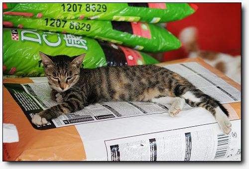
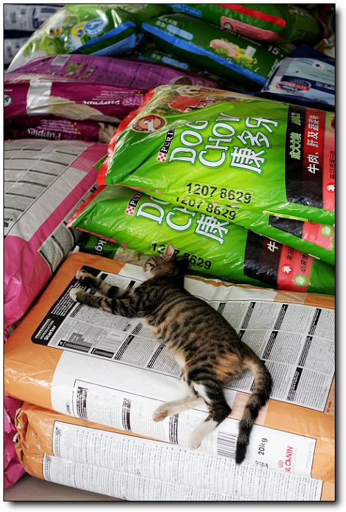
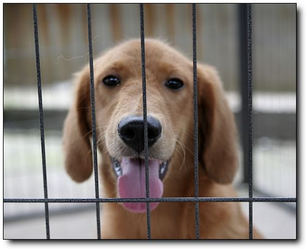
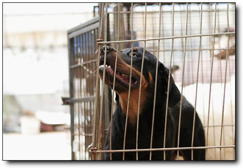
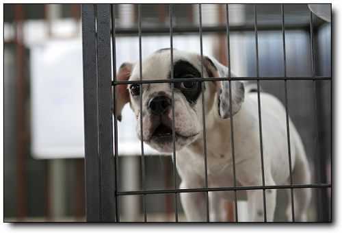
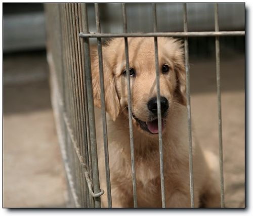
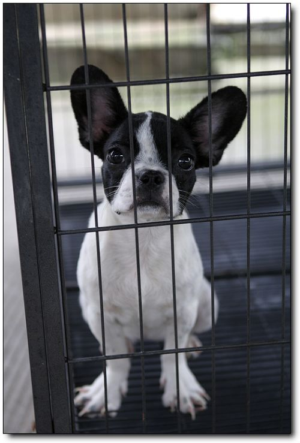
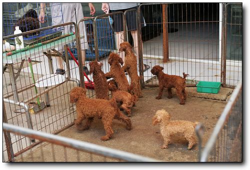
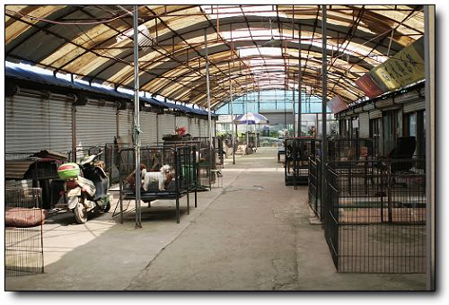

# 遇见它们

铁心桥附近的宠物集市，那里长年售卖狗狗及相关用品食品。进去看那些关在笼子里的狗狗，真想全部接回家养。好让它们离开那个令人心酸的地方。不忍心看它们的眼神~  
   
   
   
   
   
   
   
  
热爱泰迪贵宾的人们，去这里挑选吧，太多泰迪贵宾犬被繁殖出来。  
   

---

## 评论（6）

**shuwua** · 2009-09-06

每次看到这些宝贝也觉得受不了……

**[山树](http://shanshu.blogbus.com/)** · 2009-09-06

那只有一个黑眼圈的狗狗好可爱，像麦兜一样

**[幽篁](http://www.unicornblog.cn/user1/1/index.html)** · 2009-09-06

平时我不敢去花鸟市场，怕看到那些笼子里的小动物。一些小奶猫非常可怜，怕它们长得太快，店主就不给吃不给喝。

**mandy** · 2009-09-06

相邻着就是花卉市场吧，每次会去两边转转，打个招呼~~~

**[少爷](http://jennyshaoye.blogbus.com/)** · 2009-09-07

我也很怕看关在笼子的动物

**Christina** · 2009-09-07

黑眼圈的狗狗如果没判断错的话，是美国斗牛犬。好想有一只法国斗牛犬！

