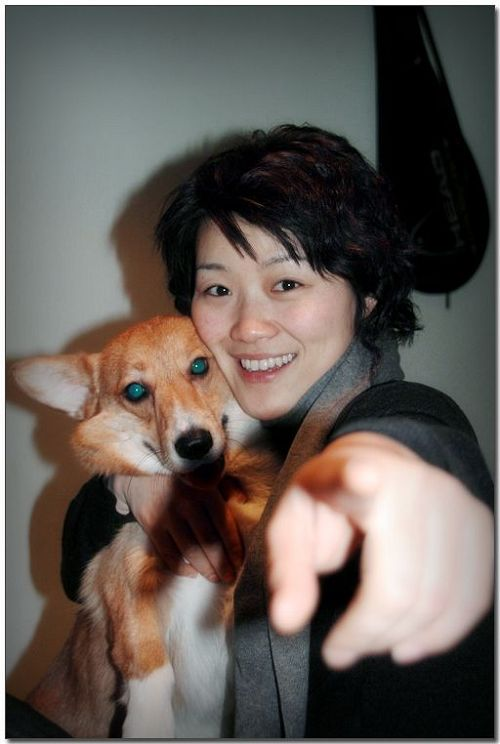
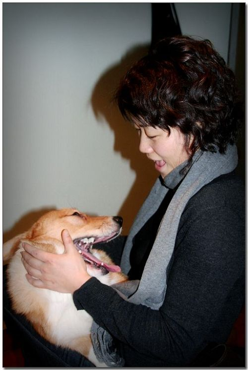
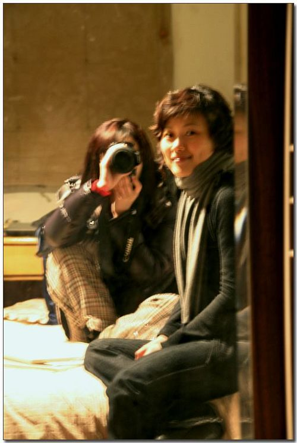
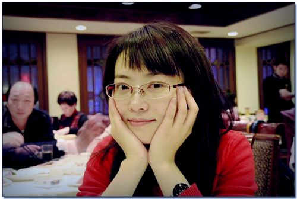

# 那时。

晚上翻以前的照片看，看到[**去年一月下大雪**](http://photo.lifetea.org/v/travel/shanghai/2008-JAN-26-27/)时候拍的，那组照片拍出来普遍偏红，忘记当时用的什么镜头，只是这几张当时为什么会被忽略了？主人和狗的表情，我们俩在一起的温暖，那时的TOBY很帅。  
  
记得那天晚上在鹭鹭餐厅吃的晚饭，然后去酒吧看你打美式桌球，你在球桌上称霸后几个人联合起来给球手出主意如何打败你。遇到一个来中国出差的美国中年男人，对jiajialing称赞你的hot。深夜我们还去公共浴室洗了澡，浴室里面很大，各种洗浴方式都有，居然还有坐在小板凳上，前面象是梳妆台上的镜子，台面上放着洗浴用品。那是我们第一次在一块儿洗澡，还记得你的表情。。。洗完澡回去拍了这些照片，对吗？TOBY好象一夜未睡，围着一张床转来转去，我们把拖鞋放在床头柜上。第二天和[**jiajialing**](http://www.jiajialing.org/)开了11个小时的车到南京，路上看到爆发户热衷的宝马车在雪地里无力地打滑，心里幸灾乐祸地说着“活该”。在镇江问路时，当地人说三天后到南京吧，那时我心里默默地坚定：今天我们一定要到南京。去年的大雪真是一场灾难，却有温暖留在这些照片中，让人回味。那时，你笑得很美。  
  
呵呵~怀前一年的“旧”是不是也意味着衰老？  
  
   
   
   

---

## 评论（6）

**喜刷刷** · 2009-09-12

一提到这位朋友，你总是少有的深情款款。呵呵，定是攒了不少情谊的。

**shuwua** · 2009-09-12

兩個美女，都是很清爽舒服的樣子，我都喜歡。

**Sherry** · 2009-09-12

最后一张背景里的男人。。哈哈哈，头发呢？

**bing** · 2009-09-13

后面的男人跟葛优样 去年的照片中人不如今年的好看：P

**zyz** · 2009-09-14

恍如昨夜…

**[少爷](http://jennyshaoye.blogbus.com/)** · 2009-09-15

她的笑脸真的很好看

