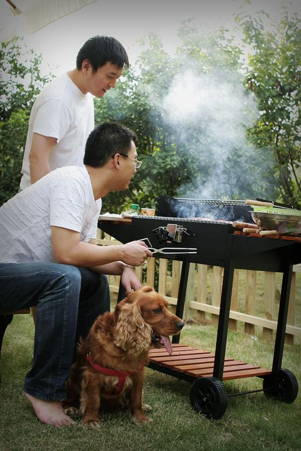

# 周末烧烤

周末在头疼脑热中度过，感觉要生病了，却迟迟没有明显的症状。  
  
一周前受邀此周末去某宅烧烤，所有食物原料从麦德龙购买，还有喜人的奶油和猪肉饼。带了LUKE去，希望它多参与社交，补偿平时没有更多时间带它玩耍，也希望它适应社交而不是每每躁动不安。  
  
整个下午某宅主人感叹N次生活之美好。不得不说这样的下午的确美好，初秋的微风、斜阳、美味及众多好友，在房子的后院中边聊天边烧烤，多亏既勤劳又手艺非凡的“大厨”。这些美好就象一副画，可以让人心满意足的回归工作状态。  
  
\*\*\*\*\*\*\*\*\*\*\*\*\*\*\*\*[**更多照片**](http://photo.lifetea.org/v/my+friends/090912A/)\*\*\*\*\*\*\*\*\*\*\*\*\*\*\*\*\*  
  

---

## 评论（12）

**shwua** · 2009-09-14

又见Luke。很乖啊，闻到香香的烧烤味也很安心吧，一定吃到了，哈哈。

**Christina** · 2009-09-14

它一闻到肉香味儿就跑大厨腿边上一坐，谗呢~呵呵~

**陈问** · 2009-09-14

好丰盛，我看见了蔬菜馒头肉饼子……这样的天气太适合踏青烧烤哇

**Michael** · 2009-09-14

不知道这烤驾要多少钱, 看起来像是煤气的

**Christina** · 2009-09-14

1400多元吧，烧的无烟木炭，不过之前点火放的好象是煤球？

**[光光](http://gaoguangguang.blogbus.com)** · 2009-09-14

你喜欢这种活动吗？

**Christina** · 2009-09-14

重点是和谁进行这种活动。

**Anyayaya** · 2009-09-14

若中意烧烤，澳洲满山遍野都是铁板灶头啊。蛮荒烙肉，乐此不疲。邻居什么都喜欢烧烤，某日中午闻到电线烧焦般的味道，我像狗一样耸动鼻子到处追踪，最后寻到他家去，猛拍门：”你家有东西烧糊啦！“开门，主人赤膊赤脚沙滩裤，夹着冒着青烟的生蚝：“尝尝啊，好吃！“身后青烟袅袅。晕！这么厚的壳也要烙，把蚝壳当小锅使啊！

**moon** · 2009-09-14

终于看到你的世界里原来还有男人，呵呵。。。一直以为你是独身主义者

**Christina** · 2009-09-14

汗。。。。。。楼上的好天真啊~

**[少爷](http://jennyshaoye.blogbus.com/)** · 2009-09-15

哇,好久没见帅锅乐:)

**候鸟** · 2009-09-15

看到一个穿蓝色海军衫的女孩，以为是你，我还想，你头发长得真快呢，结果最后一张照片才发现不是你。我很喜欢烧烤里孜然的味道。。。

