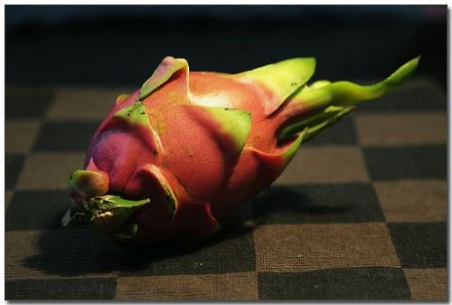
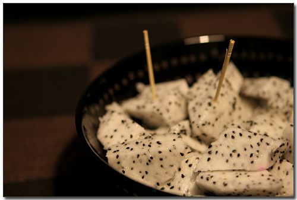
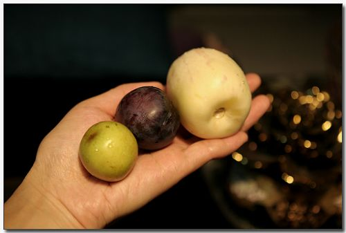

# 水果晚餐

下班去麦德龙采购一批水果回家，喝完中午的骨头汤开始吃水果。这次买的越南火龙果果肉酸甜水分足，颠覆了以前绵绵的既没水分又无味道的印象，买了两，吃一个储备一个，够小农吧。  
   
   
  
这些果子从左往右依次是沙枣、西梅和人参果。  
边吃水果边看书，还要感叹一下这惬意的生活~爽歪歪~  

---

## 评论（4）

**大姜炖去** · 2009-09-15

果然够小农……  
这四样水果先吃哪个呢  
我有一个梦想，就是让人参果里面糖分多些，不然吃完了还像二师兄一样连味道都没感觉出来

**Christina** · 2009-09-15

也有口味重的人参果，品种不同。今晚吃的的确跟二师兄吃人参果差不多滋味，但总好过直接吃维生素片儿，呵呵~

四样水果一起吃，果子就吃了一小篮儿，冰箱里还有结余，坚决将小农思想贯彻到底。四样一起吃会有化学反应吗？

**mandy** · 2009-09-16

我喜欢火龙果，刻意去咬小黑籽~~最近喜欢吃雪莲果~~

**Michael** · 2009-09-18

P2看起来好像年糕上面有点芝蔴，或是早上吃的真糕， 这水果还没吃过呢。。。

