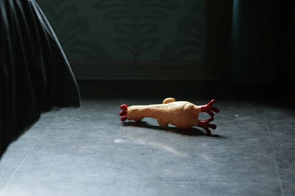
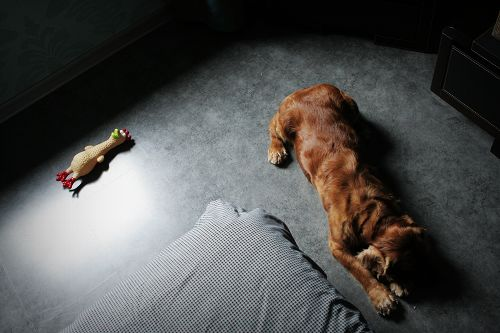
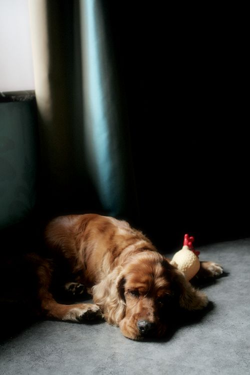
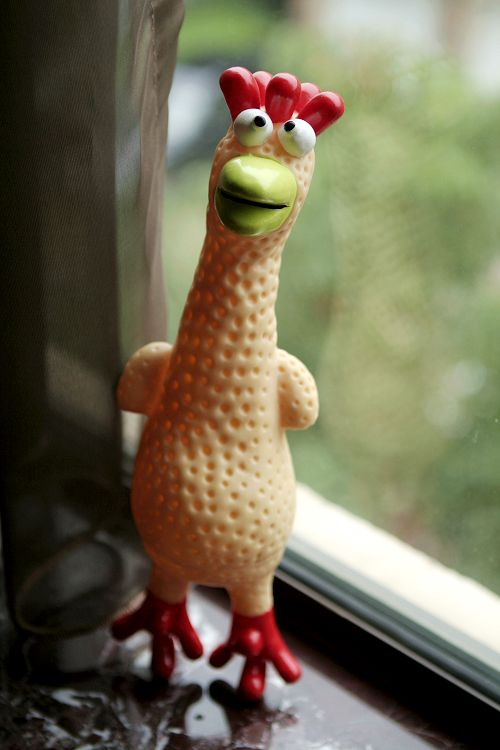

# 发泄鸡

橡胶玩具裂了，周六在宠物店给它买了新玩具“发泄鸡”。  
  
篮子里好些表情各异的发泄鸡，其中一只张着空心大嘴巴，挤压出的叫声和买回的这只不同，非常嘶哑的叫声。它爱护自己的玩具，总是在你欲走进它的玩具时迅速衔起，又或者听见玩具的叫声立刻从沉睡中惊醒并迅速寻找它的伙伴。它叼着这只鸡从车上下来，走进家门，真是很有意思的场景。  
  
这个周末它过得很开心。  
  
   
   
   

---

## 评论（6）

**喜刷刷** · 2009-09-20

Luke的表情很酷啊，他大概知道你要走了，你即便给它新玩具他也给你一张冷脸。嘿嘿，你要好好和它开诚布公地谈谈啊～

**陈问** · 2009-09-20

它不会一直咬的那家伙直叫唤么？我一般给它们毛绒不响的玩具，默默地啃一个上午，也不会打扰我。

**Christina** · 2009-09-20

它很爱护玩具的，含在嘴里。  
原来那个橡胶玩具是和它当足球踢来踢去，或者踩几脚响几声逗它玩。。。。渐渐坏了。

**shuwua** · 2009-09-20

这就是传说中的肯德鸡，不长鸡毛，脚爪和鸡冠还是胶囊做的。。。。。。

**大姜炖去** · 2009-09-21

传说中的啃得鸡  
上面的孔是不是专门用来被咬的

**Christina** · 2009-09-22

那些孔是被拨光后鸡毛后的毛孔啊~

