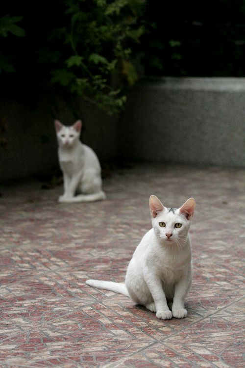
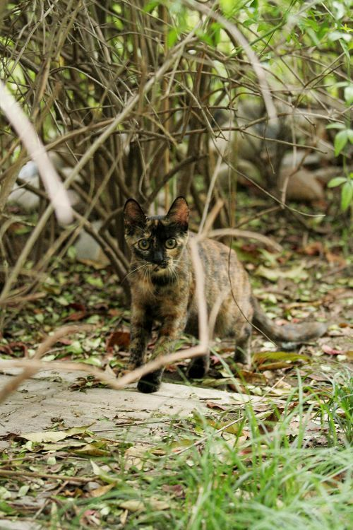
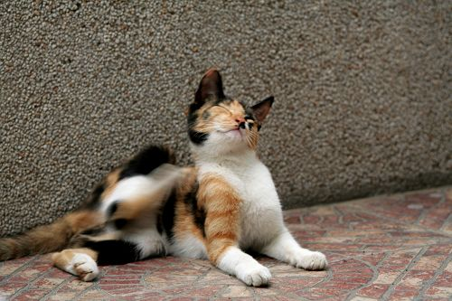
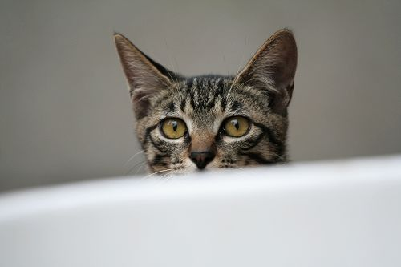
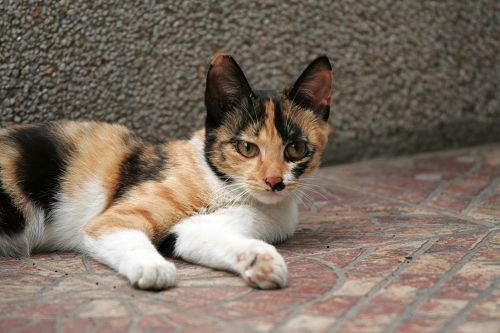
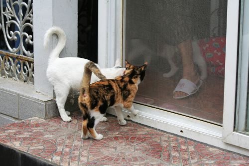
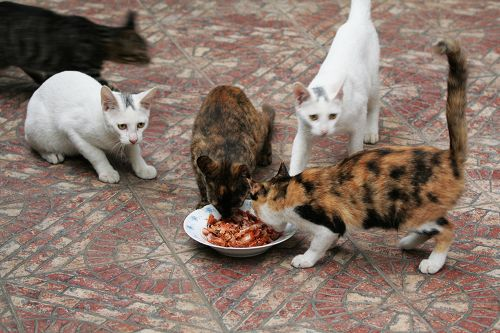
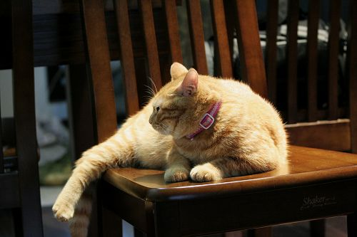

# 野猫．家猫

周末安排的非常紧凑，不仅回家陪父母过了几个小时，还做了许多家务，外出叉饭，带家宠洗澡美容。。。最最愉悦的是拍了许多照片，定焦、广角、长焦以及24-70，多多尝试不同镜头的拍摄，练习练习，寻找它们的奇妙之处。傍晚拍到一群被好心人喂养的野猫，从很小很小养大，我还记得它们外婆和妈妈的摸样。悲哀的是它们的妈妈又怀孕了，并且它们不许它们的妈妈来好心人的院子里吃食。。。这五只小猫天天生活在好心人的院子附近，把那里当成自己的家。  
  
这些小猫中我最青睐这对孪生子，它们的表情非常安静，因为白色皮毛又显得有些高贵。  
  
  
5只小猫中和外婆长得一模一样的小家伙，连惊恐警惕的眼神也有几分相似。猫外婆很早就不见踪影，但愿它还健康安全的生活在某个好心人的呵护下。  
  
  
除了吃最享受的就是挠痒痒。  
  
  
一个陌生人闯入它们的领地，胆小的狸花猫隔着水池观察我。  
  
  
这只象汤圆吗？  
   
  
早早集聚在好心人的院子里，隔着纱门朝里面张望。  
终于，晚餐开始了。  
   
  
  
做过绝育手术的胖家猫只剩下“吃”的念想。它是一只很粘人的猫，危险情况下挺身而出，比如遇见luke。虽然已被阉割，但仍然是个汉子。  

---

## 评论（10）

**[光光](http://gaoguangguang.blogbus.com)** · 2009-09-21

好喜欢这些小猫啊。有一只有点象汤圆儿。我喜欢猫得要命。

**Christina** · 2009-09-21

是挠痒的那只小猫象汤圆吧？  
中午我上张正面的给你看，呵呵~

**Sherry** · 2009-09-21

这么多只猫咪，赛上我家的了。改天我把我家猫咪的照片发给你瞧瞧。

**喜刷刷** · 2009-09-21

这个院子好有人情味儿啊,猫咪们日子过得不错.

**陈问** · 2009-09-21

猫的世界，不知道为什么，我很难走入……

**[山树](http://shanshu.blogbus.com/)** · 2009-09-21

什么镜头拍的?猫猫的神态捕捉的很好呢:)

**Christina** · 2009-09-21

70-200的爱死小小白拍的。

**大姜炖去** · 2009-09-21

孪生子头上的一撮黑毛是不是他们的小王冠

**[光光](http://gaoguangguang.blogbus.com)** · 2009-09-22

那个像汤圆儿的小猫有点像希特勒。

**Christina** · 2009-09-22

孪生子头上花纹真的一模一样哦。  
象希特勒。。。。你这么一说看上去倒真是有点象，因为鼻子上那一块黑色，呵呵~

