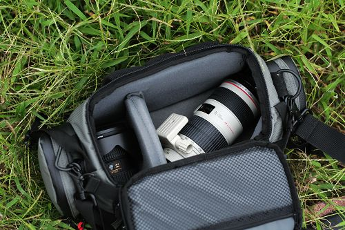
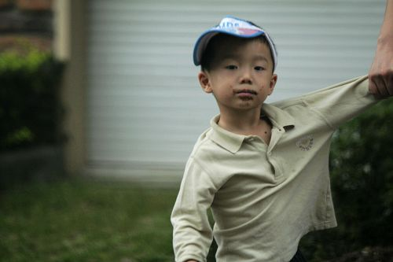
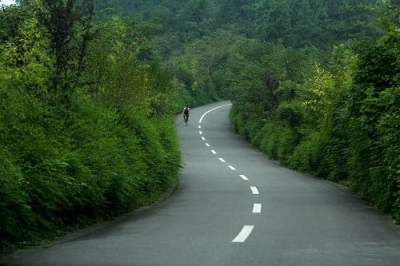
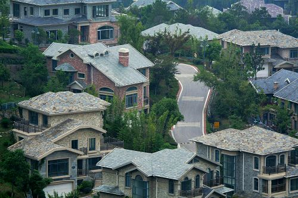
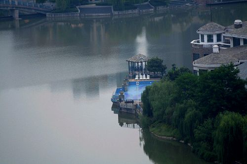
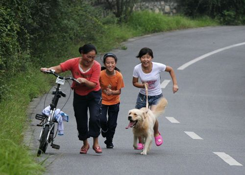
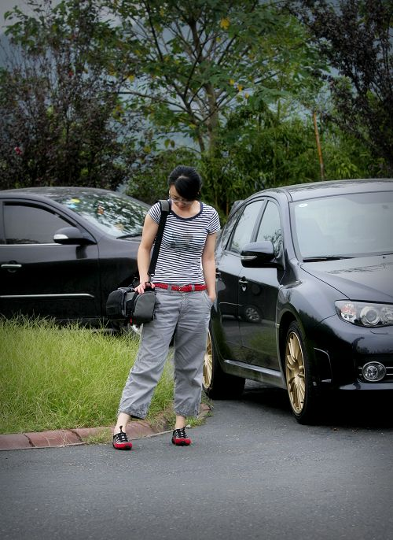

# 爱死小小白

周末第一次使用佳能EF 70-200MM F/4L IS USM镜头，眼睛贴近取景框有点小眼花，用惯中焦段镜头拍近物，这款远摄变焦镜头最近对焦距离是1.2米，非常适合风光摄影，成像非常好，可以方便地截取其中一部分景色。那么只有那只最重也是我最不喜欢的摄影包可以放下三个镜头和一个机身，其余两个根本放不下。。。多么令人忧伤的旅程啊！  
  
小小白： EF 70-200mm/4L USM   
大白： EF 100-400mm/4.5-5.6L IS USM   
小白： EF 70-200mm/2.8L USM   
爱死小白： EF 70-200/2.8L IS USM   
爱死小小白: EF 70-200mm f/4L IS USM  
  
  
  
透过汽车前挡玻璃拍摄下的小朋友，刚刚吃过冰淇淋，面颊上还残留着巧克力的痕迹，表情十分顽皮可爱。  
  
  
尤为喜欢深邃又悠长的小道，一位大叔从远处骑着山地车奔驰而来，年纪很大的大叔哦，钦佩这种健身的毅力。  
  
  
陈道明代言的别墅区，房屋层层叠叠错落有致，只是从山上望过去色彩实在不敢恭维。  
  
  
别墅里的楼王，2年前售价在2000万，不知道现在升值多少？是否已被售出？住在这样的房子里想低调都不行呢~周日空气的透明度再好些，如此远的距离用爱死小小白能拍的更清楚吧？  
  
  
山间的小公路从远处奔跑过来的快乐，截图哦。  
  
  
没想到我这么健壮！照片会将人的体重增加10斤，对吗？  

---

## 评论（18）

**zq** · 2009-09-21

还好啦！

**[山树](http://shanshu.blogbus.com/)** · 2009-09-21

是用小小白拍的吗?  
不胖不胖.看看我,你就会心理平衡了.

**[shao ye](http://jennyshaoye.blogbus.com/)** · 2009-09-21

wow,loads nice photos you have taken this weekend.   
I have booked holiday package(including flights and hotel) in Prague from 9th to 12th October. Hope to see you there.

**喜刷刷** · 2009-09-21

一个周末的素材够写一周,带着这么多小白,攒的素材够写好几年了!你这小身板,扛那么多家伙,真难以想象是去欧洲.同伴会不会嫌你潜心创作行程太慢?

**[joanna](http://yanmer.cn/blog)** · 2009-09-21

呵，这身装备出门需要点体力哈。  
喜欢那张3个女性和狗狗的奔跑的快乐。是拉布拉多么？我的爱

**Vodka** · 2009-09-22

我最喜欢第三张，构图，色调，马路中间的白色虚线……

**Vodka** · 2009-09-22

不过要用小小白，臂力得很好，否则镜头肯定会抖。

**[光光](http://gaoguangguang.blogbus.com)** · 2009-09-22

我这个星期会去趟柏林和布拉格，几天而已，回来后可以告诉你们天气，带什么衣服合适。

**也唏嘘** · 2009-09-22

呵呵，只差一个全画幅的机身了。要旅游，且如此远，买一个双肩包吧，会方便一些。祝福你平安快乐！多保重！

**shuwua** · 2009-09-22

我也觉得第三张很好看。而且小小白对提高画质很有帮助。

**陈问** · 2009-09-22

哎呀呀，那房子我们当年也心动过的，我还蛮喜欢那个砖瓦面的墙

**烟花浅笑** · 2009-09-22

呵，最近也喜欢上单反，琢磨着买摄影包，秀秀你的摄影包包吧

**Christina** · 2009-09-22

背在身上呐，前面日志里有清晰照，往前翻翻看吧~

**高原吧** · 2009-09-23

The shoes are very sexy and stylish. -c

**Sherry** · 2009-09-23

建议你买一个双肩的摄影包，带三只镜头，包括两只那么老重的，用单肩的太累了，走路也不方便，双肩的有空余的地方还可以装点个人物品，热了可以塞件外套啥的，还好你不带脚架，活活，那样你更得用双肩了，当个色驴辛苦的很，做好吃苦的准备吧，哈哈哈。

**Christina** · 2009-09-23

很令人气馁的是现在我就有只双肩的，还是专供5D的摄影包，结果三只镜头+机身完全放不下，因为包包比较浅的缘故。

**Michael** · 2009-09-24

别给自己找罪受，出门旅游就用你那只新买的中焦， 远近都能拍，小白这类是打鸟头，不适合旅游

**[绿恐龙](http://www.dlog.cn/dinosaur)** · 2009-09-26

带三个头太累赘了。。有条件16-35 一个头就够了。。最多带个70-200~

