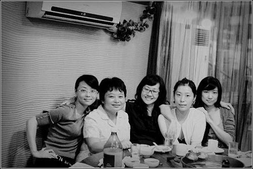

# 我们在一起。

[**Maggie**](http://bigsurprise.blogbus.com/index_1.html)组织大家吃饭，本着喝两杯放松放松的目的前往，依然背了相机去，在热气腾腾的小肥羊里海阔天空侃大山喝啤酒吃火锅，大口喝酒大口吃肉的感觉好不快活。Maggie带来一堆卡片，上面分别写有财富、友谊、成长、能力、创造力、安全感、智慧、责任、道德等等诸如此类的文字，然后我们每个人从中挑出自己最重视的5张卡片。主管通过这个测试了解一个员工的内心向往？还是别的什么意义？外企尽搞些稀奇的培训。如果说这生活还有什么令人愉悦的话，那一定是友谊，这也是我的5张卡片之一。友谊长于爱情的寿命以及在缘分到来时的相知，这是我最最珍惜的关系。如果没记错只有年纪最小的[**“旗旗”**](http://freshqi.blogbus.com/)挑的5张卡片里有爱情，这说明女性成熟独立之后，对其他方面的追求更多于对爱情。  
  
遗憾的是店里的光线实在没能体现出镜头的优势，我恨我恨我恨恨恨！（翻阅照片时，惊讶地发现[**“问问”**](http://mosquito511.blogbus.com/)的眉眼真有工笔画中古典美人的摸样。）那么，姐妹们，请给我补过的机会，让我在白天再拍一次你们！  
  
说到女人，最近真是感到好女人很多，比如6号飞深圳有蔡蔡接送至港，第二天与Helen、H集中飞苏黎世，7天后要和H结伴在瑞士停留若干天。这些旅程中琐碎的事务都有她们操办，省了我不少心思和精力，而[**英伦少爷**](http://jennyshaoye.blogbus.com/)也将布拉格之行安排在我们到达期间。飙泪~  
  
为什么这世界上的好女人越来越多，而好男人却越来越少呢？  
  

---

## 评论（20）

**陈问** · 2009-09-25

那个大胸女……是谁？我不认识。

**Christina** · 2009-09-25

这是优势，别人想有还没呢，哼~  
就让咱羡慕妒忌恨吧：）

**旗旗** · 2009-09-25

美胸呼之欲出哇。。。  
那个听胎音的合照也很耐人寻味

**[少爷](http://jennyshaoye.blogbus.com/)** · 2009-09-25

问问真的很有味道喔. 另外,我在想,到时候在布拉格,我们怎么接头呢?

**mandy** · 2009-09-25

友谊、智慧、责任、道德…..我先选这几个，这么热闹~~

**meimei** · 2009-09-25

爱情有那么让人绝望么？我还是觉得爱情是人世间最美的感情之一。

**Christina** · 2009-09-25

爱情当然美好，爱情经过常年积淀亲情的成分会更多些。具有普遍性而非绝对现象。对于成熟女性来讲，爱情并不会成为生活的重点，5张卡片中没选爱情，是因为有比爱情更让我重视的方面。

**itsmin** · 2009-09-25

额滴神，小姐，最后一句是个伪命题吧？这个所谓的好女人和好男人的数目应该是相对稳定的吧？我还觉得最近碰到的好男人多点呢。其实我们需要的只是一双善于发现的眼睛。  
南京美女真多啊。。。流口水。

**zq** · 2009-09-25

选道德（有道德活得有灵魂、有责任感）、智慧（有智慧就有了创造力、能力）、财富（这里应该特指金钱吧）、友谊（人生丰富、有意义）、爱情（生命的激情不可少），呵呵。 最后一句，经典啊！

**[不羁之舟](http://blog.sina.com.cn/yangzhoumeiren)** · 2009-09-25

友谊的确比爱情重要~~~~

**lilian** · 2009-09-25

我首选安全感（可能跟年纪有关），其次是友谊（爱情最后会转化为亲情，一些友情也会），道德（一直认为良善应该放在聪明前面），能力（生存的能力，自食其力的能力），最后是智慧或者财富。

**shuwua** · 2009-09-25

我飙泪…….  
晚回来一天就错过了五美会。

**Christina** · 2009-09-25

擦干泪花，再组织六美会~

**喜刷刷** · 2009-09-25

一直在想，没有你，我们几个没可能在一桌的。饮水思源。。。

**[少爷](http://jennyshaoye.blogbus.com/)** · 2009-09-26

我会把酒店地址及电话给你电子邮件过去

**holly** · 2009-09-26

是用什么相机拍的

**[绿恐龙](http://www.dlog.cn/dinosaur)** · 2009-09-26

真没看出是这个镜头拍的。。。

**Christina** · 2009-09-27

350D+24-70mm/f2.8 L头

**Sherry** · 2009-09-28

还漏了一个，健康，这个最重要。

**frank** · 2009-09-30

Health, family, Money, Job, Environment.

