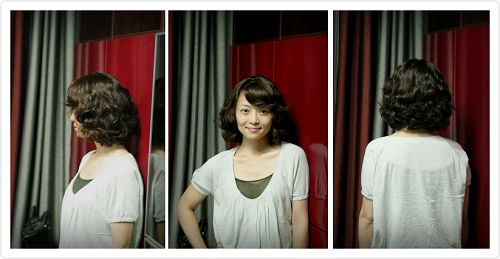
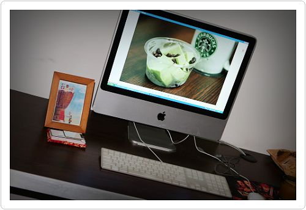
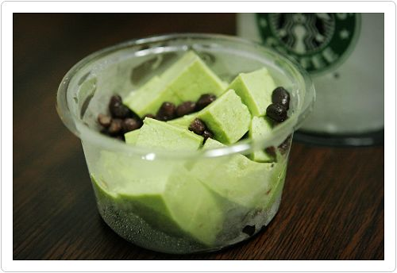

# 折#腾

10天后出发，琢磨着不能顶着政治工作者的头跑出去吧？！今天花了几小时整了一头卷出来。这个时候做任何变化都是有风险的，最坏的打算是如果不满意的话，就戴帽子度过旅程也没什么。  
  
下午还真去MUJI买了两顶帽子，不是不满意发型而是要挡挡强光，一直说MUJI是劳保用品店，现在将劳保换成“环保”比较合适，以及购入放衣物的包包，可以将行李分类包装，省去左一个塑料袋又一个塑料袋的麻烦与不美观。  
  
[**shuwua**](http://shuwua1.blogbus.com/)回来了，maggie准备组织大家打羽毛球，我问：“你是羽毛球皇后吗？”  
maggie：“不是啊，我不打，光给你们拍照。”  
我：“那组织我们跑步吧。你跟拍。”  
。。。。。。  
  
  
  
第一次吃宜芝多的抹茶豆腐是问问买的，今天自己买。  
   

---

## 评论（26）

**[绿恐龙](http://www.dlog.cn/dinosaur)** · 2009-09-26

带个帽子蒙层沙依然可以唱：“夜上海，夜上海…..”

**喜刷刷** · 2009-09-26

不错啊，等你从欧洲回来时会长长一点，会更好看的。为中国人争光啊～

**Smily** · 2009-09-26

漂亮～～～  
做颜色了还？

**shuwua** · 2009-09-26

很清新的卷发，很适合。折腾成功！

**Christina** · 2009-09-27

做了，不做颜色我的头发太黑，体现不出卷发造型。

**陈问** · 2009-09-27

深棕色的卷，很适合皮肤白的人。话说白人什么颜色都适合。

**喜刷刷** · 2009-09-27

无言以对，今天你水游城的行程。。。

**童话** · 2009-09-27

还是喜欢茶以前的清新，这个头发长点可能会自然些。

**Christina** · 2009-09-27

十几年就一个形象会让人作呕的，比如周敏慧~

**zq** · 2009-09-27

“折腾”出了洋气美。清新的感觉。

**[yanglei](http://www.yanglei.name/blog)** · 2009-09-27

发型折腾的挺好看，头大了。  
把豆腐折腾这颜色了，也好看。哈哈

**[joanna](http://yanmer.cn/blog)** · 2009-09-27

你好像瘦了，还是发型的功劳？  
其实还是喜欢你以前的造型，这款看起来有点像孩子妈妈:-)可能N看博下来，习惯了从前你的风格

**Christina** · 2009-09-27

我自己无比满意~~~~~~~~~~~

**[少爷](http://jennyshaoye.blogbus.com/)** · 2009-09-27

搞得我也想去把头发烫了:)

**meimei** · 2009-09-27

有全身照吗？：）

**holly** · 2009-09-27

看了你的相片，我准备入手500d机身了，  
另配EF 17-40/4L USM， EF 50/1.8 II，国庆拍景色和人物，这样的配置怎样？还有什么其他好的建议？

**[prettymom](http://prettymom.org)** · 2009-09-27

your new hair style is not bad. i like it.

**Christina** · 2009-09-27

节前买照相器材明摆着多送钱么，节后就跌。

**候鸟** · 2009-09-27

这豆腐怎么吃？就这样吃吗？  
我以为是抹茶的冰欺凌呢。

**旗旗** · 2009-09-28

我是技术低下的羽毛球积极响应者  
我们跑步，maggie跟拍，相机运动模式。。

**mandy** · 2009-09-28

变个发型挺好看的~~

**童话** · 2009-09-28

呵呵，自己喜欢就好。我从英国回来的时候剪了很短很短的头发。很多朋友都不接受。审美不同，最重要自己开心。祝茶旅途开心。

**lilian** · 2009-09-28

问问吃得好清淡。推荐一下它家的丹麦泡芙和烤乳酪。

**Sherry** · 2009-09-28

这发型顺眼多了~ 赞

**[山树](http://shanshu.blogbus.com/)** · 2009-09-28

哇赛，几日没上网，你竟大变样。有点不习惯。哈

**jeneffer77** · 2009-10-04

这个烫发卷很自然，颜色也真不错。羡慕能有很好的美发师在国内，我这里做发型很郁闷，英国人做不来亚洲人的头发。

