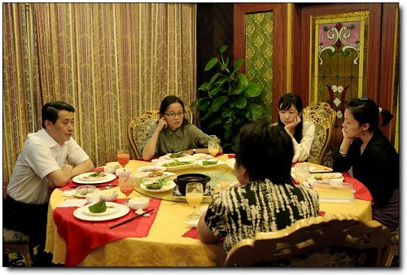
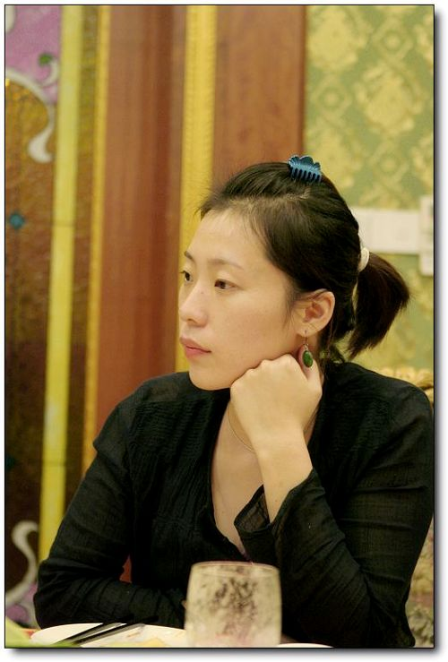
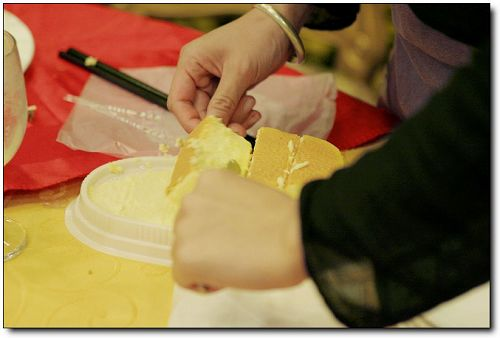

# 见面

昨有贵客到，众姐妹又有见面的机会。  
这里省去快乐文字若干。。。。。。。  
首先得赶紧吃午饭，接着又是饭局的今晚。  
努力睁大惺忪双眼，坚持到放假。  
  
  
  
弥补上回小肥洋拍摄的惨状，虽然在我拍摄时问问总是动来动去，还是抓拍到她的古典美，而旗旗美女为何眼神那么忧郁？让人不忍心上大头照呢~话说shuwua和maggie的茶经听得我们一楞一惊叹，知识渊博的人总会得到更多的喜爱。知道shuwua在，我特地换了环保的棉麻衬衣赴宴。喜欢和maggie领导没大没小的开玩笑，她从来没生气过，但听过她与shuwua的茶经，对她的喜爱又多了些敬佩，原来她有许多宝藏还没暴露出来呢~  
  
  
问问带来的美味芝士蛋糕。  

---

## 评论（9）

**zyz** · 2009-09-28

想看你的，特别是那头卷毛：）

**Christina** · 2009-09-28

Maggie就没一张拍清楚。。。

**shuwua** · 2009-09-28

poor Maggis, she really likes to take pictures. more exercise needed indeed!

**陈问** · 2009-09-28

我动来动去，没想到又被大头了。。。郁闷。好在这次没有提裤子。我强烈要求将我的照，换茶自拍图

**meimei** · 2009-09-28

问问好美：）

**喜刷刷** · 2009-09-28

问问息怒，我的技术不过关，害大家白等茶的卷毛儿照了，不好意思。

**[shao ye](http://jennyshaoye.blogbus.com/)** · 2009-09-28

the first photo, why does every one look so serious? hehe

**Jonathan** · 2009-09-28

蛋糕看着像bread talk的。

**Christina** · 2009-09-29

大家认真的在听茶经，所以看上去比较严肃。  
蛋糕的确是BREAD TALK的。

