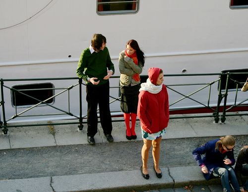

# 看图穿衣

  
  
一早从光光那里看到这张在布拉格此时拍摄的照片，从衣服以及动作判断出气温不高。几天前她在德国的照片上穿着短袖手上拿着外套。真要谢谢她先行一步，让我等知道应该挑拣哪些衣服放进行李。10月中下旬的气温应该更低吧？  
  
我到现在还没收拾行李，昨天中午错误地选择了两家小银行换汇没换到，今天中午继续。定了一个双肩背的摄影包，下面放镜头和相机，上面放自用品。究竟带哪些镜头仍然举棋不定，有时想就带一个去，有时又想如果带这个和那个或许更好。回想以前，一个傻瓜机一样行走天下，真所谓选择越多麻烦越多。  
  
以及现在的心里慌张又浮躁，一颗心天天悬着，要睡很多天觉才能从这种状况中过滤出平静来。每天这样真是令人沮丧又绝望，得不偿失。

---

## 评论（15）

**michelle** · 2009-09-30

白老外体格和东方人大不同，出远门还是多带些衣物防万一。

**Edward** · 2009-09-30

Enjoy the trip, don’t let photo staff to ruin it.

**zq** · 2009-09-30

人富裕了可以选择，可以选择了却会带来痛苦和纠集、折磨，呵呵。得与失的平衡，走走中庸之道，我喜欢。其实并不是什么事情都一定要个“更好”，让自己随时随地的“舒坦”，对我来说比较重要。旅途愉快！

**喜刷刷** · 2009-09-30

布拉格真是让人向往，每个人的评价都那么高，难得。不要犹豫了，就带新买的镜头去好了。

**[shao ye](http://jennyshaoye.blogbus.com/)** · 2009-09-30

I saw that photo too. yeh, you are right, we need to take more clothes with us

**朝九晚五** · 2009-09-30

千万别把照片弄丢了…….出趟国不容易

**[joanna](http://yanmer.cn/blog)** · 2009-09-30

这张很有时尚街拍的感觉类，高光光真有艺术细胞，赞

**Amy** · 2009-09-30

我六月中去布拉格的时候早晚都穿薄外套和薄风衣；那里纬度较高，10月中下旬应该天黑的满早的吧！~ 建议多带点实用的御寒衣服。

**Vivian** · 2009-10-01

冲锋衣这些户外用品如果你要暴走那当然是不用说了··说点别的，这个时候来推荐带厚外套和薄T恤···因为早晚温差大···白天出太阳的时候有比较热···另外建议带围巾或披肩···很有用滴~最后供你参考，目前我们这里（比利时，纬度也算比较高的啦）天黑一般在8点左右···

**陈问** · 2009-10-01

你少带一点，给自己去逛街购物的理由么

**[光光](http://gaoguangguang.blogbus.com)** · 2009-10-02

今天布拉格天晴，气温还可以，但是一到黄昏或是清晨都很凉。照片上那个女孩那样穿是在有太阳的下午，但是也是偏冷的，你可能也注意到她瑟缩的样子。我都没有穿裙子，穿了薄毛衣，还有外套。这里不适合购物，很多店不接受欧元，但是用捷克币会很亏。还有千万不要去听那种给旅游者的音乐会，质量不好也狠宰人，反正我是上当了。换汇的时候要看清“we buy“这一栏的汇率，一般欧元捷克币应该是1:22－1：24这个范围，有些exchange 柜台骗人，会被他们rip off。我就等着看你的照片了，我的相机坏了，没怎么拍。不过还是好好玩，拍照是次要的。眼睛就是照相机，照片都在记忆里。

**Christina** · 2009-10-02

太感谢你提供的信息了！  
我打算带件薄的皮衣，也想穿裙子，可是得多带一双鞋配。。。以及香港停留的若干天一定比较热。。。还是得多带一双鞋。。。

**[光光](http://gaoguangguang.blogbus.com)** · 2009-10-03

薄的皮衣可能是不够的，今天柏林很冷了，象冬天一样，还下雨。人们都穿着大衣，甚至羽绒服。如果你要去瑞士那边，应该也是很冷的。欧洲就是这样，一个星期的时间就变成了冬天。穿暖和一点吧，否则不好玩。

**aimda** · 2009-10-03

皮衣只能防风保暖性差，建议还是带冲锋衣类的外套加牛仔裤。

**jeneffer77** · 2009-10-04

欢迎来欧洲，玩的开心。上面的建议都很实用，10月份这里已经很凉了，而且欧洲的雨比较多特别是纬度高的地方，还是带件能防雨御寒的外套比较好。另外，鞋子一定要舒服的，这里很多街道都是古老的方砖铺成的，不太适合高跟鞋拉。

