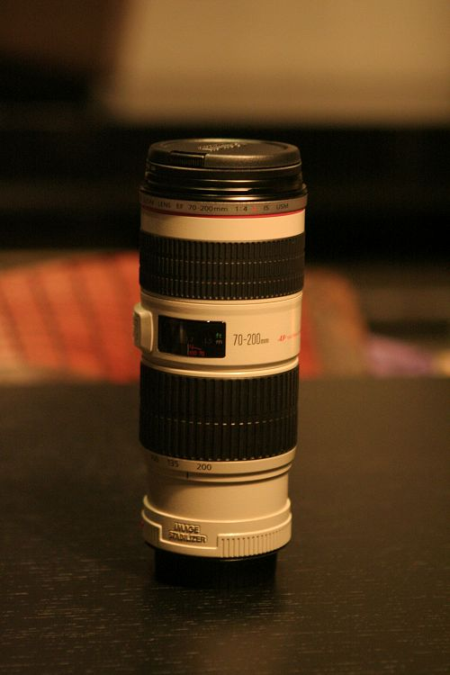
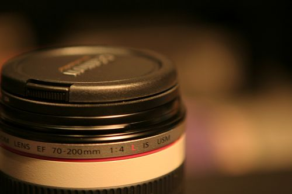

# 镜头新成员

   
  
  
话说上次用“爱死小小白”拍下的那组照片是借邻居的镜头，虽然邻居MM很热情的说“你可以拿去用，用完再还我”，一段时间内我也这么打算，然而临近出发心里总觉得欠人家好大一个人情，还是属于自己的东西用起来舒坦，为什么不拥有一只属于自己的“爱死小小白”呢？现在购进的每一只镜头都在为迎接全画幅机身做准备，翻了许多资料和杂志，综合研究下来这只70-200MM F4L IS USM的镜头很适合室外拍摄，它的重量便于携带，以及IS功能更适合频繁手持拍摄的需要。这次购买后的问题是UV镜和镜头盖不紧合，这种问题估计只会发生在我这个马大哈身上，明天还要再跑去更换，真是好事多磨哇。

---

## 评论（7）

**Weiqiang** · 2009-10-02

终于入此头了，恭喜，上片

**喜刷刷** · 2009-10-02

服了你了。。。

**[JC Li](http://www.flickr.com/photos/jinchengli)** · 2009-10-02

唉～看你也慢慢变成器材派了哦！烧完了变焦红圈，你还会想烧定焦的红圈，比如35L 1.4什么的，哈哈哈。败家无止境～开心就好。

**[Jim](http://www.lifelongblog.cn)** · 2009-10-02

现在南京这个头是什么价?

**[山树](http://shanshu.blogbus.com/)** · 2009-10-03

哇~~~

**候鸟** · 2009-10-03

茶，中秋快乐：）

**大姜炖去** · 2009-10-03

中秋快乐：）

