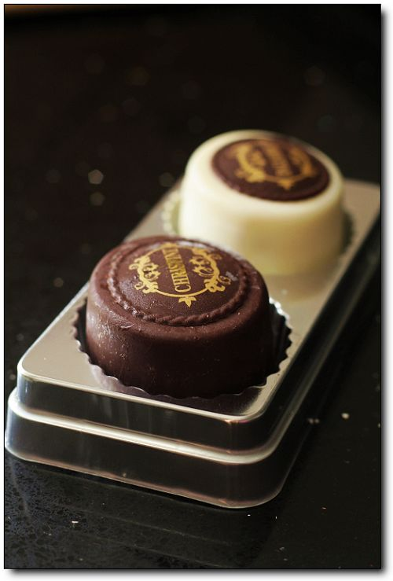
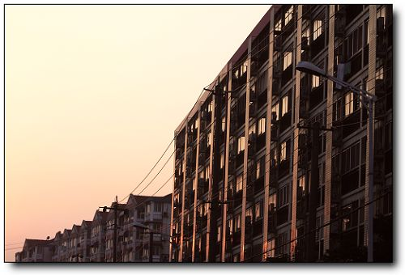
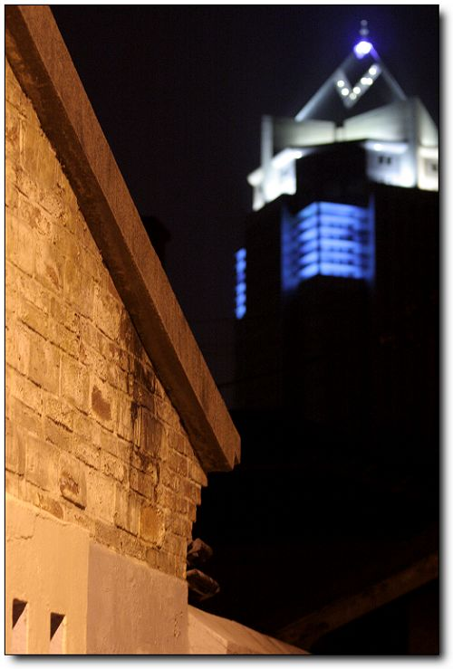
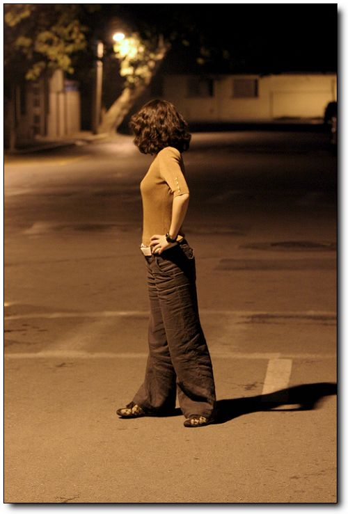
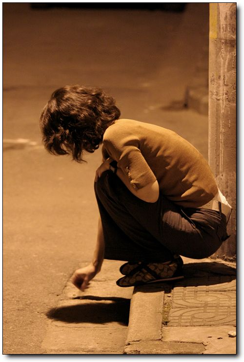

# 中秋．夜

中秋节和父母呆了一天，他们下车后，从侧视镜看到老妈雄赳赳气昂昂的走在前面，老爸驼着背缓慢地跟在后面，两个人一前一后走过斑马线，我的内心有说不出的滋味，他们真的老了，虽然老妈精力充沛，但还是老了。。。老爸说：“以前过年过节都是我们准备饭菜，现在我们年纪大了，以后由你们儿女准备饭菜吧！”  
  
中秋还没到，小区前后左右就有人开始放烟花，那些天女散花的烟花屑散落在附近的汽车上，未燃尽的火药对漆面会有腐蚀性，可是有谁会去阻止别人想要快乐的愿望呢？倒是LUKE不遗余力地朝着无颜六色的天空狂吠不止，一解我心头怨气。  
  
除了捣鼓镜头外，到现在还没收拾行李。考虑到以前总是将箱子塞得要吐出来的状况，这次准备了最大的箱子，富余空间以备所需，事实上我的采购计划里除了手表和鞋没其它东西了。看着硕大的摄影包和行李箱，这次旅行不会轻松吧？  
  
月饼越做越稀奇，冰淇淋也上月饼菜了。  
  
中秋的傍晚，太阳的余辉洒落在建筑物上。  
  
夜晚拍摄总能轻易就表现出“感觉”这个伪文艺。  
静谧的城市这一角，对应着城市那边的霓虹。  
   
   

---

## 评论（11）

**shuwua** · 2009-10-04

喜欢最后两张的色调，以及最后一张的姿态。你俯身捡什么啊？

**半饱** · 2009-10-04

最后一张应该是在逗蚂蚁（或者蟋蟀、小强… …）。  
居然和你有一双一样GuccI鞋。

**喜刷刷** · 2009-10-04

喜欢最后一张～幕后人抓拍的细节很到位。

**陈问** · 2009-10-04

小朋友在马路边，拾到一分钱……

**[山树](http://shanshu.blogbus.com/)** · 2009-10-04

我也很喜欢最后一张，感觉像放学不愿意回家的小朋友。色调也喜欢。

**[少爷](http://jennyshaoye.blogbus.com/)** · 2009-10-04

月饼好看,不知道好吃否?最后两张的色彩怎么用的呢?还有今早收你的短信,只是全是方框,看不到字,因为我的手机只支持英文.看来,到时候我们只能说话,不能短信了.

**大姜炖去** · 2009-10-04

节日快乐，旅途愉快

**shuwua** · 2009-10-04

注意一下行李最近的限重哦，最近不少航空公司好象都降低了限额。

**旗旗** · 2009-10-04

中秋都过了，我和扑土的手工月饼还没做出来，冰淇淋月饼也没吃过。。真是情何以堪。。。

**okdata** · 2009-10-09

又见静谧的小巷，很有颐和路的味道  
隔壁或许就是新造的华山路老仿，繁华与淡定，一街之隔

**lilian** · 2009-10-13

也喜欢最后这张,呵呵.

