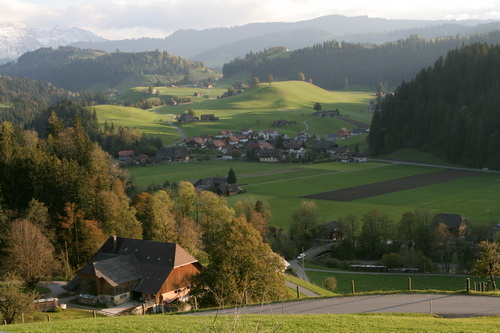
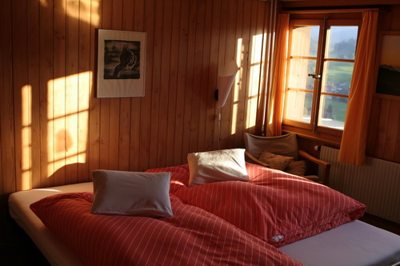
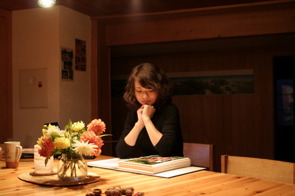

# @Eggiwil

和Miranda睡到十点多钟起床，打车前往苏黎世火车站，花费CHF46.6，这比我们两人乘地铁要便宜一些，一个人的地铁票是CHF26.00/人。午饭在火车站的NORDSEE点的快餐，总共花费EUR53.00，欧元与瑞士法郎银行按1：1.48换现金，商店和酒店就会少0.07左右。不过比布拉格旧城广场内的银行好多了，布拉格换钱简直。。。不可思议，这个故事等日后详说。肯定有人说这两大傻冒花53欧元吃了顿快餐，筒子们，这就是瑞士。Miranda后来在火车上买了瓶立顿红茶饮料支付了EUR3.50，小杯可乐一杯的价格是EUR3.3。开始我还习惯性的在脑子里换算成人民币，渐渐就不愿想这事儿了。  
  
俺俩儿乘下午2:04分的火车离开苏黎世，在Luzern转车到Langnau，然后乘汽车到达目的地Eggiwil，家庭旅馆的男主人Hans开车在车站接我们来到Ruth＋Hans旅馆。  
  
   
  
  
我们居住的房子有三百年历史，这家旅馆开了十六年，他们有一只叫Sky的可爱又乖巧的金毛犬，下周即将三岁。这家旅馆非常Popular，来自德国、美国、瑞士的游客很多，或许是我有限的想象力，这里完全。。。完全。。。超出我之前所有的想象，就像一个童话世界，风景如画，湛蓝的天空，阳光灿烂，山坡上整片整片绿油油的草坪，牛羊在草坪上悠闲的享受下午暖阳，这在我的生活里还是第一次体会到人与自然和谐的美好。未到达Eggiwil之前我是计划用两天各做一天的Day trip，去Luzern和Bern转转，看到这里的风景以及这座家庭旅馆的环境，我是哪儿也不想去了。只想在这周围消磨剩下的四天时间。要问当地人瑞士哪里最美，几乎所有人都会说Emmental，所以我们在瑞士选择居住在Emmental的乡下，而不是象之前六天马不停蹄地的跑景点赶路。  
  
在我们住进来之前已经有一对老年美国夫妻Jane和Tom，一对瑞士年轻夫妻，一个美国家庭以及自行车旅行者Bernolt居住在这里，天黑后大家在客厅里见面打招呼，做饭的做饭，上网的上网，聊天的聊天，看书的看书，真感觉在家里一样温馨。我们这座房子里居然有木质的桑拿房，两间卫生间，五间卧室，一个不算小的客厅及一间厨房。房间布置的很好，以后上照片。楼下有很漂亮的花园，我们准备明天在这里干躺着一天。  
  
   
  
晚饭在我们下车的不远处的超市购买了西红柿、葡萄、苹果、生菜、酸奶、四根香肠以及六大瓶EVA矿泉水，一共CHF27.75。六大瓶EVA矿泉水CHF8.00，等于10块人民币一大瓶，这在国内肯定买不到这么便宜的EVA。这里水龙头的水开了就能喝，公共场所除非有特殊标志不能饮用的，其余也可直接喝。对了，这次旅行我对一路上用过的自来水的印象很好。另外，一个很严重的失误，当然这个失误还是弥补了，那就是电源转换器，我带的是德标的转换器，到了瑞士不能用，好在Miranda带了万能转换器，谢天谢地，我那相机的电池有救了。

---

## 评论（18）

**[三月四月](http://11)** · 2009-10-15

第一张图像儿时挂历上的一样，好安静的感觉。旅馆不错，很温馨啊。南京现在早晚很凉了……

**陈问** · 2009-10-15

上图了，不枉我每日颠颠跑这里多次。  
还能怎么说，这就是想象中的乡下啊。茶，你好好待着，多呼吸这里的空气~~啊。

**Maggie** · 2009-10-15

太漂亮了，天天躺着看窗外风景也值～

**lilian** · 2009-10-15

是啊，马不停蹄太赶了，在一个地方多呆几天才能体会那种美好~

**grace** · 2009-10-15

那个人物的照片像米兰拍出来的风格哦，那里好爽啊~~~  
你在瑞士如果去看表的话能不能帮我看看欧米茄2210.50.00这个型号的价格，如果不方便就算啦：）(**\_\_**) 嘻嘻……，偶在想是去香港买还是瑞士买呢：）

玩得开心啊，(**\_\_**) 嘻嘻……~~~

**[薇安](http://bulaoge.com/?vivianxu)** · 2009-10-15

好美好美好美，原来图片上的画都是真的存在

**[joanna](http://yanmer.cn/blog)** · 2009-10-15

好漂亮，你的心情好像我当时在德国国王湖，宁静的村庄，远处的雪山，就想静静地呆着……  
http://yanmer.cn/blog/wp-content/uploads/2009/03/69.jpg

**Lily** · 2009-10-15

This is the first time I left my comments on your website, thought I’m your fan for a very very long time.  
It’s like a fairytale wonderland, in my childhood dream. I wish I could be there someday…  
Wish you a happy journey

**frank** · 2009-10-15

能有一段艳遇，人生就完美了。

**候鸟** · 2009-10-15

好美，像拍《魔戒》的地方，能到这样的地方走一趟，真是幸福！还有你的新发型很像王菲：）

**a friend ?** · 2009-10-15

don’t forget VAT return if you are getting swiss watch(es) like omega’s

**shuwua** · 2009-10-15

乡间散步，发呆。有牛羊、牧人从身边走过，世界上真有这样的童话国，估计常年住着的人倒没有游客感觉幸福。

**大姜炖去** · 2009-10-15

新鲜的空气，悠闲的小镇

**大姜炖去** · 2009-10-15

新鲜的空气，悠闲的小镇  
波兰的同志们在遭受雪灾，你这边看起来很不错

**[Nio](http://www.nioxiao.com)** · 2009-10-15

本来有去瑞士学习的机会，放弃了，可惜呀。。。。。那里真的很美！

**一叶帆** · 2009-10-15

Emmental那里有很好的cheese。。。。。。

**[少爷](http://jennyshaoye.blogbus.com/)** · 2009-10-16

真正度假的感觉, 好好享受吧,茶

**Pretty** · 2009-11-03

I love this pic so much, you look so great in it!!!

