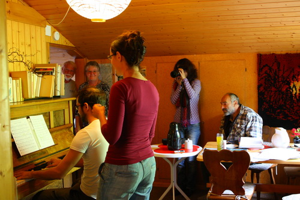
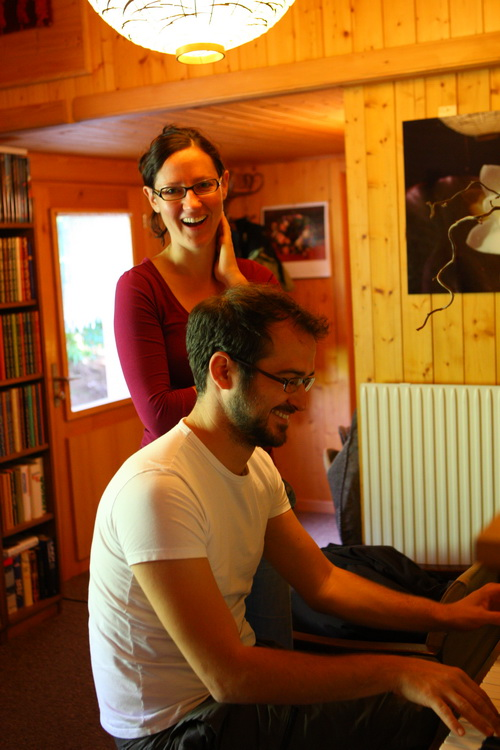
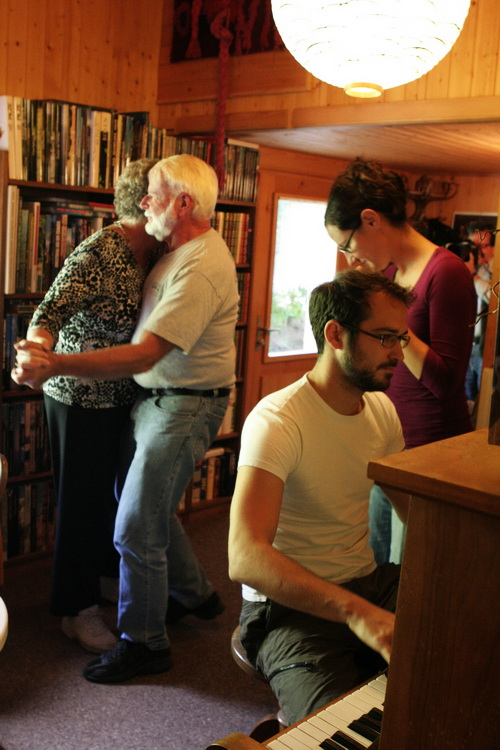
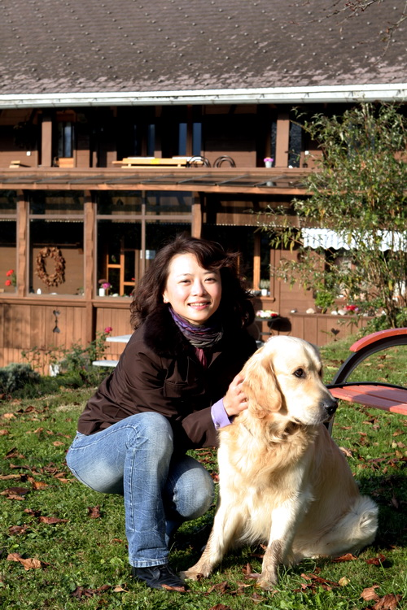
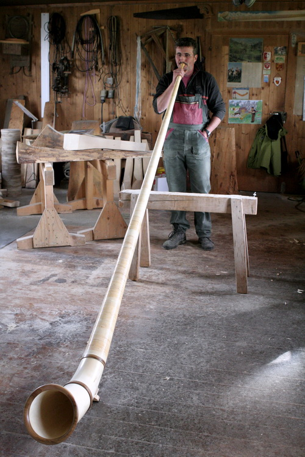
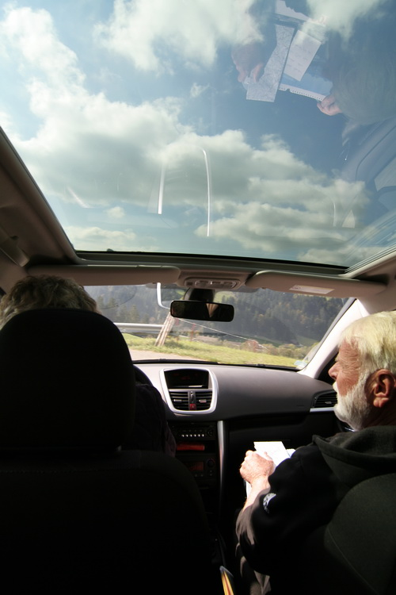
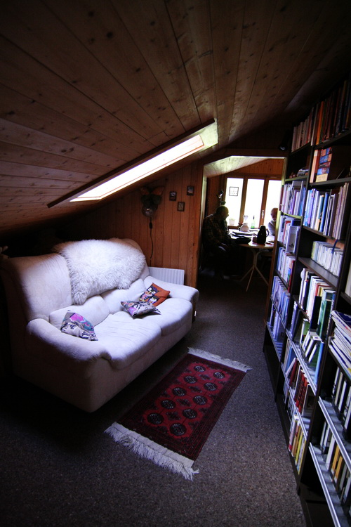
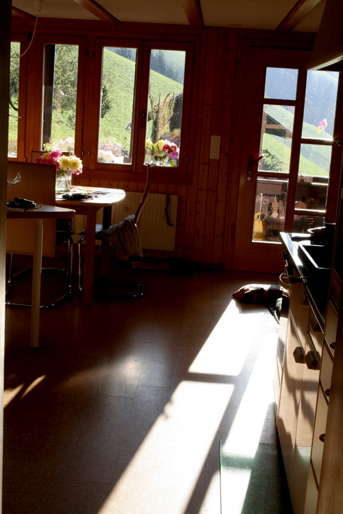
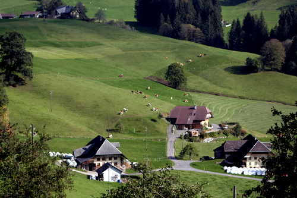
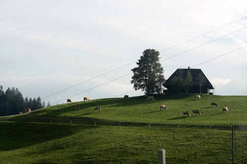

# @Emmental

美国来的老夫妻俩TOM和JEAN驾车在欧洲旅行四个月了，在此次旅程中已是他们第二次住在RUTH+HANS家庭旅馆，前一次在八月份。并且，他们在两年间就来这家旅馆四次。该地区为德语区，TOM曾为美国空军，在德国工作过五年，住在德国人家里，所以德语还不错，解决了问路的问题。但是瑞士人讲的德语与德国人讲的德语还是有区别，不太好懂。他们开着法国朋友借给他们的标志207，在欧洲大陆上走走停停，旅行期间已跑了1.3万公里。上午两位老人赶往小镇上剪头发，下午邀请我和Miranda去饼干工厂和Alp Horn制作坊。真是太好了 ，首先他们有车，其次他们比较熟悉地形，还曾在此进行过几天的徒步旅行，如果不和他们一起去的话，我们可能需要几天时间才能走遍Emmental地区。  
  
午饭前大家聚在一起弹钢琴、跳舞。图中两位年轻男女刚从LUZERN音乐学院毕业，也在此 度假。每天会弹一小会儿钢琴，唱唱歌。  
   
   
  
  
Alphorn是当地的一种乐器，类似西藏喇嘛教吹奏的那种长长的金属号角，但这个乐器是用木头和藤条为原料，需要花费几年时间才能完成一个成品。木头为当地采伐，木头里的水分要晾几年才能蒸发，否则制作出来的乐器容易变形，乐器外面的藤条则从印尼进口。目前全瑞士仅有二十人继承了这项手工艺，我们下午去的这家祖孙三代都是制作Alphorn的，工作室里有许多爷爷传下来的自制手工具及机械工作，非常有意思。TOM想要订购一只Alphorn，约2、3000美元。听完工作室主人详细的介绍后，去的每个人都得到了使用Alphorn的机会，有的吹出来的是气息声，有的能吹出不连贯的旋律，我则只能吹出毫无音阶的声响，无论吹出什么声音，大家都会给予鼓励与喝彩。  
  
早晨在房子前面和SKY的合影；  
  
  
Alp Horn及制作手工艺者。  
  
  
Kambly饼干工厂在更远的山区，绕了好多弯才到，晕死我了。这里有许多U型弯道，很适合飙车，当然技术得一流才不会丧命，因为这里的山道很窄，坡道也多。厉害的JEAN驾驶着手动档车开50公里时速穿梭在Emmental山区里。许多当地人到Kambly购买饼干，价格不是太贵，不同饼干前都有可供客人品尝的样品，吃完再选择，并且这里接受信用卡支付，POS机上会显示瑞士法郎和人民币两种总价，你可以选其中一种货币支付。  
  
Tom&Jean驾驶的全景天窗的标志207，这天窗太适合郊游了。  
  
  
二楼走道上的读书区；  
  
  
看到洒落在屋内的阳光，让人想马上推门出去。  
  
  
早晨起来后发现草坪上有一层白色的霜，天气冷得好像是零下了。女主人Ruth昨晚没有采摘下的鲜花经过一夜的霜冻几乎都冻坏了。我也穿上了秋裤，换了稍微厚点儿的毛衣。室内还是很暖和的，什么是高度发达的文明社会？那就是这里的乡下有全套供暖设备和排水系统，我们使用的水全部来自山上融化的雪水形成的山泉。在这里你完全可以享受到在城市里所有的硬件条件，旅馆还提供免费无线上网。  
  
到瑞士就一个感觉：生活在这里非常幸福。  
  
   

---

## 评论（20）

**[光光](http://gaoguangguang.blogbus.com)** · 2009-10-16

照片真棒，就喜欢这种有故事的照片。旅途愉快！

**[光光](http://gaoguangguang.blogbus.com)** · 2009-10-16

简直太期待你的照片了。

**大姜炖去** · 2009-10-16

sky真是很漂亮  
很温馨的书室，一直很期待去瑞士  
旅途愉快

**itsmin** · 2009-10-16

旅行中的人感觉真的不一样. Enjoy!

**[mercy](http://mercysong.blogbus.com)** · 2009-10-16

亲爱的，我看你的笑容真好看~~~跟以前的很不一样哈！  
天天期待着看你的记录。

**陈问** · 2009-10-16

你用几天的时间换来幸福，比什么都值得呀

**Lily** · 2009-10-16

看，你笑得露牙齿了，和以前不一样^\_^

**[三月四月](http://11)** · 2009-10-16

那张车窗和那张读书区的照片，真是相当有感觉

**zq** · 2009-10-16

感觉是真正发自内心的笑！容光焕发的茶！期待了好多天了，一切真是超出想象的美啊！

**喜刷刷** · 2009-10-16

我见到了你鲜有的灿烂笑容，也体会到了你心中的阳光。真是渐入佳境啊～就在那边晃着吧，别回来了。

**[山树](http://shanshu.blogbus.com/)** · 2009-10-16

真美呀，那边的环境真好。好好享受你的假期

**雯子** · 2009-10-16

好美的旅程哦！

**vivi** · 2009-10-16

Fabulous pictures! I also think that your smile is more sweet than before though I am just your fan. Have a good time!

**[shao ye](http://jennyshaoye.blogbus.com/)** · 2009-10-16

can you get some information from the owner, I will book a holiday there later. thank you.

**陈问** · 2009-10-16

茶，我在博上转载了一些图。可以么？

**[joanna](http://yanmer.cn/blog)** · 2009-10-17

全景天窗？wow@@@@@看图片，等不及明年的旅行计划了。emmental盛产奶酪吧？是一种奶酪的名称拼写

**shuwua** · 2009-10-19

那张两个弹琴唱歌人的照片，真的很美。镜头果真很好。

**mandy** · 2009-10-20

看着你的照片，幻想身临其境的感觉~~

**okdata2003** · 2009-10-21

peaceful life, nice place

**Pretty** · 2009-11-03

I am so regret for not going with you!

