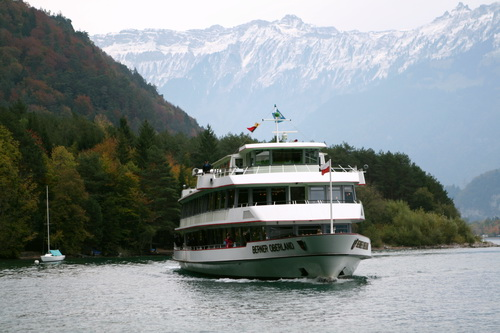
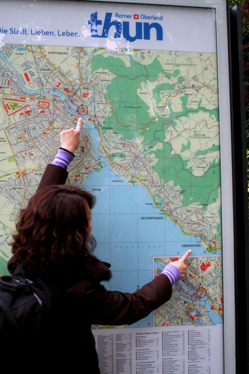
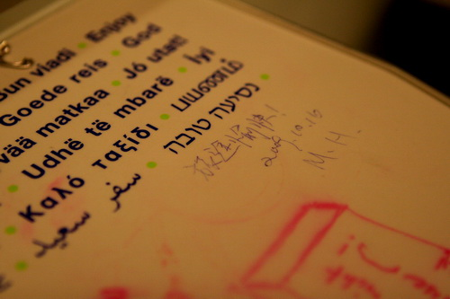
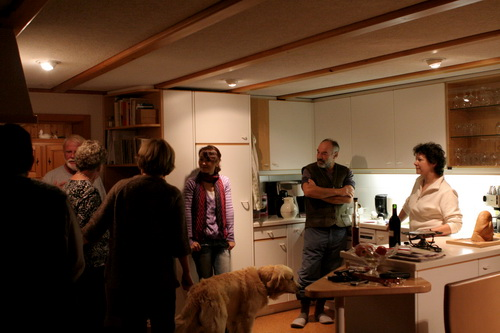
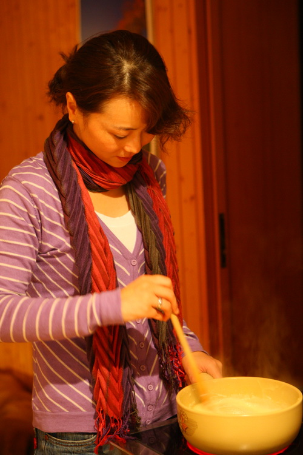
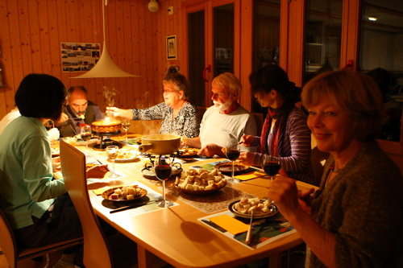

# @Thun

在Hans推荐下我们今天前往THUN湖游览，一早Hans开车顺便带我们到达Signau火车站，很小的站台只提供自动售票，好在有Hans帮忙操作，购买了两张往返的火车票，中间换乘一次火车到达Thun，游船的售票点就在火车站边上，买的是一天使用的票，一等舱为40瑞士法郎，可以在一天内反复乘坐游船，一路上停靠的码头都可以下来逛逛，售票点走几步就是码头，很方便。并且每个码头到达的时间都很详细的列在售票点随手可得的旅游册子上。  
  
在船上用完午餐，考虑到时间问题我们决定在Interlaken前两站的St.Beatus-Hohlen下来走走，意外走到一个有名的CAVES，需要走过一段不算远的山路，非常美，旁边能看到湖水及远处的雪山，满地落叶与五彩缤纷的秋色，没有言语能够表达当时身处此景的心情，完完全全从心脏深处溢出来的陶醉与快乐。为了体会更多瑞士的细节，返回时我们俩特地提前一站下船走回总站Thun，用了大约1.5个小时，顺着湖边行走，路过许多居民区，非常美，照片回来上传。  
  
我想提到的是返回Eggiwil的巴士上我们遇到一个非常友善的女孩子Stephie，她主动提出下车后她回家开车送我们会客栈，于是我们多乘了一站路跟她回家取车。要知道当时天全黑了，还下着雨，到了Eggiwil之后需要步行一段山路才能到达，这种情况下对我们来说简直就是雪中送炭。更有意思的是，快到Eggiwil时，几乎全车的人都在提醒我们，把我们俩乐坏了。Stephie每天往返于Eggiwil与Bern之间上下班，需要乘巴士－火车到Luzern-火车Bern，这在我们看来简直不可思议，但这恰恰说明瑞士交通多么发达，换乘交通工具之间几乎只需要走几步路而已，且换乘间隔时间仅5-10分钟。在好心的女孩子送我们回客栈的时候，Hans则在汽车站等着接我们呢。瑞士人民简直太友善，太友善了。  
  
我们乘坐的游船；  
  
  
码头等船的当地人；  
  
  
我们在Thun前一站下船行走的路线；   
  
  
这是瑞士火车上的桌子，上面除了中文似乎什么文字都印了，于是女伴儿用圆珠笔留下这行字；  
  
  
昨晚客栈主人邀请客人们一起晚餐，有名的瑞士奶酪火锅哦，上桌前搅拌奶酪到融化为止，用面包块及自家摘下的梨块沾着吃，同时还可沾点白兰地酒。主人提供了红白葡萄酒，加上奶酪火锅，这就是瑞士人的大餐了。  
   
   
  
聊天是晚餐的主要项目，从各个国家的金融到保险，以及美国人的笑话。比如瑞士政府要求所有旅馆经营者投保一种险，以便客人在这家酒店或旅馆发生问题时赔付。政府特别强调尤其要小心美国人，因为美国人真的很爱打官司，之前还真有一个美国人把律师请到瑞士来和酒店打官司呢。  
  
  
明天将独自一人前往苏黎世，没有笔记本电脑更新会慢一些喽。

---

## 评论（10）

**sususu** · 2009-10-17

茶搅拌的就是奶酪吗？

**喜刷刷** · 2009-10-17

虽然穿了毛衣，但旅程还是很温暖啊～

**[山树](http://shanshu.blogbus.com/)** · 2009-10-17

好温馨的场面。祝茶旅途顺利。

**may** · 2009-10-17

唉唉，看的我心动不已哪。。。梦中的欧洲。。

**[joanna](http://yanmer.cn/blog)** · 2009-10-17

迫不及待等回国后上片子，旅途愉快，好好享受+珍重

**Michelle** · 2009-10-18

文明中的高度文明

**itsmin** · 2009-10-18

瑞士之旅，看了让人心生温暖。真好。

**陈问** · 2009-10-19

加油加油，大家都在等你回来

**[shao ye](http://jennyshaoye.blogbus.com/)** · 2009-10-19

Pretty girls alway get help:)

**mandy** · 2009-10-20

瑞士人民真友善，我也想去~~

