# Ruth+Hans Kern@Berghaus Eggiwil （1）

在整个旅行中Eggiwil给我留下既深刻又美好的印象，旅行途中更新比较困难的缘故一直没有回答少爷Eggiwil家庭旅馆的信息，这家旅馆分不同房间，房价会有所不同。旅馆提供免费早餐、免费上网，楼下有洗衣房（可能需要支付一点点费用），请拿哪条浴巾就一直用哪条浴巾，晚上十点半之后不要洗澡或使用吹风机，不提供牙刷、拖鞋。询问过当地人是否常常见到中国游客，回答是今年只见过两次。可能中国人出国旅游都忙着跑景点吧，象我们在瑞士之前的行程一般！据说上一次是上海的游客，让主人家头疼的是上海游客用电脑在旅馆里看在线电影。。。。很晕。。。。以至于网速变得很慢很慢，影响了别的客人使用。这让我想到中国人在旅行途中聚集在一起打扑克的情形，真的很不能理解这些旅行中的行为。  
  
\*\*\*\*\*\*\*\*\*Ruth+Hans Kern\*\*\*\*\*\*\*\*\*  
Website：www.berghaus-eggiwil.ch   
Tel:++41/+34/491 2368  
Fax:++41/+34/491 2375  
E-MAIL:berghaus@eggiwil.cn  
  
这是Ruth+Hans家庭旅馆的整个建筑的照片；  
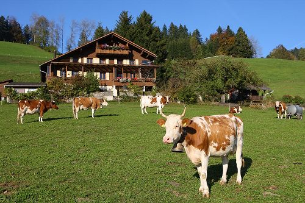  
  
无论客人还是主人都会先到达旅馆后门，客人从左侧门进房间，而正对我们的门一般是主人进出，客人出门也从这个门走。为什么这样呢？客人和主人居住在同一座建筑里，主人也需要私人空间，所以相互尊重彼此的私人空间比较好；  
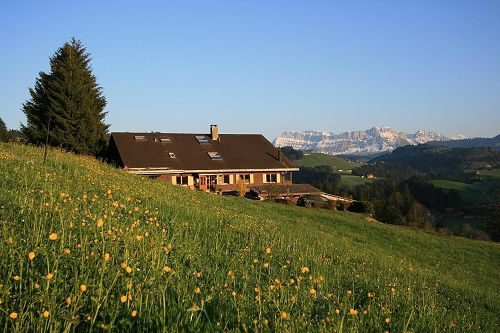   
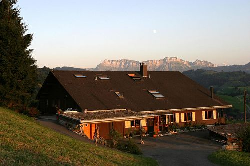   
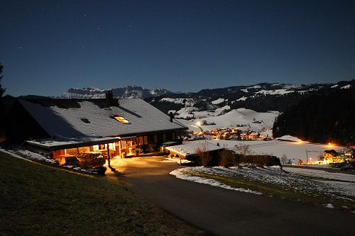   
  
人间仙境~  
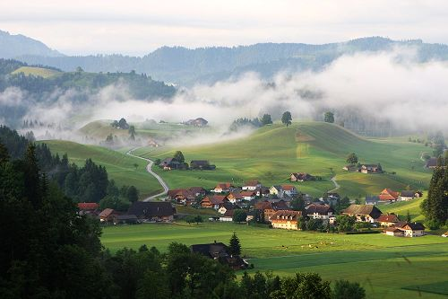  
  
旅馆的庭院，有小花园，从这里可以远眺的风景更美；  
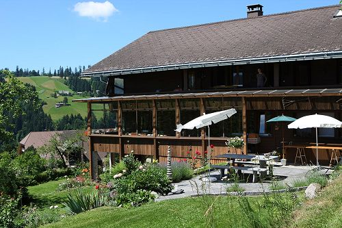   
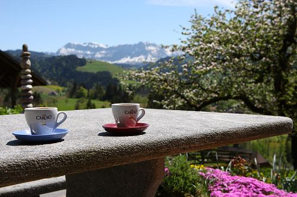   
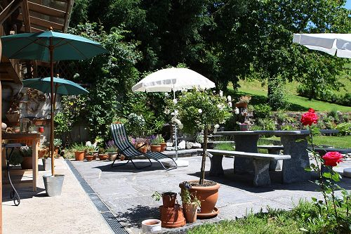  
  
住宿费里包含一顿免费早餐，每天早晨都有酸奶，是主人带着瓶子到山下小镇上打回来的。还有他们自己酿制的果酱。  
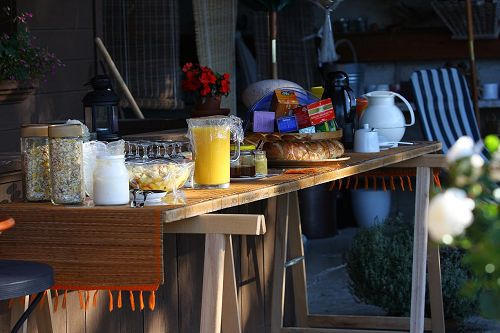  
  
右下角的瑞士奶酪是口味较重的一种。我在瑞士航空飞机上吃了很多这样的奶酪，吃到腻吃到只要一乘坐交通工具就想吐。  
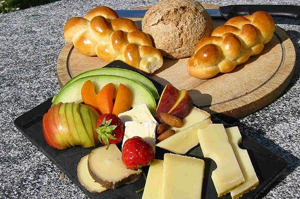  
  
旅馆主人自己种植的水果，苹果树就种植在庭院里，以及奶酪火锅吃的梨子也是自家种植的果实。  
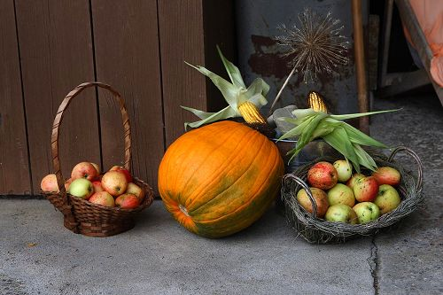

---

## 评论（13）

**喜刷刷** · 2009-10-25

趁我不注意玩分身术啊～欢迎归来！

**Christina** · 2009-10-25

呵呵~欢迎来踩一脚，等我安定一周我们聚聚哦~

**[少爷](http://jennyshaoye.blogbus.com/)** · 2009-10-25

谢谢你的信息.我给你的邮箱发了信,请查收

**[光光](http://gaoguangguang.blogbus.com)** · 2009-10-25

不可以把照片放得大一点吗？照片小了，就少了很多细节，还有光。

**陈问** · 2009-10-25

么么么，想吃死了。酸奶和奶酪都是我最爱，不晓得连续吃上一周是不是也会呈昏迷状。

**Lily** · 2009-10-25

啊，突然发现，我们公司的产品是在Eggiwil装配或者生产的… ABB

**旗旗** · 2009-10-25

美死啦，每一幅都是完美的明信片捏。。人间仙境看得我心都碎了

**Christina** · 2009-10-25

我会为每个地点和主题做一个相册，那里面的照片尺寸会比较大，请等待，嘿嘿~

**雯子** · 2009-10-25

期待更多人间仙境的图片，先养养眼。

**[joanna](http://yanmer.cn/blog)** · 2009-10-25

得一此处安度晚年，万事足……这种地方适合美美呆上几周，果真生活……会不会对青年人而言，太乏味？  
欢迎回国

**jiajia** · 2009-10-26

最喜歡那張亮起燈的，太美了。

**[三月四月](http://11)** · 2009-10-26

这组照片没的说了，像挂历一样完美，你可以选一组照片，去图文店做成台历了

**lilian** · 2009-10-27

看得人心情特好，为之神往～

