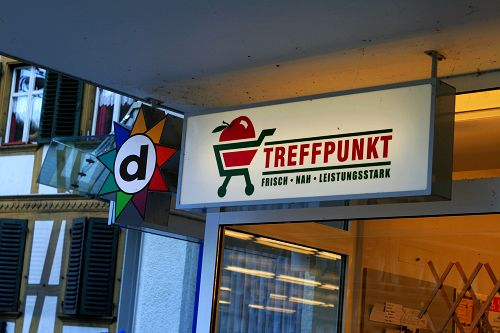
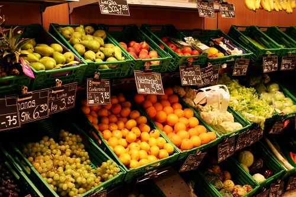
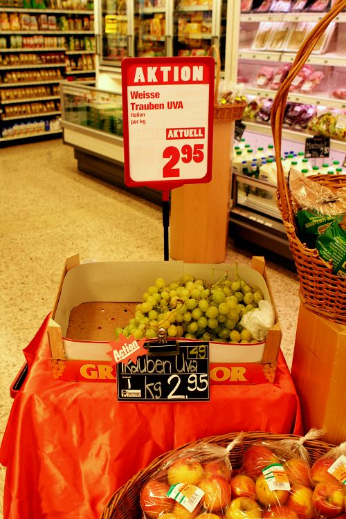
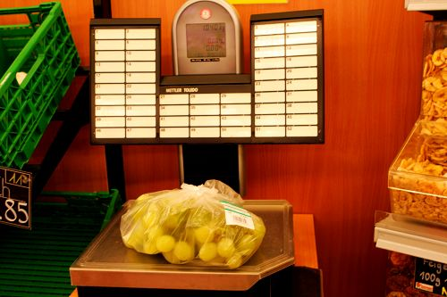
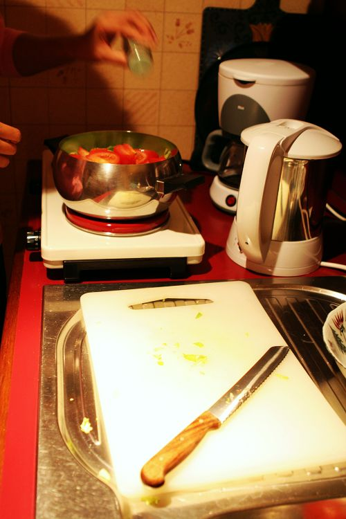
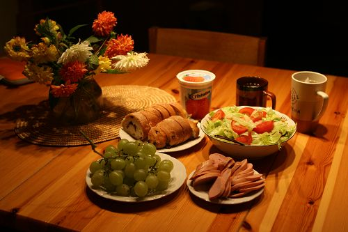
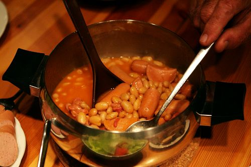
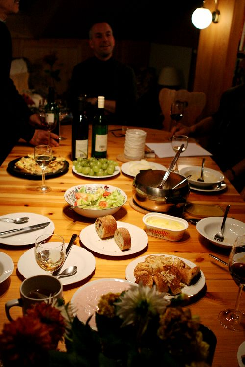

# Ruth+Hans Kern@Berghaus Eggiwil （2）

小镇上的超市；  
  
  
这么多水果蔬菜让从东欧过来的人看着眼馋，恨不能马上拿一只西红柿啃一口；  
  
  
葡萄每公斤售价是2.95瑞士法郎，瑞士去年才加入申根国，货币也接受欧元结算，但是用欧元结算有点贵哦，还是换成瑞士法郎消费比较划算些；  
  
  
葡萄的编号是49，超市里的每种商品都有相应的编号，购买需要自助，自己拿了葡萄放在秤上称，选择上面的编号，价格就出来了；  
  
  
Miranda是烹饪能手，做起西式菜驾轻就熟，并且她非常会照顾人以及照顾别人的情绪，女性中如此能干又智慧的不多见！这是供客人使用的小厨房，餐具、调料样样俱全，看上去比自家的餐具还干净；  
  
  
这是我们自己做的晚饭，简单又营养；  
  
  
邀请Tom和Jean加入我们的晚餐，他们带回黄豆鸭肉罐头加热，口味和中国菜基本没区别。老俩口对这道菜的好感缘于以前他们在法国朋友家品尝后留下的印象。  
  
  
我们老少四人吃得欢畅，Hans夫妇以及楼上一家三口瑞士人也陆续加入。Hans又奉上红白葡萄酒供大家畅饮。这一餐之后我便独自将起程去Zurich了。  

---

## 评论（4）

**喜刷刷** · 2009-10-25

你们的饭比老两口的饭好看，他们的汤含糊不清的。还是你们姐俩能干！

**Christina** · 2009-10-25

拜托，俺们俩同年哦：P

**[三月四月](http://11)** · 2009-10-26

每次旅游回来，我都会在路上特别想念盐水鸭

**[joanna](http://yanmer.cn/blog)** · 2009-10-26

那两口带来的罐头，曾经吃到恶心，罪恶的留学生活哇。要看个人照”-)

