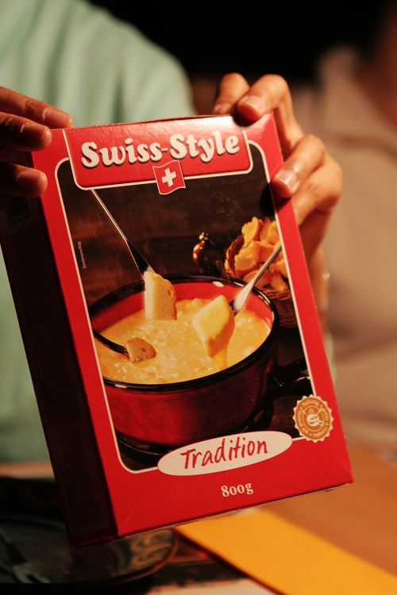
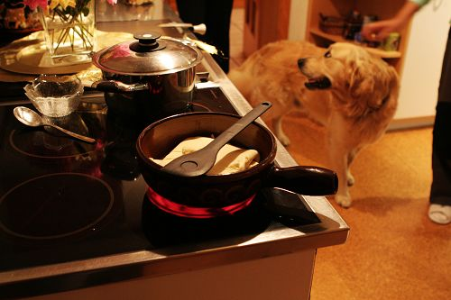
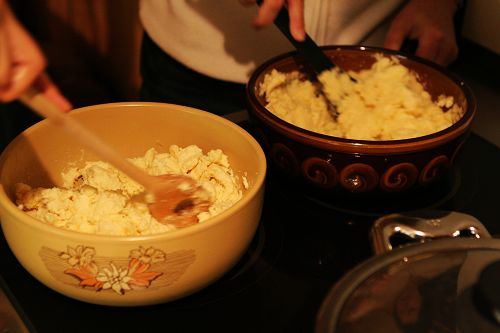
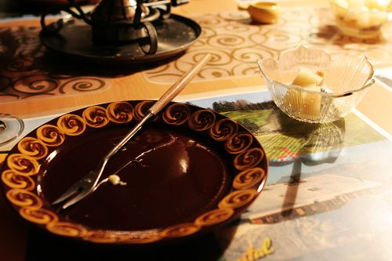
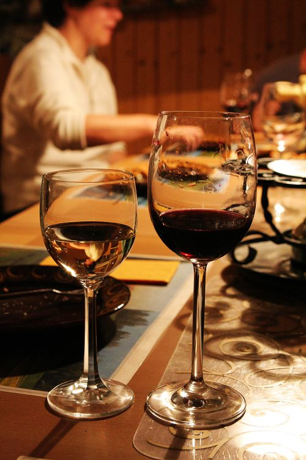
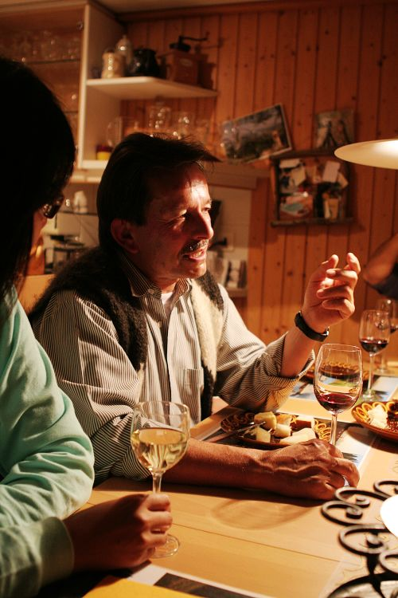
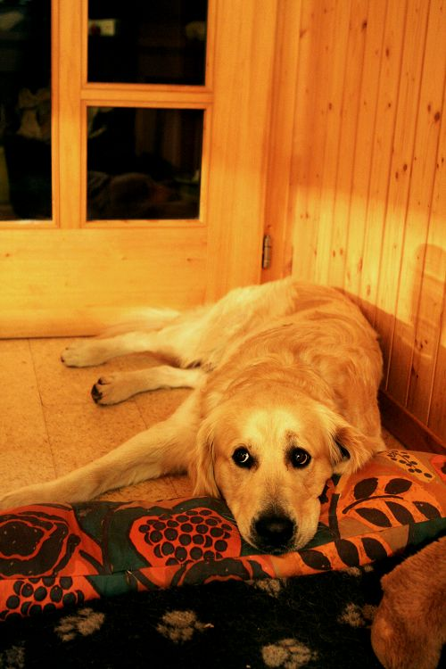

# Ruth+Hans Kern@Berghaus Eggiwil （4）

奶酪火锅用的奶酪品牌；  
  
  
奶酪放入锅里，边加热边用勺子在里面绕8字，一直到奶酪融化为液态状，说实话我觉得有点咸，或者不完全是咸的味道，好象还有酒的味道。但是看他们当地人吃的很享受的样子，连锅底都用面包块擦得干干净净；  
   
   
  
吃火锅用的餐叉，用它叉着面包块、水果块放进融化的奶酪里沾一下吃。上面一截是木头的；  
  
  
仔细观察，主人家永远用矮点儿的酒杯盛白葡萄酒，用小口大肚个头儿高的盛红葡萄酒。端酒杯的方式也有讲究，如果用手掌托住酒杯的肚子，手上的热量会影响葡萄酒的口味，且在碰杯时声音没有端在杯脚处好听。  
  
  
男主人Hans，从雨夜在汽车站等我们就可以看出对客人照顾的非常周到。我离开的那个下雪的早晨他开车送我到Langnau火车站，火车就要开了，我买完票冲上车，Hans将拉杆箱迅速地搬上火车，门关上火车缓缓离开车站，我朝着Hans招手，鼻子忽然酸酸的。回来后，心里还惦记着那家旅馆的人与物，回忆着在那里度过的温馨又快乐的时光。  
  
  
温暖的气氛、温暖的火锅、温暖的眼神。  

---

## 评论（8）

**喜刷刷** · 2009-10-25

他们会一顿饭又红又白吗？每次喝多少？最后一只狗狗的眼神好单纯啊～

**Christina** · 2009-10-25

喝酒还要规定量，那就不是请客啦，对不对，嘿嘿~大家也很自觉的。

**[Sophie](http://www.flickr.com/photos/morena7/)** · 2009-10-26

再放一些有Christina的照片吧, 这是你的故事啊 :)

**Michael** · 2009-10-26

想多看一些大自然的照片

**yy** · 2009-10-26

请教一下签证，这样自助旅行都要商务签证吧，一般人好像不太有机会拿到商务签证

**[三月四月](http://11)** · 2009-10-26

在杂志上看到，红葡萄酒，白葡萄酒，和其他酒，每种的容器都应该不同，这是最佳饮用温度还有和醒酒的时间不同决定的，也是一种乐趣，前阵子看美剧，就对里面的酒杯感兴趣的很

**shuwua** · 2009-10-26

我觉得你出去拍的照片特别好。构图、色彩、光线和故事都不是平常的状态。  
最后一张狗狗的眼神好无辜哦。

**Christina** · 2009-10-26

大概是那里的色彩和光线好吧，处处是景，容易出好片：P

