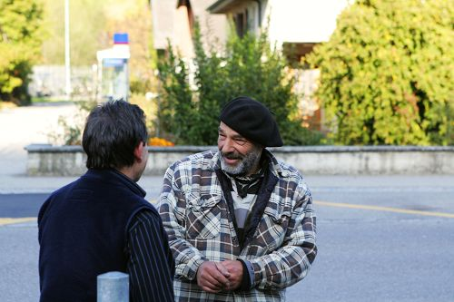
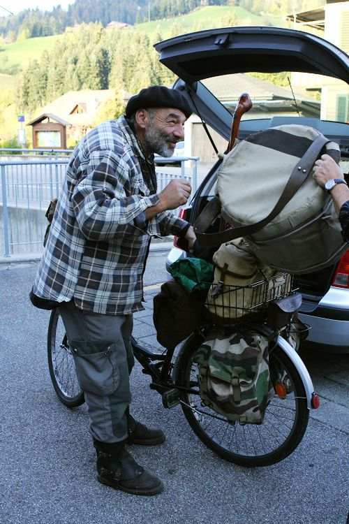
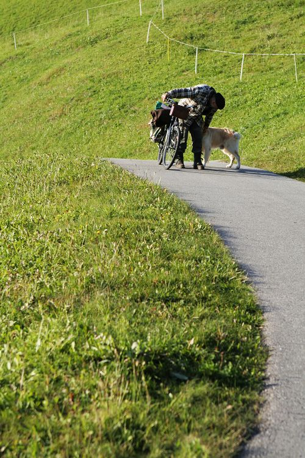
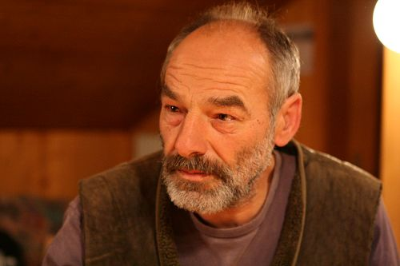
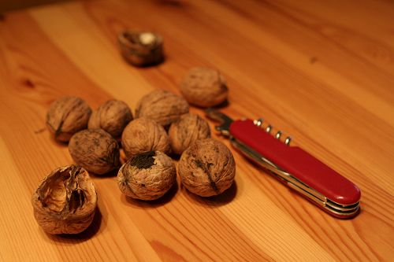
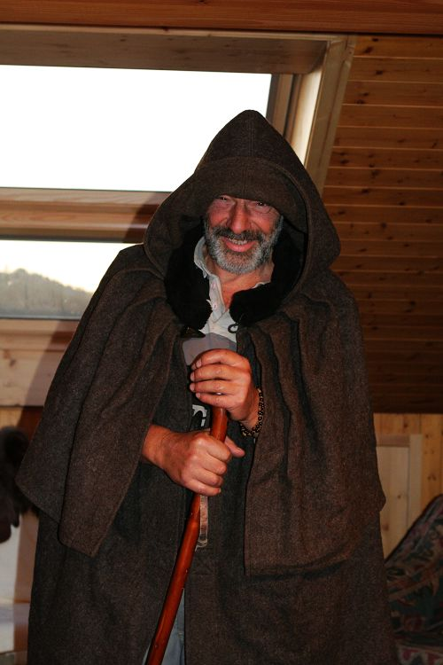
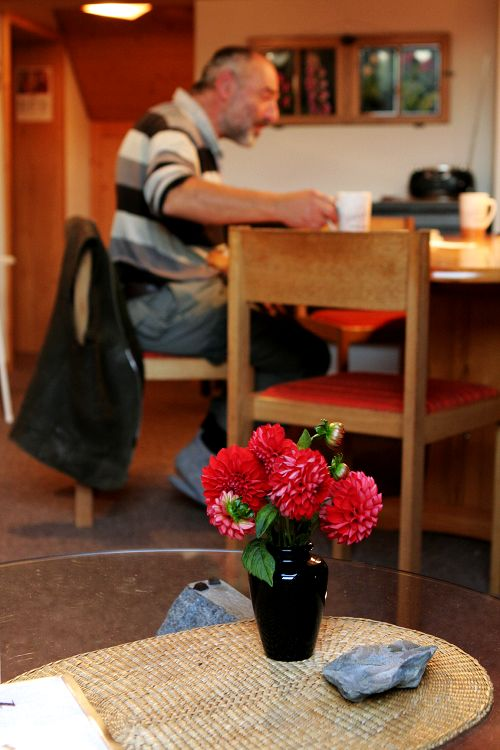

# Bernhard的故事@Eggiwil

晚上打开旅行第一站匈牙利的文件夹，翻看之后仍然无从下笔，除了景点照就是留影照，没有半点故事可以写，或许可以写写那里的天气带给我们最初的困扰？还是等下下篇再写吧。  
  
这篇仍然是发生在Eggiwil的故事，在提及Bernhard时Miranda强调我写下“自行车旅行者”，而我认为一个没有家的人是不是称之为“流浪汉”比较贴切？  
  
Miranda和我于10月14日的下午到达Eggiwil汽车站，Hans开车来接我们的同时遇到骑自行车前来的Bernhard。Hans夫妇于一个月前在外吃晚饭以庆祝他们结婚纪念日，那个晚上认识Bernhard，交谈后对他印象不错随即邀请他一起进餐，Ruth说那个夜晚过得很愉快，告别前还邀请Bernhard来他们家里做客。  
  
据说Bernhard以前是在邮局工作，生产钟表的地方是他的家乡，自第二任太太病逝后，对他打击很大，于是骑上自行车开始欧洲旅行，这样的生活持续了七年。因为长久不工作没能按期交保险，他的医疗与养老保险也被停掉。平时他睡在公园或树林里，打些零工挣点小钱，有时会帮森林里的农户做农活，对方允许他居住在森林的小木屋里。听完这些故事，**我很好奇这七年的漂泊生活带给他的是什么？以及他从这种饥寒露宿的生活方式中是否寻求到精神抚慰？**  
  
Bernhard和我们同一时间到达，住在我们隔壁的客房里，和我们一起吃早餐，午餐和晚餐可能和Hans夫妇一起吃，总之Hans请大家享用奶酪火锅的晚上他也和我们一起。有一次看到他做在沙发上缝自己的裤子，规律的针脚间距，手工活不赖呢。在瑞士的流浪汉也有地方做个人卫生，比如火车站就有提供客人洗澡的地方，只需几个瑞士法郎。所以Bernhard看上去还算干净体面。  
  
Hans在车站看到Bernhard，喜出望外热烈的拥抱他；  
  
  
Hans帮他把行李装上汽车，那个大大的行李包里是一只军鼓，并且Bernhard的行李里还有许多乐谱。说到邮局想到我的一个朋友曾经乐呵呵地说到卖给瑞士邮局的工作服如何赚钱的表情，Bernhard穿的裤子是否就是瑞士邮局的工作裤呢？  
  
  
我们乘汽车先到达旅店，因为道路坡度大，Bernhard推着自行车随后到达。好客的Sky看到Bernhard老远地就迎上去欢迎了。  
  
  
他的眼神里似乎还潜藏着悲伤，他居住在旅店里很自觉主动地找活干，比如帮陈旧的椅子皮带上蜡，扫地，收拾客人用完早餐的餐具，太阳出来他把花草挂上阳台边缘。  
  
  
我们邀请Bernhard一起吃葡萄，之后他从口袋里掏出一把新鲜的核桃，用他随身带的瑞士军刀撬开核桃外壳，我尝了一个，的确与干核桃的口味不同。这些核桃可以在树林里拣到，我们在维也纳还拣到过栗子呢。  
  
  
Bernhard在旅馆期间常常收拾清洁他的衣物，他穿着这件长披风拿着他的手杖秀给我们看，多么古老的装束啊~  
  
  
这张照片是第一个早晨拍摄的，Bernhard在和Miranda聊天，他只会讲德语，所以交流起来得用手势比划，往往也很难理解。希望他能长期在Hans夫妇经营的家庭旅馆住下去，这样也解决了他的生活问题。不知道下次去是否能见到他在那里，或许这一别便是永别？遇到他让我了解不是每个流浪汉都是好逸恶劳，他们有着自己的故事。  

---

## 评论（9）

**喜刷刷** · 2009-10-26

讲故事的时候，你是最好脾气最耐心的。喜欢。。。

**[少爷](http://jennyshaoye.blogbus.com/)** · 2009-10-27

这篇很有人情味. 喜欢那张狗去迎人的照片. 取景取得真好.

**Edward** · 2009-10-27

Thanks for sharing the story!

**frank** · 2009-10-27

流浪汉的生活看来很悠闲轻松，想想我们在美国要供两套房子，生活压力太大了。

**[mercy](http://mercysong.blogbus.com)** · 2009-10-27

看着你讲得这故事，想起《交换日记》里面也有一篇讲流浪汉的，里面那个人会涂了防晒霜坐在公园的长椅上晒着太阳看书，多惬意。最近看《新世界》，这本书的作者也曾经流浪了几年。人，大抵经过这样的历程，生活会变得更朗清。

**[三月四月](http://11)** · 2009-10-27

这样的流浪汉估计很多人都想做，但家人的牵攀，让人要放弃很多

**lilian** · 2009-10-27

独特的视角，温馨的故事。

**候鸟** · 2009-10-27

很像电影剧照：）

**虹蝶碧苓** · 2009-10-28

Bernhard的眼神好复杂，向外是真诚的微笑示好，向内“潜藏着悲伤”。自我放逐而无法回到正常生活中来的人，需要他人的救助。Hans夫妇做得比我们身边所见的人要好得多。

