# Oct.06@HK

光光说的很对，照片尺寸缩小后会损失很多细节，当我翻看这张时，那个晚上的街灯仿佛笼罩着我，栩栩如生的人物流动在画面里，那些女性面部表情生动，叼着烟拖着凉拖或雨靴，对啊，现在很流行雨靴，即使不下雨也有穿，都是时尚惹的祸。我穿着短靴走在香港的街头觉得很闷很热，不知道穿雨靴的MM们是否舒适？亦或象传说中的UGG，即使夏天穿也透气？  
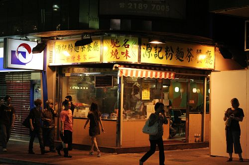  
  
印象中香港街头很少看到开怀聊天的人，所以画面中两位妙龄女郎在街头无所顾忌地抽着烟，裂着嘴大笑着聊天，仿佛春雨袭来，挡也不挡不住被吸引了眼球。  
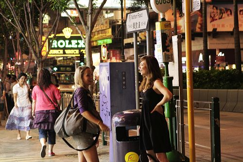  
  
那一抹红让你无法忽视！  
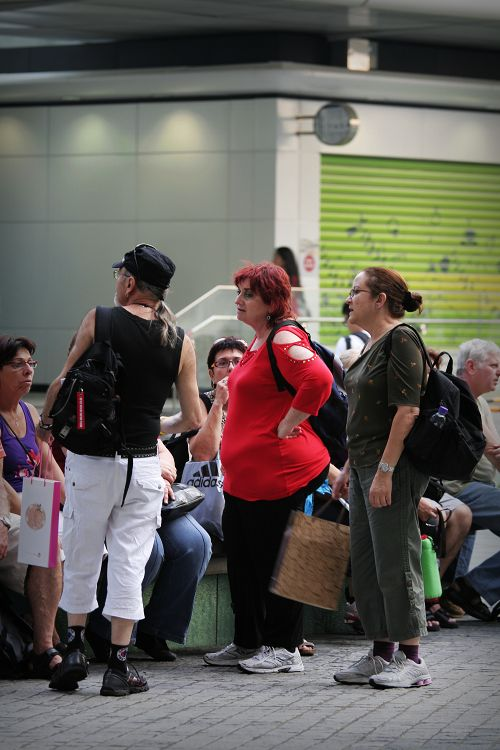  
  
上传这张的原因是因为捕捉到画面中的流动与静止，说明瞎猫真的能碰上死耗子。  
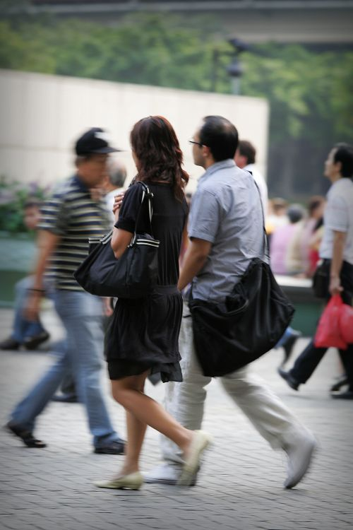  
  
这次去香港在尖沙咀看到许多印度人或巴基斯坦人，象许多欧美人区分不出中、日、韩的人一样我也区分不出究竟谁是印度的谁是巴基斯坦人，有谁能解释香港为什么会有这么多印度人或巴基斯坦人吗？我从Zurich火车总站打车到机场，司机就是巴基斯坦人，在瑞士生活了20年，知道我从中国来马上竖起大拇指称赞中国人心肠好，如何援助他们而不求回报，说巴基斯坦和中国是好兄弟，我一听到“brother"就晕，总之不可避免的想到中东人，想到某些人拍胸脯搂肩膀的相互称兄道弟的情景。  
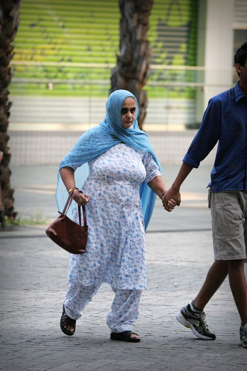  
  
一个学生妹穿着校服穿越繁华夜市，左前方不远处一个打扮甚是妖娆妩媚的中年妇女坐在国际桑拿店门口招揽生意，右边一排身形活跃的市民在等车，下班后的时光总是令人愉快的。  
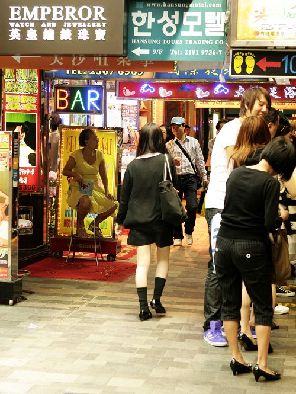  
  
我爱拍创意橱窗。  
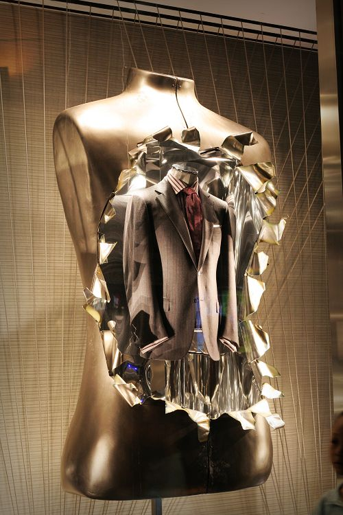  
  
为避开南京海关我选择往返深圳的飞机，这样从欧洲返回带的东西可以避免开箱检查或扣押的风险。南京机场的国际航班少，海关同志们没那么多事就会找事干。曾经亲眼看到海关要求一个小年青为他手上的MP3交税的一幕，小年青很拽地坐在那里与他们理论，多浪费时间啊，成全他们好了，要么就避开这帮孙子。那么深圳往返香港多亏了蔡蔡指点帮忙，感激呐。当我返回香港时，她居然还要请假来陪我，这女人也太有责任感了，飙泪~  
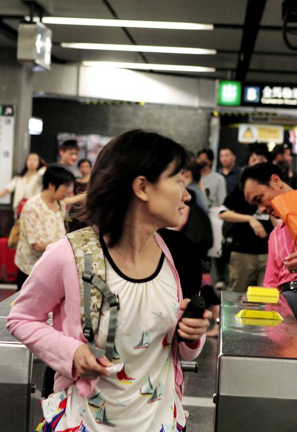  
  
我们俩在广告牌前，香港人的表达在内地人看来的确比较搞笑。  
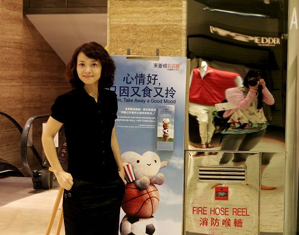  
  
出发前Helen和Miranda挤在一张床上翘脚。  
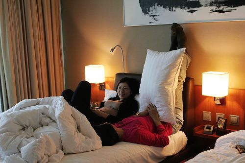  
  
时间尚早，我们三儿准备看场电影，因为时间问题无果，但寻到这张搞笑指示。  
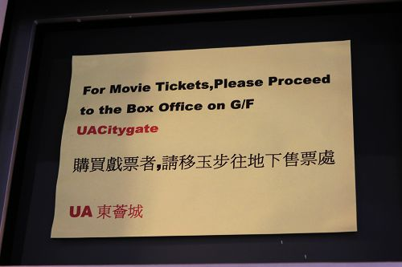  
  
不知道内地是否会上映？  
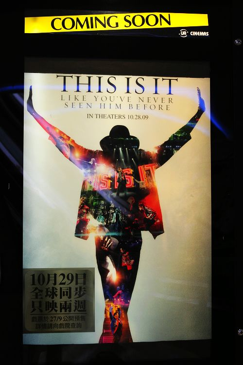  
  
总叫俺上片子，瞧瞧Helen举着啥？我琢磨着在她相机里究竟有多少不错的PP？反正她和不爱照相的Miranda在我相机里有许多惊艳之作哦~开始我拍Miranda，她总是低着头或挡着脸，后来在瑞士发现她开始配合我拍照了，这就是成功。以前我姐姐也不爱拍照，后来还特地喊我出来帮她拍。  
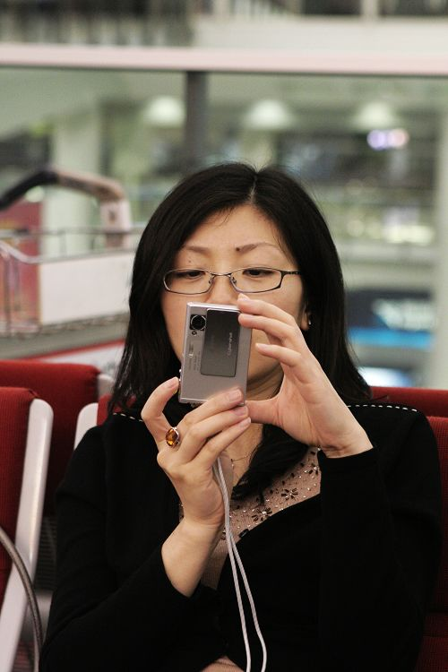

---

## 评论（10）

**喜刷刷** · 2009-10-27

10.28全球同步上演，来华纳看吧。

**[少爷](http://jennyshaoye.blogbus.com/)** · 2009-10-27

茶的拍照技术还真有待我好好学习之

**aimda** · 2009-10-27

提前预约下你的相机。每年一组照片很满足地。谢谢。

**[三月四月](http://11)** · 2009-10-27

哇哇！茶那张照片真是好看！还有那个街头橱窗，也挺有意思

**lilian** · 2009-10-27

那天一朋友看了我出去旅游后拍回的照片竟然以为是用单反机拍的，还让我推荐相机呢，哈哈，真开心！

**[shanshu](http://shanshu.blogbus.com)** · 2009-10-27

你那张照片真漂亮.是不是又瘦了点了?

**okdata** · 2009-10-27

Good taste, nice lady

**rebecca** · 2009-10-27

茶真漂亮啊，女人美的味道在你身上都可以看见！

**frank** · 2009-10-27

中国人也到处都是，特别加州。

**Anyayaya** · 2009-10-27

啊呀呀，茶劳祀嘲笑人捏！大餐（单反）吃不上，弄盒盒饭（傻瓜）吃吃咂巴咂巴嘴，阿行啊？ ：）

