# @Budapest

从香港乘瑞士航空到Zurich机场换乘飞机到具有“中欧巴黎”之称的Budapest，第一程11小时，第二程2小时，我的眼镜左边鼻架脚不幸在航程中被弄断，仅靠右边一只鼻脚架支撑了一天。Budapest比我们预计的要热许多，完全象在夏天，奔波13小时下了飞机是早晨9点多钟，如果我没记错的话，下了飞机就开始逛。浑身肌肉象发酵的面团略有浮肿，挂着一脸疲劳和松弛行走在本应悠闲轻松的旅程中，惊觉Helen皮肤的质感出奇的好，除了遗传基因外，和她每日早睡也有缘故吧？Budapest给我最深的印象是年轻的俊男靓女多，身材比例好，连7、8岁的小朋友身材也象舞蹈演员一样。老年人不多见，也许白天都呆在家里了？  
  
晚上和香港的Esther住一间房，本以为我的行李箱已经很大了，结果她的箱子比我的还要大，不经意瞅见里面装的大多是长衫棉衣长裤，想到这么热的天气不禁哑然失笑。我这人就这么奇怪，形势不利于我的时候我真的会认为有意思而笑起来。  
  
“天气很热，没有带太多短袖啊。”我说道。  
“是啊（拖着长长的尾音），怎么搞呢，一件短袖也没有啊。。。。。”Esther拖着长长的香港音调，嗑磕巴巴地寻找她熟悉的普通话词汇回答我。这一晚她并不想和我多聊，后来才了解的确是因为她不适应说普通话才有如此反应。经过几天的相处，对Esther越来越喜欢，下车看到美景，她会不停赞叹“哎呀，太美了，哎呀，多美啊。。。”然后举起相机，在布拉格即将结束的那个下午她相机里的储存卡便用完了，我们俩摄影的疯狂程度不相上下。东欧之行最大的收获应该是结识了这些香港女孩儿。  
  
乘船游览多瑙河，是许多游客在Budapest的首选项目，多瑙河将Buda与pest两个城区分开，这条河上由Margit hid、Szechenyi Lanchid、Erzsebet hid和Szabads hid这几座桥梁承担着两座城的交通，其中最引人瞩目的是Szechenyi Lanchid（锁链桥），建于1839-1849年。  
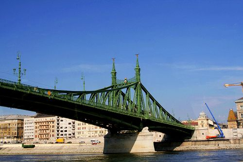  
  
一群好奇的孩子在多瑙河边围观鸽子吃食。  
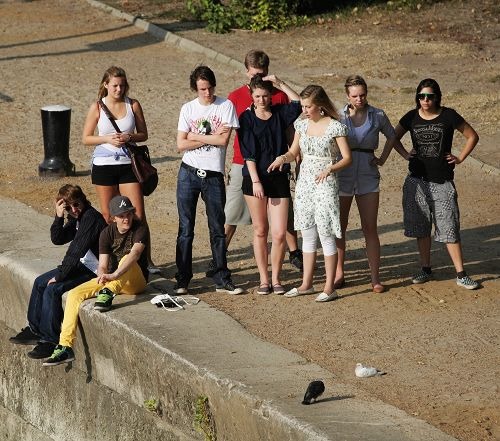  
  
游船驶过新哥特与巴洛克风格相结合的国会大厦，沿多瑙河边而建，历时17年完成。  
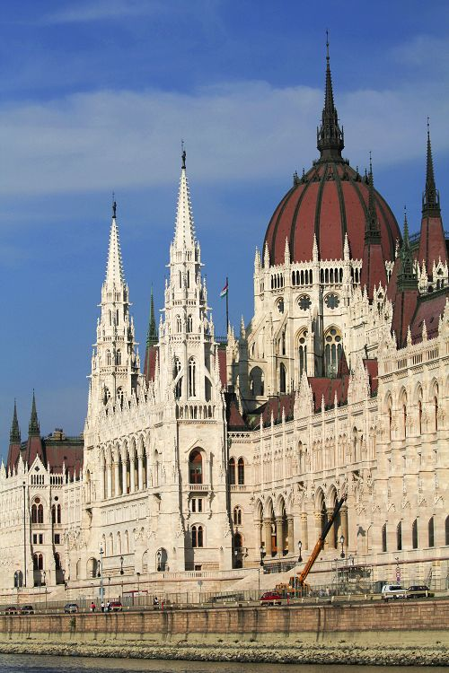  
  
曾在凤凰卫视节目上了解到这些裸体雕像的私处本来是裸露的，受到宗教权势压力后来加上去的遮掩物，比如位于Vaci utca（瓦采街）雕像上的树叶。  
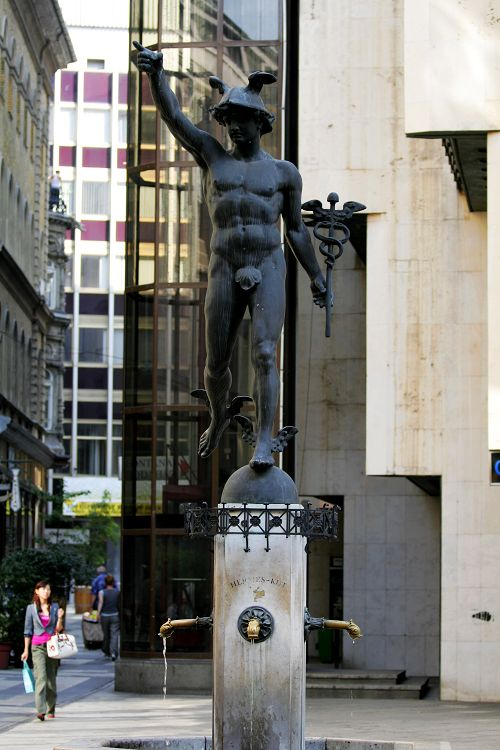  
  
匈牙利皇室原先只使用东方和西欧的瓷器，原本只生产粗陶和实验陶瓷制法的小型工厂在1839年Fischer接手之后在他努力下业务扩展及技艺研发非同寻常，以至于使得他们始于1826年创立的Herend成为匈牙利瓷器第一品牌，并被匈牙利皇室及欧洲各国王室所喜爱。  
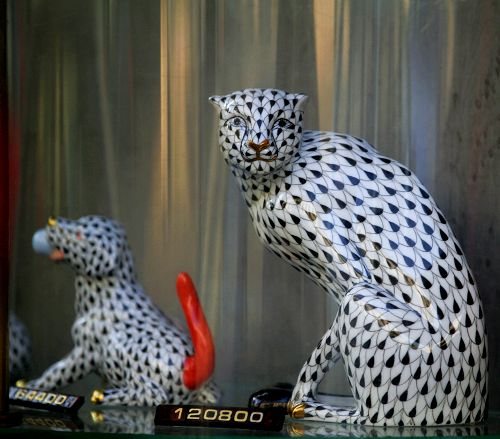   
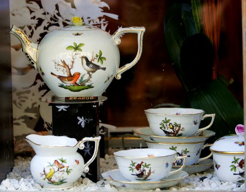  
  
有个人在Budav ri palota（布达皇宫）里傻笑，这个人经过13小时的飞行，身背7公斤的摄影器材，戴着一只鼻架的眼镜，拖着浮肿的身体见到如此辉煌的建筑能不傻笑吗~  
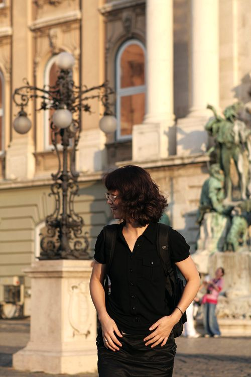  
  
当地人给我的印象不那么拘泥一格、沉闷严肃，装束的色彩较其他欧洲城市丰富艳丽。  
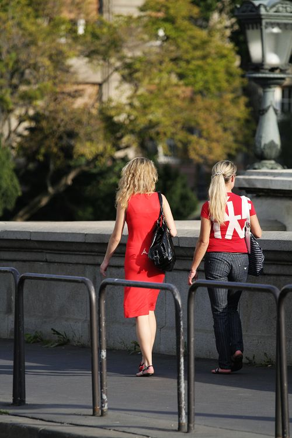  
  
这位皮肤超好的女士轻盈地迈着观光客的脚步行走在多瑙河附近的广场上，周遭俨然是落英缤纷金灿灿的秋色。她手中拿的不是网球，而是一枚翠绿色貌似网球的果实。  
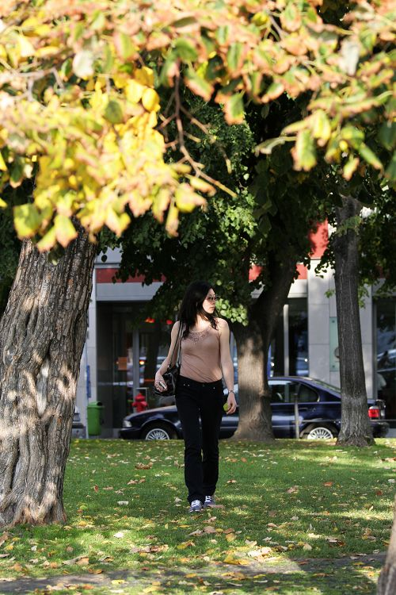  
  
香魅啊~  
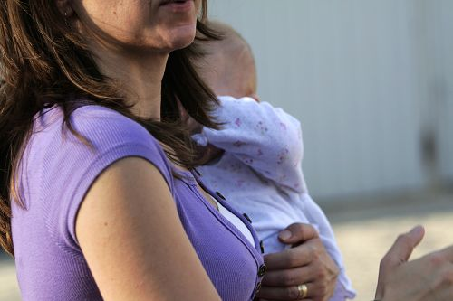  
  
中世纪时渔夫为防御入侵者所建造的碉堡，我只拍了冰山一角。夜晚的渔夫堡最迷人，在灯光衬映下仿佛童话中砂糖城堡或是沙滩上的沙堡。  
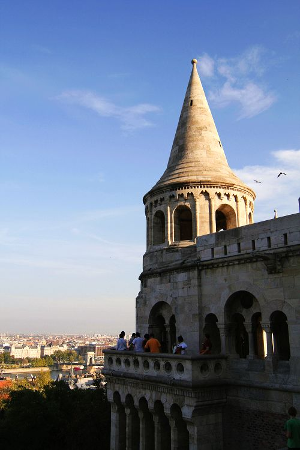  
  
严肃的老妇人，不可思议的脚踝，小宠的舌头一直斜着耷拉在嘴外。  
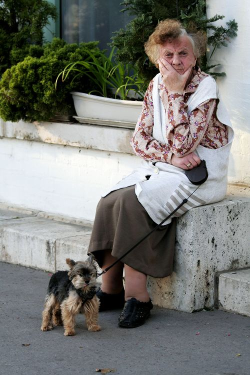  
  
多瑙河边一个人的世界。  
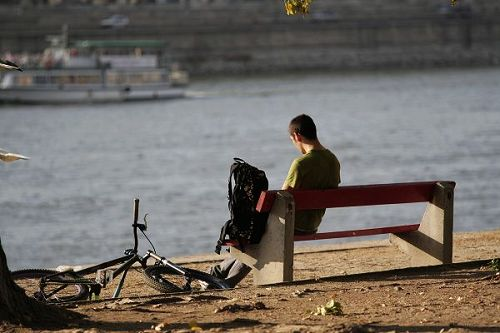  
  
18世纪这里的居民为纪念黑死病的消除在Szentharomsag ter（圣三位一体广场）而建的纪念柱。  
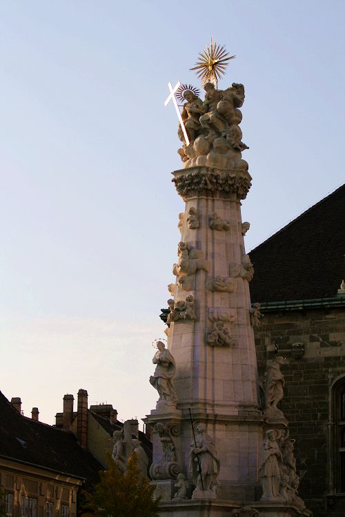  
  
Budapest的电车具有浓浓的东欧风味，主要行驶于市区多瑙河两岸和主要道路。  
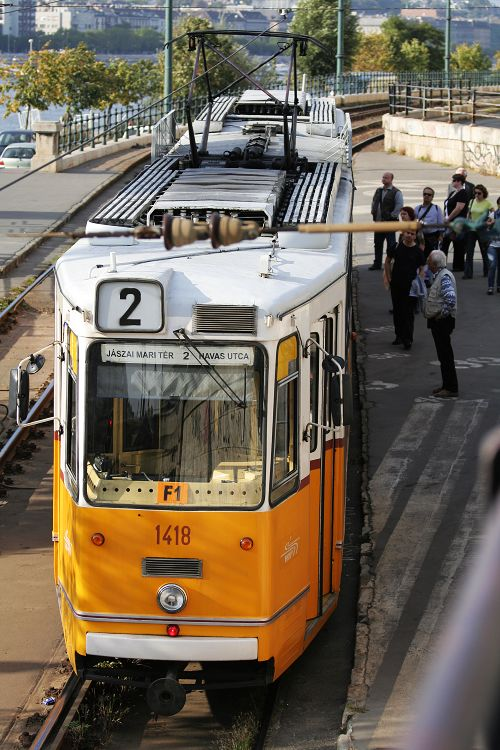  
  
粉红色小女孩，旁边是深红色母亲，母女俩等公交车的同时把梧桐树的落叶当花一样聚拢在手掌里玩耍。  
  
  
普通居民住宅楼  
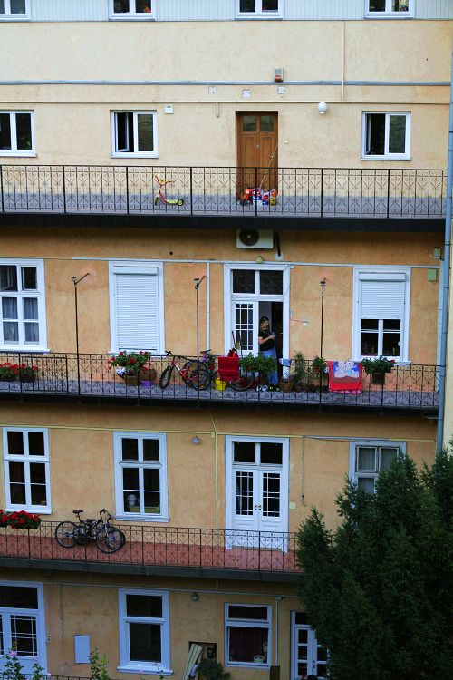  
  
Helen换了一些Budapest货币，我们仨儿在瓦采街的Habana Cafe稍坐休息，喝酒、喝咖啡、喝茶。  
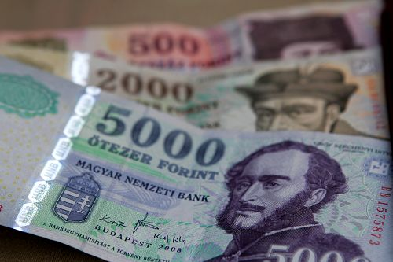   
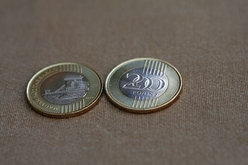  
  
宫廷古典布偶。  
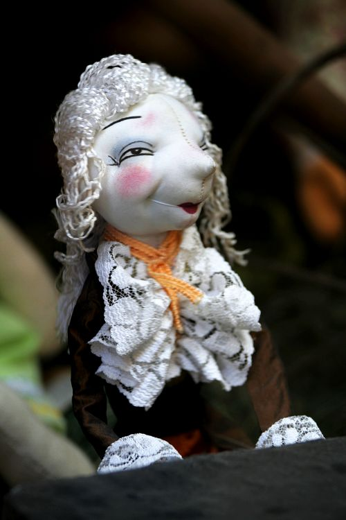  
  
古灵精怪的玩偶。  
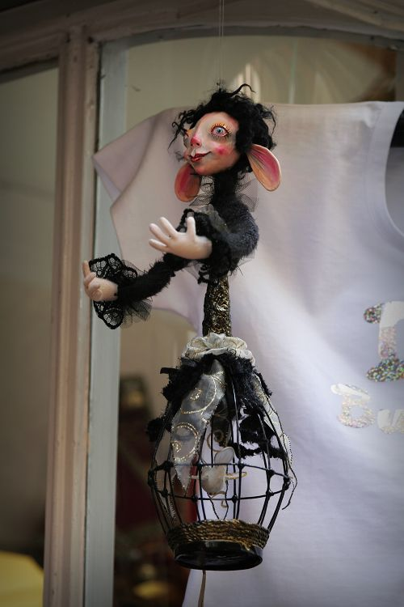  
  
大头先生。  
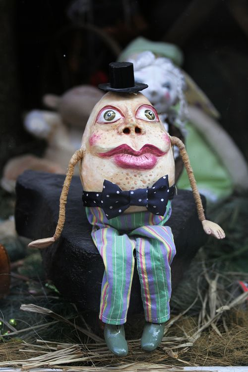  
  
Miranda好奇瓦采街的这家餐馆，询问之后得知建筑有上百年历史，餐馆岁数小。  
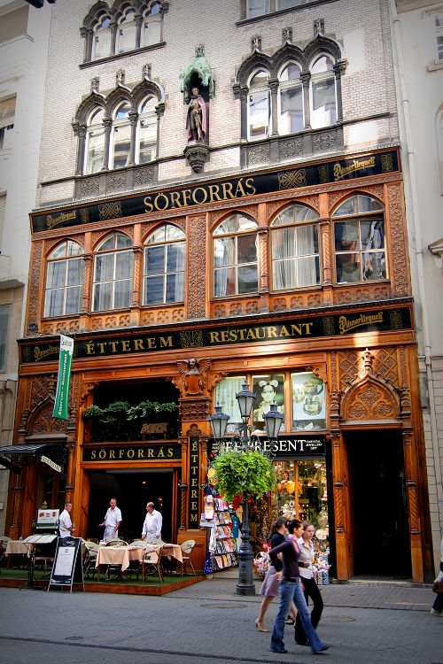  
  
夜晚的Buda城，保存了许多重要的中古遗迹，对岸的Pest城为现代都会，据说Buda是生活区，Pest主要是工作区。北京、香港有直飞Budapest的航班，Budapest有七个火车站，其中只有三个停靠国际线火车，布拉格到此每天仅有一班直通火车，维也纳每天约有七班直达火车。  
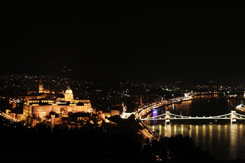  
  
夜晚在Budapest最高点的古堡餐厅里用餐，有当地风情的音乐、舞蹈和歌唱节目的表演。开始大家还聚精会神地看小提琴和风琴表演，到了要小费阶段，再高雅的艺术也沦落到求生的本质上，尤其表演未结束前用餐结束的游客陆续走出餐厅，看得出他们是经过专业训练的艺人。如果象维也纳那场音乐会一样，有专人收钱，专人负责场内秩序，两者性质相同，但经营方式却能维护艺术尊严及表演者的体面。我不爱看这种表演，不是技艺不高，而是作为观众和表演者都会感到尴尬吧。  
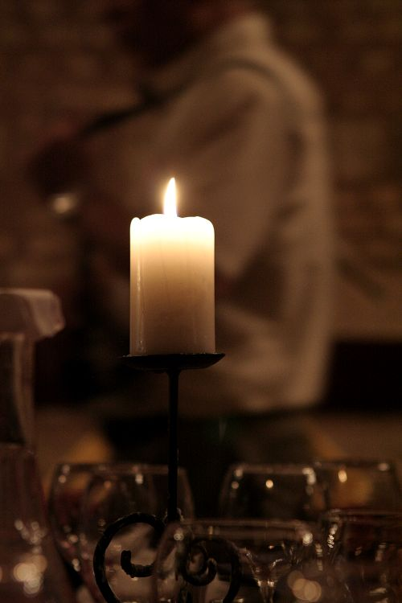  
  
享受旅行的游客。  
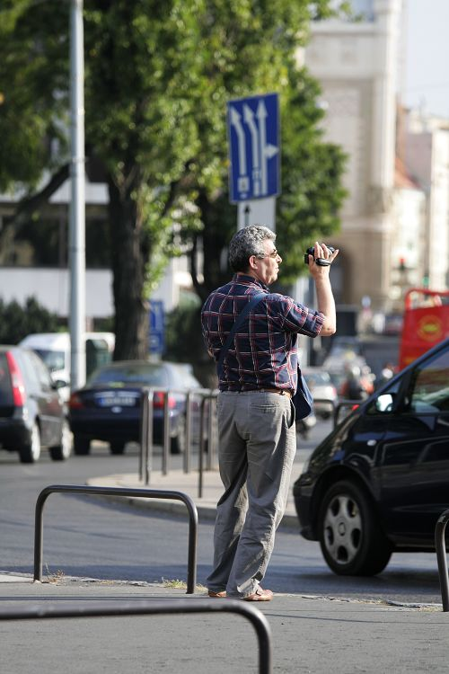  
  
和Helen在Hosok tere（英雄广场），Budapest最赏心悦目的林荫大道尽头处的Hosok tere建造于1896年，为纪念匈牙利建国1000年修建。广场两侧各有一座美术馆，其中包括匈牙利国立美术馆，收藏了不少名家作品。  
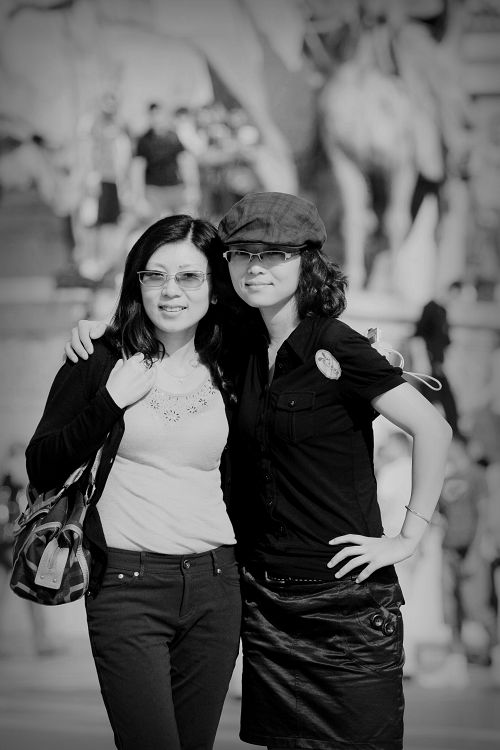  
  
Budav ri palota（布达皇宫）附近的游客。  
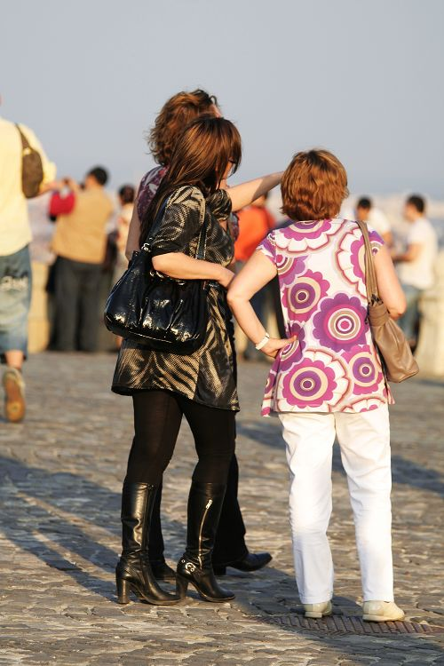   
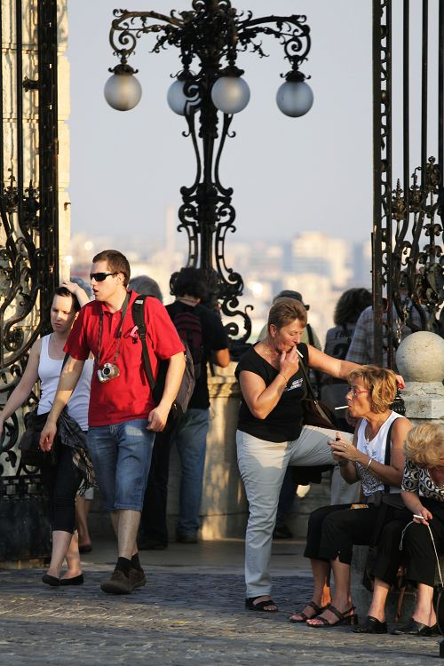   
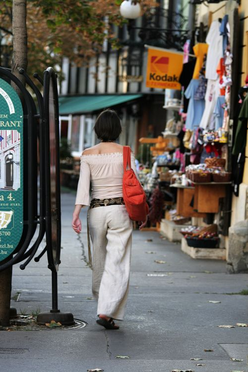   
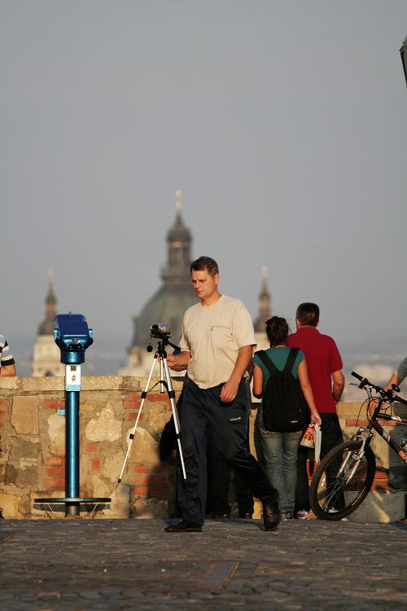  
  
戴黑礼帽的女骑士，拿着苍蝇拍为她的马匹驱赶苍蝇。  
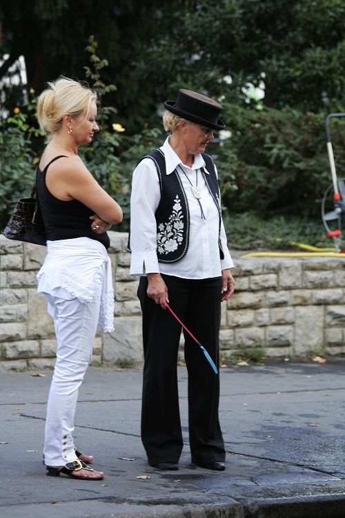

---

## 评论（22）

**喜刷刷** · 2009-10-27

写篇游记不易啊，估计还被你省略了不少，略知布达佩斯一二了。

**灰子** · 2009-10-28

嘎美的城市，跟电影里一样。

**[光光](http://gaoguangguang.blogbus.com)** · 2009-10-28

国会大厦那张一级棒。你的镜头肯定超好，我的狗头拍出来的照片总是黑乎乎的。当然主要是我技术差，别人用我的相机拍出来的都比我拍的好，为此我很生气，所以不要这个相机了。人物那张怎么弄成黑白了，欧洲好像彩色照片好看，因为色彩好看。我上班的地方到处都是那种网球果，比网球大，车一压就是一地的黄浆，跟屎一样，还是稀的。那个古灵精怪的玩偶参加万圣节能得最佳装扮奖。

**[光光](http://gaoguangguang.blogbus.com)** · 2009-10-28

还有布达佩斯的人们小胖哈，美国是大胖。

**[少爷](http://jennyshaoye.blogbus.com/)** · 2009-10-28

茶真的很有耐心写游记和发照片,赞一个

**emma** · 2009-10-28

照片拍的真好，前两个月我bf父母也去了匈牙利，完全没有看出来好风光。这下算是补上了:D

**Christina** · 2009-10-28

基本这些照片中的人物和建筑是用“爱死小小白”镜头+350D菜鸟机身拍的，很适合远距离偷拍而不让对方察觉到。镜头表现力很棒！那个网球一样的果实能吃吗？以及东欧的人身材比较高大挺拔，养眼呢。光光有没有发现其实瑞士人好看的不多？且身材相对比较小。

不做这样的整理，会有囫囵吞枣的感觉，温故而知新嘛。整理照片比较花时间但看到拍的好的照片，心情会为之一振，有时甚至是激动。香港的Esther会为拍摄物从不同角度拍摄照片，我觉得这种痴迷摄影的程度我还没达到，不过摄影总能让我保持兴奋状态，这点是我希望保持的。

**Christina** · 2009-10-28

我有在布达佩斯拍到一个巨无霸，长得象“帕瓦罗第”，呵呵~超级胖，只能用背带提着裤子。

那些玩偶特别在眼睛，大概因为国内的玩偶大多是黑眼睛，而这些玩偶的半透明状的各色眼睛，好象能望到人心里面去。

**[光光](http://gaoguangguang.blogbus.com)** · 2009-10-28

哎呀呀，不能吃，象屎的东西怎么能吃呢。瑞士山区的人可能长得比较朴实，本身也比较朴实嘛。我记得我们当时在哪个城市，苏黎世吧，去了一个酒吧，里面的人好漂亮的，全部象公子哥儿，还是有钱的那种，当时我们狠流哈喇子来着。东欧的人也一般吧，全世界纽约男的最好看。我觉得。

**Christina** · 2009-10-28

传说中意大利男人比较帅，真到了意大利也没觉得有多帅，呵呵~纽约男人比较精致吧，有看到《白天纽约，夜晚巴黎》的文章吗？

**灰子** · 2009-10-28

哈，又加了点照片！那家餐馆感觉真好。西欧人是活在天堂里啊～

**[joanna](http://yanmer.cn/blog)** · 2009-10-28

本来挺美的，看光光的评论，屎啊屎的，又多了想笑的乐趣。一身黑很好看，东欧的人是不是和中国人一样，喜欢穿色彩浓烈的服饰？  
漂亮啊，正计划明年春节的行程，犯愁中

**karen** · 2009-10-28

真没想到茶拍的照片这么棒～ 真是养眼，人跟景都拍的蛮好的嘛，背着这么沉的包能拍出这种效果的片子来也很值哦！我是尼康的机器，但估计是我技术太烂，反正我是拍不出来这样紫的哦～

**joy** · 2009-10-28

好美的地方  
照片画面感超好，色彩、取景都好好。

**lilian** · 2009-10-28

黑白那张超帅，是我喜欢的Type．

**lilian** · 2009-10-28

看到“身背7公斤的摄影器材……”，我彻底折服了！

**ILN** · 2009-10-28

光光,You seem full of s\*\*t lately. Would you please do us a favor, leave it in your own home before you head out?

**陈问** · 2009-10-28

居民楼那张也好美。构图也好 。你在风景里，自然随意啊。每天跟踪你博，简直成为我生活一部分了

**[光光](http://gaoguangguang.blogbus.com)** · 2009-10-29

《白天纽约，夜晚巴黎》没看过，是小说吗？纽约男的就是比较有个性和气质，当然也不是所有。意大利的还可以啊。你这次也去了意大利？没听你提。

**ILN** · 2009-10-29

光光;  
Who are the New Yorkers? Have you given any thoughts to it? Let me shade some light for you. The people you saw on the New York streets are made of; (my rough estimates) tourists, business travelers, students, diplomats, office workers and street workers (mostly newer immigrants). New York is big melting pot and its people are from all over the states and the world. Most people live there for a few years (or for many years), then they leave. Just like a bus, people get on the bus and get off the bus. But not too many of them are riding the bus from the beginning to the end.   
So when you say you like the New York males, in reality, you are just saying you like male in general (or everyone who is a male).

**Christina** · 2009-10-29

以前去的意大利，我也喜欢居民楼那张，比景点照更亲近有味：）

**shwua** · 2009-10-30

即使东欧，钱的质感也比人民币好得多。从钱可以看到一个国家的文明程度。

