# Super doggie！

昨天到今天茶又被[**“豆瓣9点”**](http://9.douban.com/channel/life)的反向链接覆盖了，从开始的3人对茶的推荐到现在的14人，好奇地点进去看这14人的豆瓣，kar推荐的小组话题里有一个标题[**“欧洲。47国，120 天。11万。明年五月”**](http://www.douban.com/group/topic/8471206/)，天呐，不上班玩4个月？11万人民币？挺奢侈的，如果只是吃住行的话，花不了那么多钱吧？还是被这个计划小小的震撼了。有意向有闲有钱的主儿可以报名参加，希望旅行计划不要那么赶就好。以及[**“人生就象茶几 上面都是杯具 ”**](http://www.douban.com/photos/album/20041160/)也有意思。   
  
昨晚没更新，因Luke患了肠炎拉肚子，带它去瞧医生，又是打针又是挂水折腾到快10点才到家。上周五晚上接它回家，第二天和一帮朋友开车去外地吃螃蟹，午饭喂它好吃的人多......小家伙忍耐力很强，扎针打针一声不吭，丝毫没有挣扎，我怀疑它是否有痛神经？从宠物医院回来它居然叼着玩具玩起来，一点没有受到影响似的。简直是Super doggie！  
  
ZQ的留言提醒了我，国外对狗的宽容可能是我们大多数中国人无法理解和想象的，在我去的欧洲国家，几乎所有的狗可以和主人一起去用餐，喝咖啡，逛商店，上火车，公共场所常常见到它们可爱的身影，更别说公园了，就连维也纳美泉宫周围的园子也可以见到宠物狗在玩耍，你说咱故宫的园子里可能看到宠物狗吗？南京好一点的草坪都被圈起来，禁止人和狗进入。中国公园是万万不允许带狗进入的，除非是专门为宠物建造的公园，这样的公园大概只有上海有。  
  
Animal Planet频道曾介绍美国凤凰城的动物警察，有期节目讲几只大丹犬幼崽因为环境卫生问题而生病，被人举报，动物警察前来拍照取证，获得合法收养权带走幼崽，并帮助它们康复等待市民收养。比如出车祸、被虐待的、对狗不负责任的主人....等等，会有相应的救助及惩罚，有的甚至还要上法庭。我所看到的国内养犬现状是警察只管收钱打针、罚款和打狗，至于狗狗丢失，被虐待，被谋杀等等一切不利于狗狗的行为，没见警察管过。  
  
住在瑞士乡下时Hans说有个美国人，为了带他的狗一起到欧洲旅行，选择乘船从海上走了4-6天到达Eggiwil，家庭旅馆的相册上应该有这个美国人和他的狗的照片。选择航空也可以托运宠物，但必须与主人分开，被关进笼子放在货舱里，这会不会是主人选择海运到欧洲的原因？  
  
我当然很想很想带着Luke一起去旅行，估计出咱中国海关问题最大，以及要做动植物检验检疫才可能让宠物出国。走一圈下来，就咱中国海关安检最负责，有一次居然让我把靴子脱下来检查。即使这样，在整个旅行期间我的随机行李里都放着打火机，回家才发现，居然没有一处海关的安检机器检查出来，说明什么？说明恐怖活动仍然有机可乘！  
  
回来后见到我的人都说：“哎呀，你瘦了啊！”旅行多辛苦啊，的确瘦了，但咱还可以养回来的嘛。有个家伙说：“旅行记录就一篇啊？”那是你笨吧？请找到界面左下角的“**Previous**”，点击它，界面会翻到前一篇日志，以此类推。考虑到近期图片较多，多篇日志显示在茶的主界面上，回使得页面下载缓慢，设置一页只显示一篇日志，方便茶友。  
  
@苏黎世火车总站  
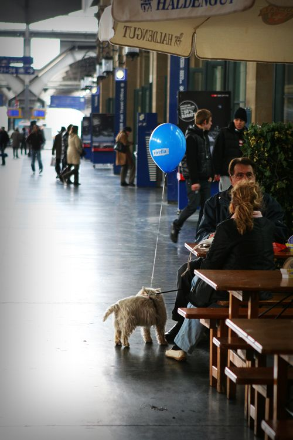   
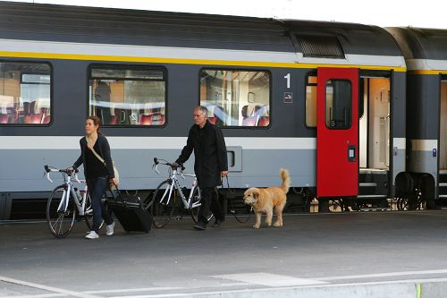  
  
@斯洛伐克  
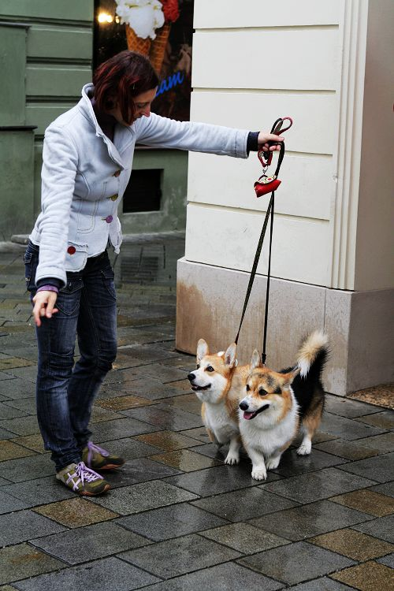  
  
@维也纳主要商业街  
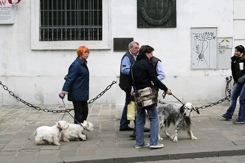  
  
@布拉格古城街道  
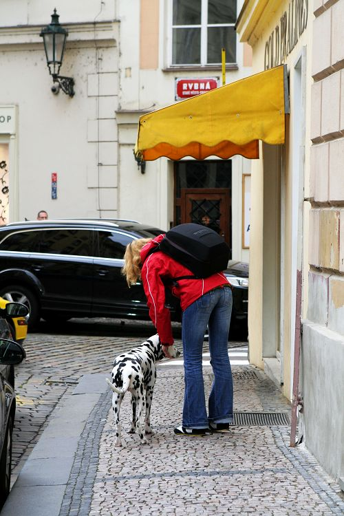  
  
@瑞士的图恩  
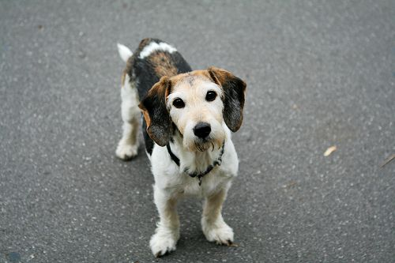  
  
Ruth+Hans旅馆的Sky  
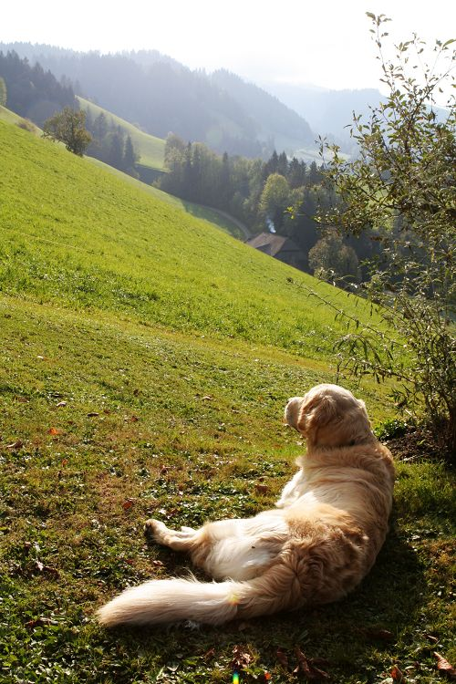  
  
@捷克-克鲁姆洛夫   
一大早，这只古镇上的英国可卡犬可能刚睡醒，被主人牵在公园坐椅上，主人去办事了，它就坐在那里等。  
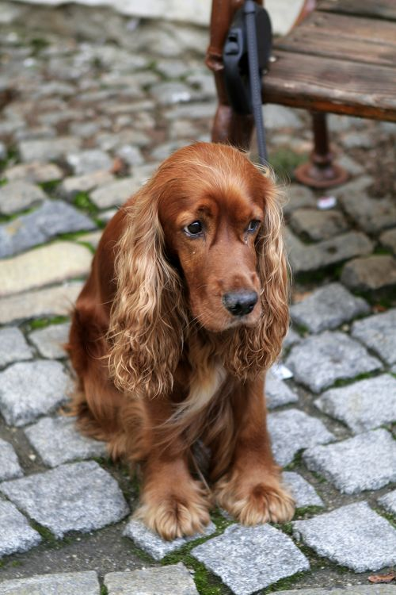  
  
@苏黎世 班赫夫商业街  
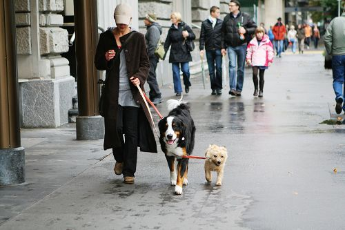   
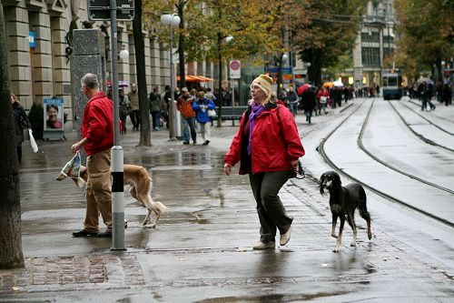  
  
班赫夫商业街的盲人与导盲犬，注意他左脚下面是专供盲人等车设置的盲道。面对镜头的小胖子是有轨电车工作人员，上前来牵引盲人上车并安排好座位。这就是高度文明社会的体现吧？！  
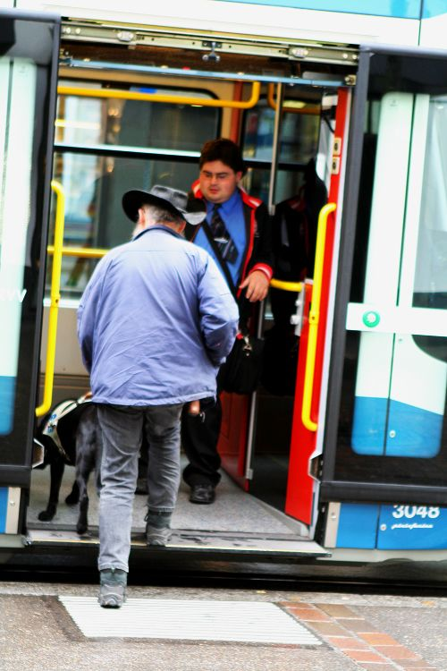   
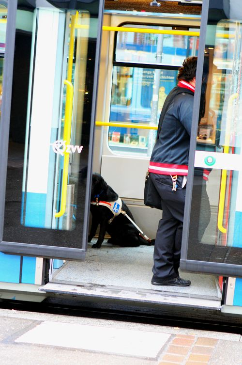

---

## 评论（25）

**zq** · 2009-10-29

想知道当你欧洲归来时LUKE见到你的情景，它什么表情啊？呵呵

**Christina** · 2009-10-29

超级粘我，开心地笑，后来几天生怕我抛弃它似的，总之很粘人，回到家啥事没有它自个儿裂着嘴浅笑，那样子很逗呢。

**zq** · 2009-10-29

要是能带LUKE一起去EGGIWIL多好啊！还有我，我这辈子还有个人生愿望，就是去EGGIWIL住上几天…….

**Christina** · 2009-10-29

拜托，这个理想对你还不是很容易么！你想什么时候去就能去。

**lusfe** · 2009-10-29

那个豆瓣的“欧洲。47国，120 天。11万。明年五月”我怎么没找到呀？

**[joanna](http://yanmer.cn/blog)** · 2009-10-29

看过一篇报道，四川某妇女，老公在日本多年，一直是狗狗陪伴，终于可去日本团聚，为了带它，检疫、条款什么的弄了半年，国外的海关也不认可中国的检疫，还将样本送去日本化验……周折。上点Luke的照片吧

**Christina** · 2009-10-29

昨天KAR上面还推荐的，今天的确找不到这帖子了，是豆瓣一个叫happypiggy的人写的。

**frank** · 2009-10-29

六个月太长，最多在外面旅行十天，现在很少长旅行，其实CAMPING是很好的休闲方式，今年我们一百多家一起CAMPING，很有意思。

**Lexi** · 2009-10-29

以后还是少给Luke吃我们吃的食物吧，这样对他们身体不健康，美国这边养狗的一般都只给狗食，偶尔才会给点我们吃的剩饭。我的不少美国朋友家里有狗的，吃饭时都不让狗在旁，不让他们养成讨食的习惯。  
不过狗狗们在西方国家是比较幸福些。

**Christina** · 2009-10-29

恩，这次吸取教训了！那天去吃的还是螃蟹….不晓得一群人都喂它吃什么了。

**zyz** · 2009-10-29

柯基！希望狗狗们能在中国逐渐享受到日益完善包容的待遇！

**陈问** · 2009-10-29

希望LUKE身体很棒的说。  
那只可卡的眼神象K，偷偷摸摸的，哈。

**lilian** · 2009-10-29

我这个国庆也出去旅行了。。发现出去反而吃得比平时多，来多少吃多少，可能是对旅途劳累的一种补偿吧，所以照片拍出来不见瘦反而多了一个肥肚肚。。郁闷哦～

**喜刷刷** · 2009-10-29

Luke，身体好些没？有空打我电话，接你出去玩～

**[shao ye](http://jennyshaoye.blogbus.com/)** · 2009-10-29

poor luke. It’s crazy to stop people and dogs walking on the grass…

**[光光](http://gaoguangguang.blogbus.com)** · 2009-10-29

我的一个美国同事，每天上班就把他的狗Belle送去狗幼儿园，下班去接回来，跟小孩子一样.办公室很多Belle的照片，刚拿到小狗的时候，还开一个欢迎的party,让大家和Belle见面。他的儿子上大学了，现在Belle确实就是他的孩子。Belle就是少爷有的那种狗，长得很大，很帅，都上我们这里的宠物电视了。那只趴在山坡上的sky真舒服。介绍你看一本书，近似儿童读物《The good dog》by Avi. 本来我是cat person，看完都想养只狗了。

**Christina** · 2009-10-29

Belle是意大利语里“美女”的意思啊~呵呵~养猫容易被传染上弓形虫病，养狗被传染的几率不大，建议你养狗吧，不过你得腾出时间来陪伴它，得每天花时间遛，如果没有这样的时间，最好放弃，免得到时候狗狗和主人都受折磨。

**[光光](http://gaoguangguang.blogbus.com)** · 2009-10-30

对，就是这个陪伴的问题，每天遛它倒是没问题，就是如果要出门就不知道怎么办，也许等我再老一点，真正安定下来就养一只大狗，一只小狗，一只猫，一只乌龟，两只鸟，一只蜥蜴，几只鱼。猫只要经常检查弓形虫就没问题。

**Christina** · 2009-10-30

天呐，养这么多动物你会很忙的！你准备养多大的蜥蜴啊？

**frank** · 2009-10-30

连人权都不尊重何谈狗权，在中国，人都养不活再养十几亿狗猫，还是多关心人吧

**[三月四月](http://11)** · 2009-10-30

哇！我喜欢柯基犬！

**大姜炖去** · 2009-10-30

luke好点没

**shwua** · 2009-10-30

没有宠物权的地方，人权会好吗？

**[光光](http://gaoguangguang.blogbus.com)** · 2009-10-31

小的蜥蜴就行，免得找人照顾它的时候把人家的鼻子一下咬住，我朋友的大蜥蜴就一口把他女朋友的鼻子咬住了。蜥蜴很笨的，除了猫狗，其他都是笨蛋。狗最聪明，你的Luke是聪明狗吗？我的汤圆儿看起来笨实际还行。

**[光光](http://gaoguangguang.blogbus.com)** · 2009-10-31

还有你知道为什么要养鸟吗？因为鸟会陪你一起洗澡。这个比较酷哈。

