# @Slovakia-Bratislava

Bratislava是Slovakia的首都，拥有50万居民的Bratislava被称为“多瑙河上的美景”，紧邻匈牙利和奥地利两国边境，位置独特。城市最重要的地标-Bratislava城堡，其次是19位匈牙利君王在此加冕圣史蒂芬王冠的圣马丁大教堂，最著名的是茜茜公主。  
  
我们从Budapest乘汽车到达Bratislava的早晨下着雨，仅仅停留半天时间，更象是路过，或者是去那里用午餐。但我对那儿却留下一些好感和留念，也许是因为一场雨，也许是因为一顿不错的午餐，也许是那儿的朴实？天晓得。这一篇记录比较无聊，好象除了一顿午餐啥也没印象，其实Slovakia的葡萄酒、歌特建筑、它的碉堡城堡以及山脉自然风光还是比较有特点的，只是我们没有在这个点上安排太多时间。  
  
Slovakia国家剧院  
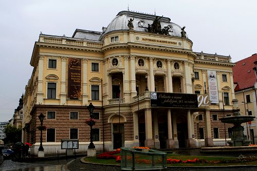  
  
Slovakia-偷窥者  
这个青铜雕像真的在地面上，那个阴井盖也是雕塑的一部分。他天天趴在地面上面带笑意，其实他是因为偷窥着穿裙子的姑娘而笑，所以被戏称为“偷窥者”。了解到这层解释是不是很晕啊？  
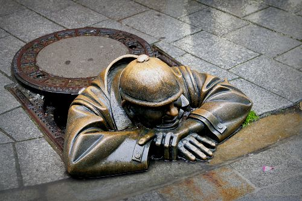  
  
Michalska brana（米懈尔门）内类似指南针的黄铜标记。  
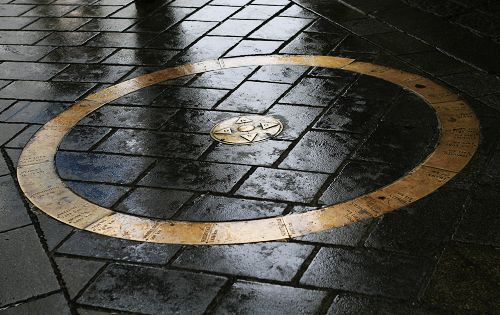   
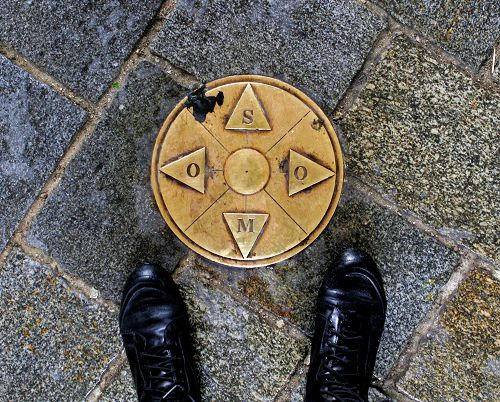   
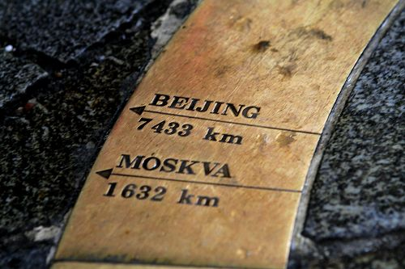  
  
咖啡馆前落了一地黄叶。  
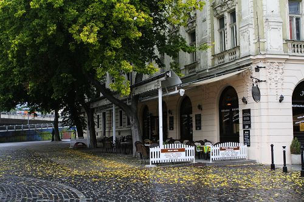  
  
麦梗扎的小人纪念品。  
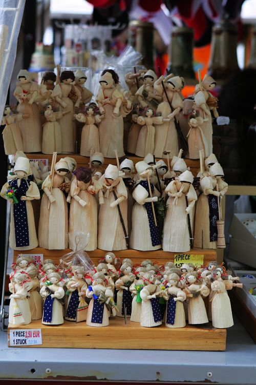  
  
室外咖啡座上的女人。  
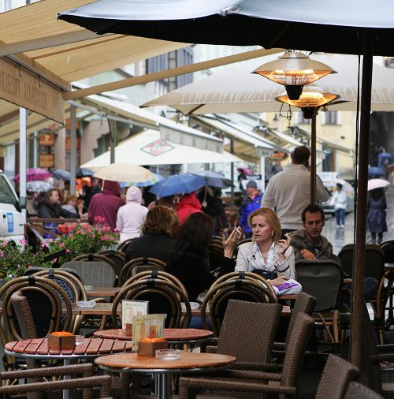  
  
下雨天这些小摊点还是继续营业。  
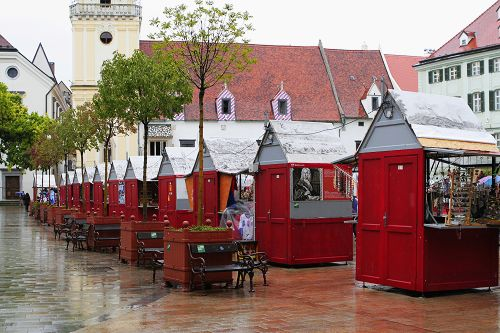  
  
名为“Roland”的餐厅，我们时间比较宽裕，所以享用了一顿比较丰盛的午餐，有人点了热酒，据说还是有点晕忽忽的效果。  
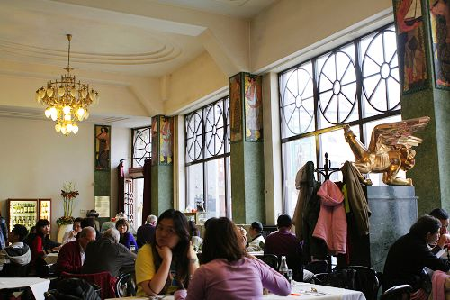  
  
午餐系列  
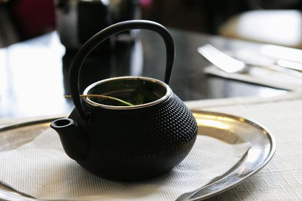   
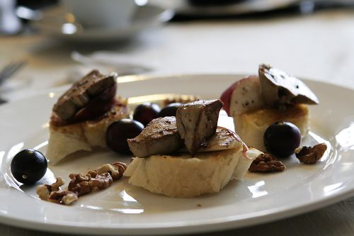   
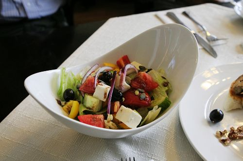   
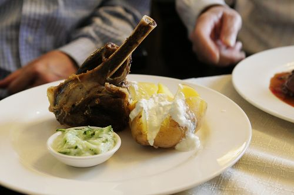   
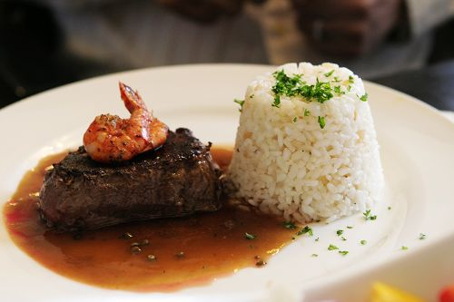   
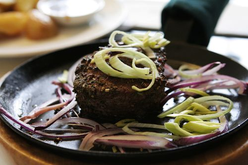

---

## 评论（11）

**喜刷刷** · 2009-10-29

就半天啊？太匆匆。

**rebecca** · 2009-10-30

欧洲很美好，但感觉欧洲的城市看多后，基本都大同小异了，可能再好的东西多了也有审美疲劳的时候！

**frank** · 2009-10-30

对于没有在国外长期生活和工作的人来说，欧洲还是值得一游。

**lilian** · 2009-10-30

看中了你的短靴～

**[三月四月](http://11)** · 2009-10-30

一地落叶的感觉真好，当然最吸引我的还是美食

**Christina** · 2009-10-30

靴子在这次旅行中磨损了很多，下雨天就是雨靴的作用，心疼呐~

**陈问** · 2009-10-30

好东西就是用来磨损的。。。可以继续买。不怕。

**shwua** · 2009-10-30

东欧人有黑色幽默。

**喜刷刷** · 2009-10-31

出行前买的镜头真是及时啊，值！

**itsmin** · 2009-10-31

楼主继续更新呀。。。

**[少爷](http://jennyshaoye.blogbus.com/)** · 2009-11-01

吃得还真丰富呢

