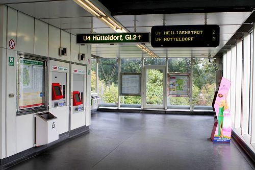
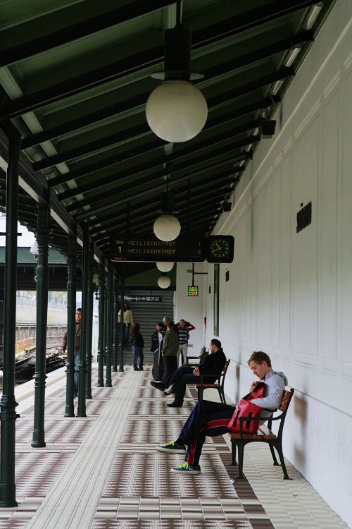
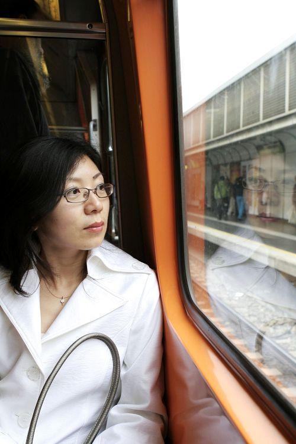
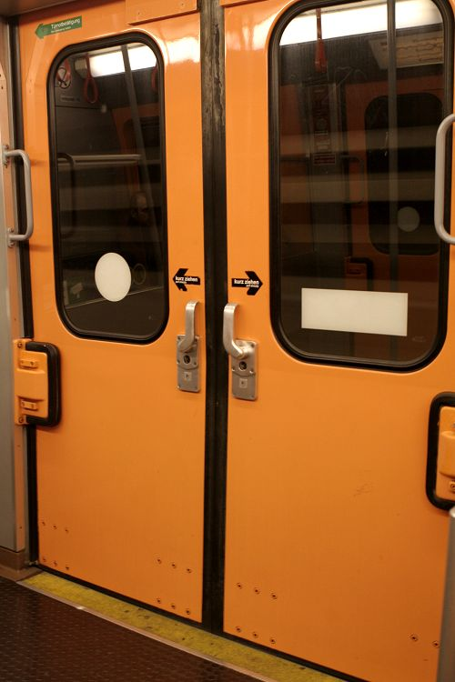
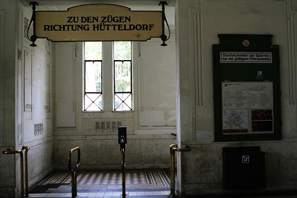
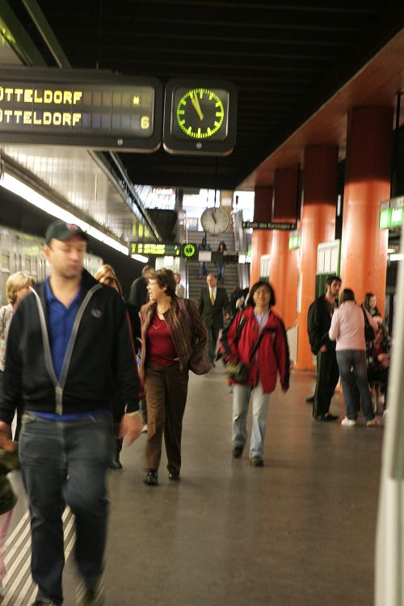
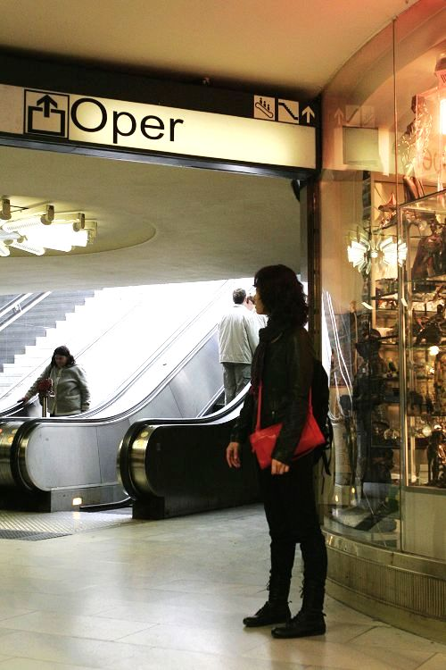
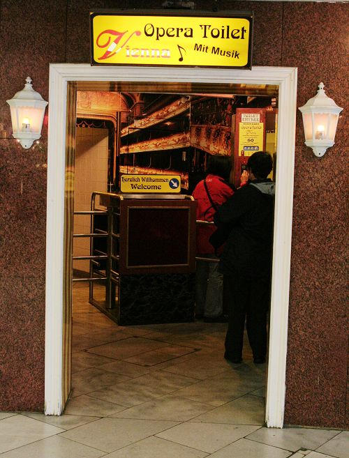

# @Vienna-1

Miranda、Helen和我在维也纳乘地铁的经历颇有趣，从Heiligenstadt站买票上地铁。  
  
  
Heiligenstadt站台。  
  
  
地铁上。  
  
  
我们仨儿聊得正欢，负责看地图的Helen忽然想到可能快到站了，就在地铁停下之后几秒钟询问了旁边人，大家惊慌失措地准备下车，只有Miranda身手敏捷地在目的地下了车，而我们俩面对关闭的车门不知所措。原来这门必须手动操作上面的门把手才能开啊。。。  
  
  
多乘一站下来，重新买票再往回乘一站。  
  
  
下车后老远看到穿红色冲锋衣的Miranda疾步走来。如果在自己熟悉的城市里乘错车乘过站会是稀松平常，但在陌生的国度陌生的城市乘过站，这个小插曲不可避免成为旅行中有趣的回忆。  
  
  
维也纳的地铁通道没有德国地铁里那样香甜的烤面包味儿以及好闻的香水味。而是多年反复使用后的陈旧味。  
  
  
那间位于出站口的Opera Toilet播放着音乐，即使没有需求也会让人想走进去瞧一瞧。于是我们中的一位走进Opera。  

---

## 评论（5）

**大姜炖去** · 2009-11-01

这个地铁车厢是不是比较老了，看起来不是很人性化。

我在想opera里面的音乐会不会突然变，呵呵

**喜刷刷** · 2009-11-01

原来三个人还小小的失散了一下，真刺激～怎么这次回来后你都不爱贴自己照片了？

**Christina** · 2009-11-01

拍人家的多啊。

**joynanako** · 2009-11-02

嘿嘿, 去年我在Vienna也同样因为不懂得开门而坐过站了, 不同的是, 全程只我一个人, 所以谈不上失散, 赫赫,, 不过真的蛮有趣哒!! :P

**六欲有节** · 2009-11-02

我也在维也纳不会开门被后面的大姐鄙视了。  
不过好像根据维也纳的规矩，你们这样的不用重新买票哈！同方向，一小时内换乘都不要买票的。1.8挺贵的。

