# @Vienna-3

“瑞士门”为最为出色的文艺复兴时期的遗迹，通往霍夫堡中皇家珍宝馆和城堡小教堂的门户，每个星期天维也纳儿童合唱团在此献唱。  
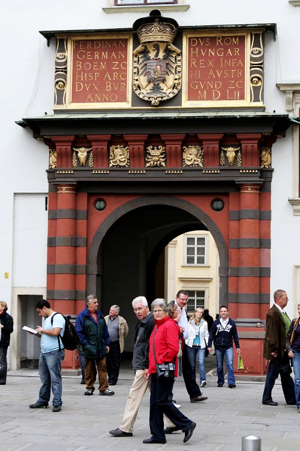   
  
在维也纳Karntner Strasse（克恩腾大街）上拍到这位双胞胎母亲灿烂的笑容。  
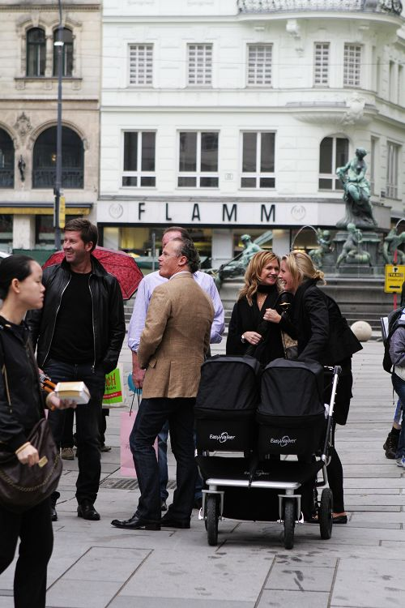   
  
牵着宠物犬逛店的女孩子，有着非常漂亮的面部侧面轮廓。  
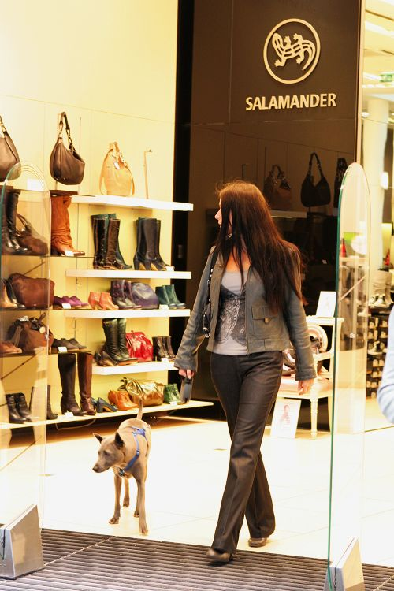  
  
1622年奠基建造的Kaquzinergruft（皇家墓穴），自1633年起为哈布斯堡皇族陵寝。  
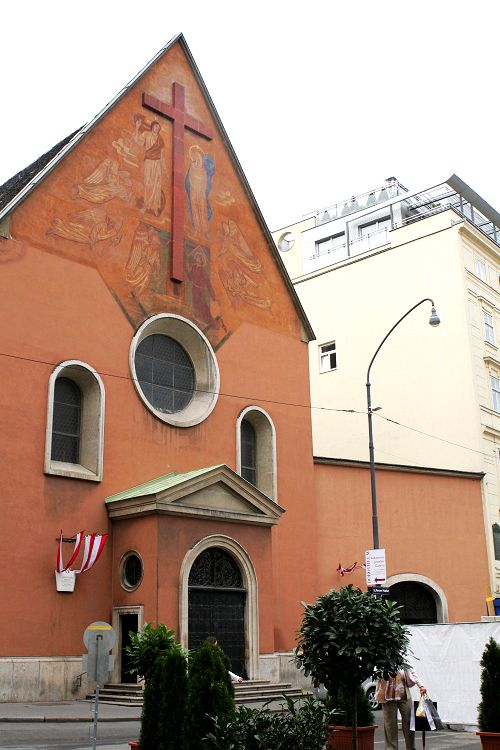   
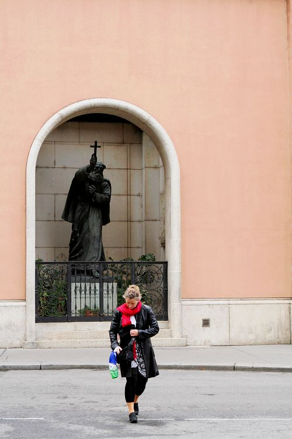  
  
人为自己的肉体建造房子之后，又为自己的灵魂建造了了房子，这座房子的主管是神。欧洲保留下来的教堂之多之完整令人惊讶，回头想想我们几百年前的建筑保留完整的还有几座？维也纳Stephansdom（斯特凡大教堂）为老城中心的城市标志性建筑，罗马和哥德式建筑风格。  
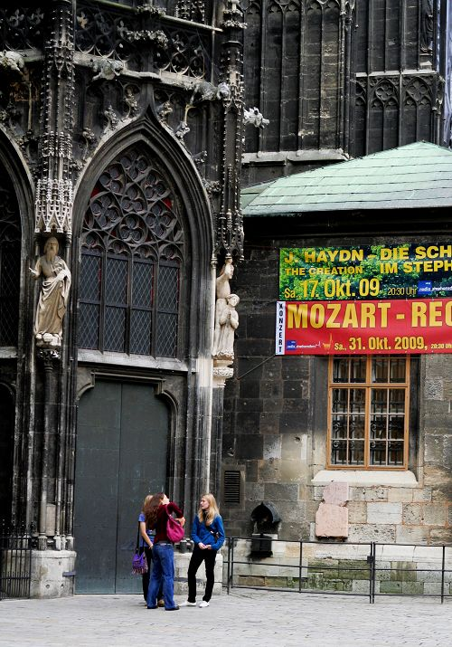  
  
Karntner Strasse（克恩腾大街）上，之前有个胖小孩作出夸张的动作和这个乞讨艺人合影，那情形令我内心的那个小孩活跃起来，也快乐地跑上前和他合影。  
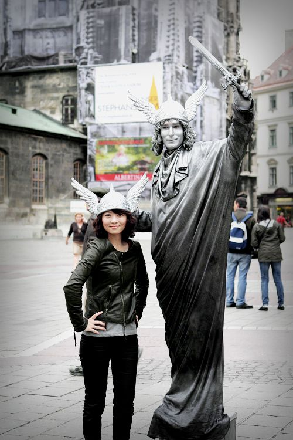  
  
擦橱窗的店员，象电影里的某个镜头。  
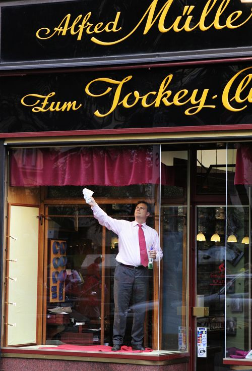  
  
可爱的婴儿与婴儿车。  
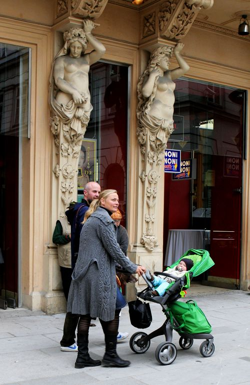  
  
颜色搭配的真好看，在阴雨天里简直象一道彩虹出现在眼前，以及。。纤细的脚踝和靠上的小腿肌肉是我喜欢的腿型。在街头看见几个极其优雅的中年女性，希望我到时候也可以这样优雅。  
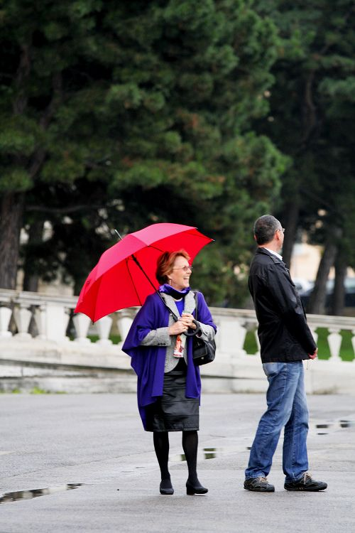  
  
当时M和H讨论城堡花园中的这尊雕像可能是为纪念某位著名植物学家而立，因为它的周围比别处多了各种植物。我查了资料才知是“弗兰茨.约瑟夫”皇帝。  
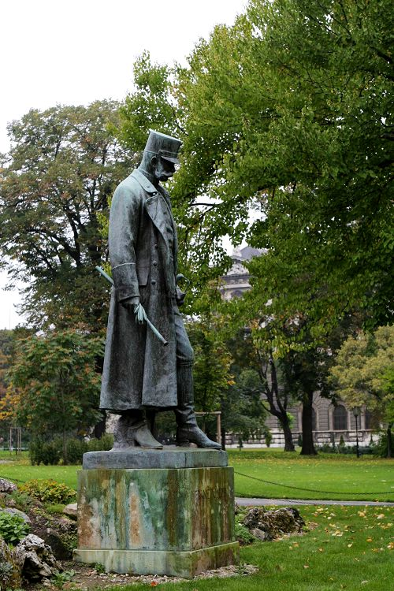  
  
与“莫扎特”讨价还价会很有意思吧？  
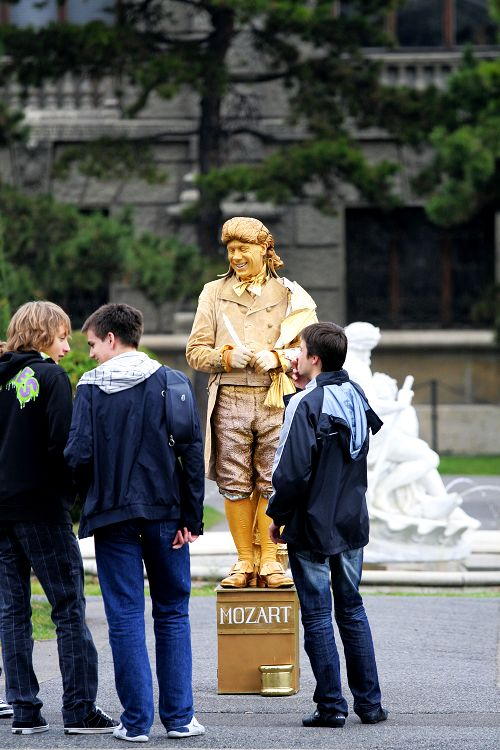  
  
天空开始飘雨，他的背影象一片被雨淋湿的落叶。  
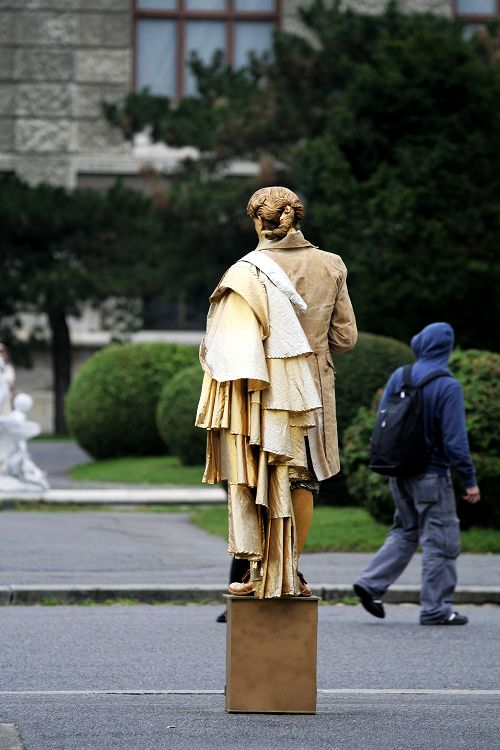  
  
这也是莫扎特雕像。  
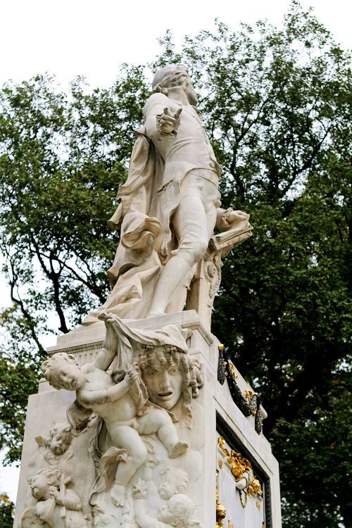  
  
香港女孩儿Jenny遇见一对双胞胎姐妹，欢喜的不行。  
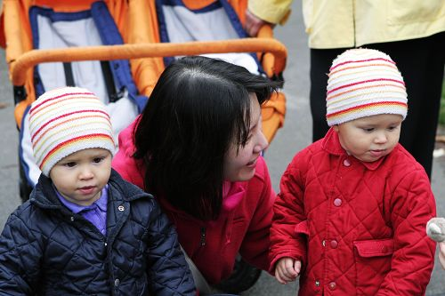  
  
在莫扎特雕像附近休息的Helen，我喜欢这张的表情。自我们在布拉格分别后，她到现在还没看过我相机里的照片，在茶上看到会不会有小惊喜呢？我在家里的电脑上翻看这些照片时，与在旅程中的感受会不同。那么Miranda和Helen是不是也会和我一样？  
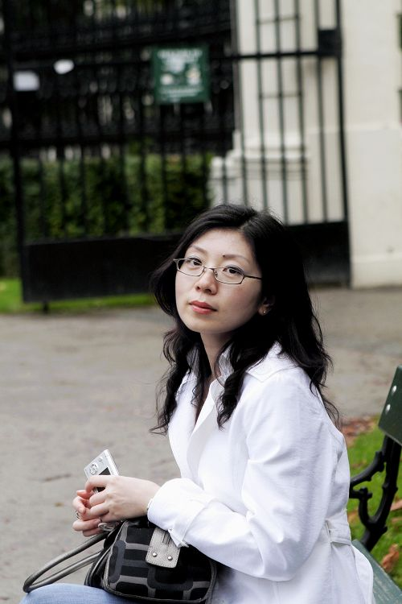  
  
Karntner Strasse（克恩腾大街）上的High Tea。  
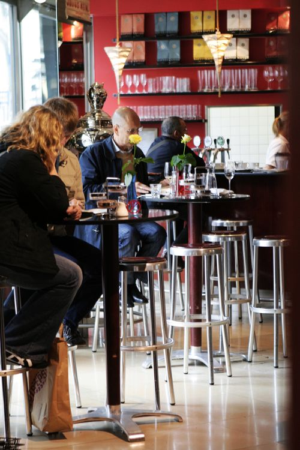  
  
女高音“Cecilia Bartoli”广告画，把她的身体处理成岩石效果看上去很酷。她特别擅长演唱罗西尼与莫扎特的作品。   
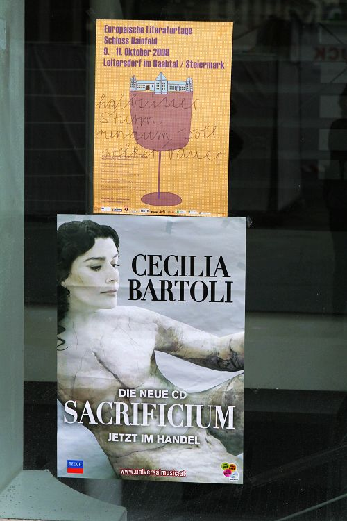  
  
从咖啡馆出来的女人，站在门口边吸烟边等人的样子。来来往往注视她的人不少，这算是维也纳的时髦打扮吗？  
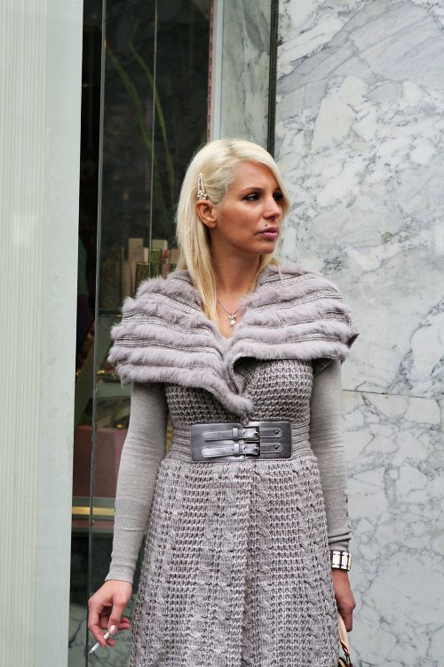  
  
Miranda走进这家书店买了张名信片，写好并邮寄到北京。  
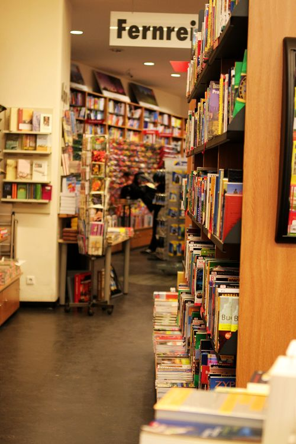  
  
维也纳的有轨电车。  
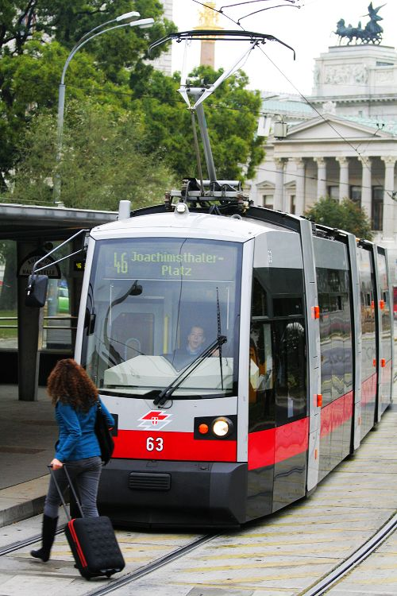

---

## 评论（7）

**喜刷刷** · 2009-11-02

欧洲一抹红给我留下了深刻的印象，很多图片上都恰到好处。

**shuwua** · 2009-11-02

你带的小帽好可爱，雄赳赳的叉腰姿势。发型也和那个表演者相似唉。

**Christina** · 2009-11-03

嘿嘿，我喜欢那个人身上的金属色，很酷呢~

**陈问** · 2009-11-03

我喜欢那个书店！书店！

**karen** · 2009-11-03

拍的感觉很棒哎～ 其中有张有点貌似欲望都市的海报呢。

**陆路** · 2009-11-03

第二张，双胞胎妈妈旁边的那个同样穿黑色衣服的女人好像friends里的rachael啊。。。。

**lilian** · 2009-11-03

这张Helen很象我以前的一位同事,她的英文名也叫 Helen.

