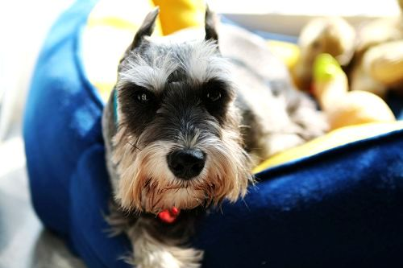
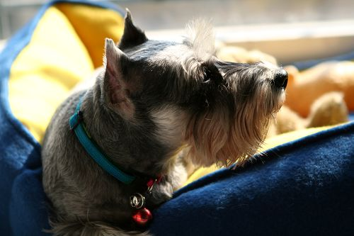

# 狗，也有命运。

晚上早早钻进被窝，睡不着，掏出小手机上网。  
  
我有一只爱吃水果的狗，从上周六在宠物医院见到它，将它领养回家，到现在我每天都有思想斗争：两只狗会不会太多？虽然从体重到体型它只有Luke的一半。我有毅力照顾它到老吗？它若改不了随地小便的习惯怎么办？它的指间囊肿什么时候能好？  
  
它的名字叫土豆，这只长胡子的MM约五岁，以前的主人拿它当生育工具繁殖小狗赚钱，雪纳瑞容易难产，已两次开刀，最终拿掉子宫无法生育，于是它也被抛弃。  
  
   
  
作雪纳瑞挺苦的，人们为了让它看上去更美观，从小就要剪耳断尾，赛犬级的还要拔毛。  
  
土豆除了耳朵尾巴和子宫动过手术，声带也被割了。。。它总是仰起小脸，用人一样的眼神望着我，那么渴望、胆怯、好奇与思考的眼神，既使在我训斥它管教它的时候，它还是看着我。每每如此，我既着急又心疼。每天从遛两次到遛四次，以防止土豆在家小便，我总在心里安慰自己：就这么一段时间，Luke刚来时也让我操心的，土豆会象Luke一样适应这儿的生活，会知道规矩守规矩的。  
  
象土豆这样需要帮助和关爱的弃犬很多，我非常憎恨遗弃、偷盗宠物的人！他们的行为会受到报应和惩罚！Luke和土豆都是被收养的，都很懂事通人性，只需要坚持它们到达你家后的一段调教时间。**如果你打算拥有一条宠物犬，何不去领养一只？遭遗弃及流浪过的狗狗会很珍惜现在你给它的一切。**  
  

---

## 评论（21）

**喜刷刷** · 2009-11-04

天哪，你默默地又爱心泛滥了吗？愿她给你更多快乐～我喜欢她的名字。

**[三月四月](http://11)** · 2009-11-05

遭遗弃及流浪过的狗狗会很珍惜现在你给它的一切  
这话我深有感触，我妈妈就在喂养邻居不要的狗，它每次吃完我妈妈送去的食物，都会感激地舔舔她的手

**itsmin** · 2009-11-05

神会保佑你们的。

**陈问** · 2009-11-05

她5岁了，到你这里来还是随地小便么？也许是狗们快速熟悉环境的方法。不然还真是蛮怪的。

**Christina** · 2009-11-05

尤其是早晨，它起来一会儿就要小便，两个早晨居然在同一个地方小便，被我揍过都不长记性，奇怪吧！也许它之前在宠物医院养着，没人带她按时出去方便，她就随地解决了。

所以今早晨我起床后没刷牙洗脸就先套上衣服带土豆下楼，好在它很快就小便了，然后马上回家。

昨天晚上惊喜地发现LUKE和它在玩，今早上也是，两个小家伙一起来就打闹嬉戏，希望它们能相处愉快。

**Christina** · 2009-11-05

我爸妈也会喂养邻居家放养的狗狗，想想蛮难过的。

**frank** · 2009-11-05

其实养宠物是人类自己的需求而已，动物未必喜欢，他们是你的精神和感情寄托，其实是你离不开他们。

**shenwen** · 2009-11-05

我养的猫没有尾巴，被压断两条后腿，差点死掉。好不容易救回来。很长一段时间无法正常在猫砂盆里大小便。  
狗更通人性，慢慢就会好的。

**[三月四月](http://11)** · 2009-11-05

是的，就是邻居放养在外面的，也不怎么喂吃的，晚上也不让它进家门，都睡楼道。后来我妈给它搞了个窝，有时带它回去洗澡，或者把它养在小房间。给它吃饼干，它会叼走，埋在花坛里，傻得可爱，但是它还是愿意忠于它原来的主人，即使他们对它不好，它还是很认定

**Christina** · 2009-11-05

“但是它还是愿意忠于它原来的主人，即使他们对它不好，它还是很认定”

这是最让人难过的地方。狗比猫对人类的依赖性更大一些，无论谁需要谁，相处久了都会有牵挂有割舍不下的感情。

**quinn** · 2009-11-05

呵，Luke有伴了，想看看土豆的样子  
看了你的描述心里都酸酸的

**mandy** · 2009-11-05

想看看土豆的照片~~对你的行为感到钦佩，简单的收养内含着更多的责任~~

**lilian** · 2009-11-05

茶好有爱心哦～

**shuwua** · 2009-11-05

看得我都眼湿湿了，你心真好。希望命苦的土豆最后有一个温暖的家。Luke如果喜欢，两个狗做伴挺好哒。

**zyz** · 2009-11-05

是件喜悦的事情：）

**不羁之舟** · 2009-11-05

我有个朋友 对狗狗的热爱无以伦比.流浪狗是她不能碰触的伤痛…每每因此而憎恶人类.  
生命没有排序…人类很多时候很可恶.  
茶的两个狗狗很有福气~

**喜刷刷** · 2009-11-05

看上去，她现在过得很美好。愿阳光永远普照，每天每个人都能爱心多一点。

**喜刷刷** · 2009-11-05

正面凶狠，侧面优雅，下得厨房，入得厅堂。

**小原子** · 2009-11-05

这篇看得让我感动…..

**[风信子](http://blog.sina.com.cn/lixuelei)** · 2009-11-06

狗远比我们悲惨，他们在人的世界里被人宰割着，我们却经常忽视这些弱势小动物，不懂得恋爱。每当看到流浪动物，我从不想知道他们到底经历了什么，因为那会让人痛心的，我更无法去靠近，害怕还要再失去，想到这些，有时会认为这个世界并不可爱。有时甚至认为，我们庆幸我们是人，我们还可以呻吟。

**[prettymom](http://prettymom.org)** · 2009-11-08

people should consider if they can take care of a dog before they get one. i feel sorry for 土豆‘s past, but it’s now in good care. you are right, if people want to have a pet, adopt them. don’t buy from dog farmers who treated dogs just as cash generators.

