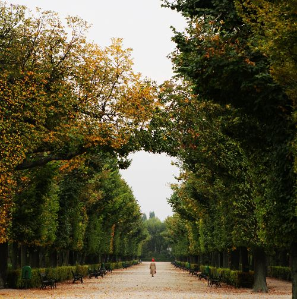
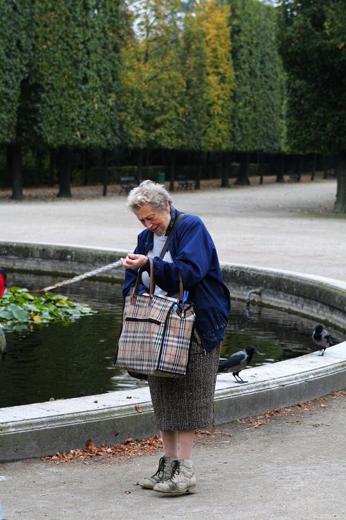
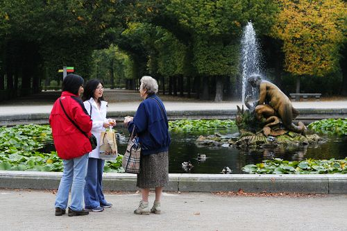
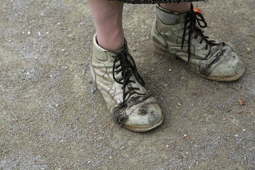
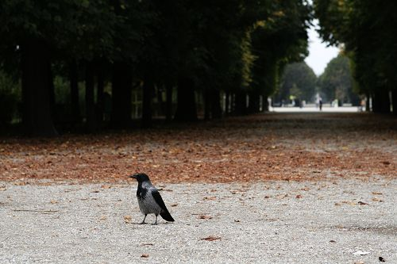

# @Vienna-4

美泉宫的上午清冷清冷的，但还是没有现在的南京冷。其实我挺喜欢现在的季节，自然界除了绿色红色还有金黄色，午后阳光比任何季节都可爱。这个季节的欧洲却多雨，而今年的南京干燥到要人工降雨的程度，到了下午嘴唇有轻微的疼感和紧绷感，大量喝水也无用，是一定要擦唇膏的。每天起床在橱柜里挑衣服挑袜子挑鞋时，会感受到十多天前那些湿漉漉的日子，衣服湿的、背包湿的，靴子成雨鞋，偶尔出半天阳光，大家都好开心。  
  
美泉宫的上午虽然没下雨，但也不见阳光，在柜台要了掌上导游机，边听中文解说边参观功能不同的房间，对这种参观没多大兴趣，看完了事，我对美泉宫的园林很有好感，这样国家级的宫殿园林里居然允许居民在里面晨跑，真是太令人羡慕了，最大限度地服务于人民。根据巴洛克宫廷建筑的理念，建筑物和大自然必须有机地交织成一体，所以美泉宫的建筑与花园设计从多重角度来看也是相辅相成的。玛利亚.特蕾莎在世的最后十年，美泉宫的巴洛克风格的花园最终成型，并一直保留到今天，成为美泉宫园林的主要景观。1996年，整个美泉宫宫殿园林被联合国教科文组织例为世界文化遗产。  
  
  
有意思的是在皇家花园里遇到一位老太太，将包里的切片面包撕成块儿投给附近的鸽子和野鸭子。她身穿藏青色短风衣，格子裙，丝袜，胳膊上挂着一个破旧的Burberry格子大包，以及一双补了又补的米白色皮鞋。她的家或许就在这附近？亦或许收容所就是她的家？Miranda和Helen听老太太讲述美泉宫诞生的历史，象她这样年纪的老人一定非常渴望与其他人亲近的聊聊天吧？！  
   
  
  
她脸色苍白，眼睛上蒙着混沌不清的一层白雾，象大多数老年人一样处处失去光彩，奄奄一息象泄了气的皮球，嘴角堆积着白色分泌物，可是依然可以判断出她年轻时的美貌和气质。她一个人孤零零地在冷风飕飕的早晨，站在恢弘的皇家花园的水池边，慢悠悠、毫无欲望地度着余生，这些鸽子和野鸭子就是她的宠物。  
  
  
看到几只小松鼠在树林里跳来跑去，有一只甚至跑到离我们很近的地方，它们总是不停的忙碌着，所以很难在光线不好的情况下拍清楚。但是我拍到了这只喜鹊？Helen说是褪了毛的乌鸦。  

---

## 评论（7）

**喜刷刷** · 2009-11-05

这双鞋很有意思，那么破旧可是却不让人讨厌。值得深思。

**老听众** · 2009-11-05

我想是因为虽然鞋破但很干净，其实老太太人也一样，虽然穷但非常善良。

**[joanna](http://yanmer.cn/blog)** · 2009-11-05

穿着倒未必是流浪的，只是鞋子太……我的法国接待家庭，老爷爷打季节工的蓝领，老太太家庭主妇，衣服都像是80年代的款式，却开4W欧的奔驰房车。老外的消费观实在奇怪

**Christina** · 2009-11-06

上海人的消费观是一定要将钱花在面子上的，和joanna说的这种类型正好相反。

**[薇安](http://bulaoge.com/?vivianxu)** · 2009-11-06

第一张拍的太赞了。！

**大湖** · 2009-11-07

I have seen the similar bird, that looks like the Chinese 喜鹊, in other European countries. The locals call it “the Tuxedo Bird”.

**Faye** · 2009-12-07

第一张的人物简直象幽浮在照片上，红帽子和棕色风衣之间的头颈完全不见了。

图片令人印象深刻。

