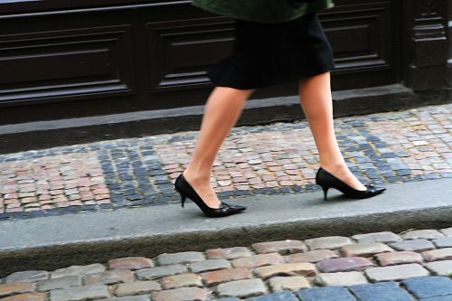
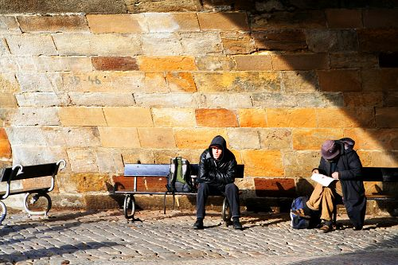
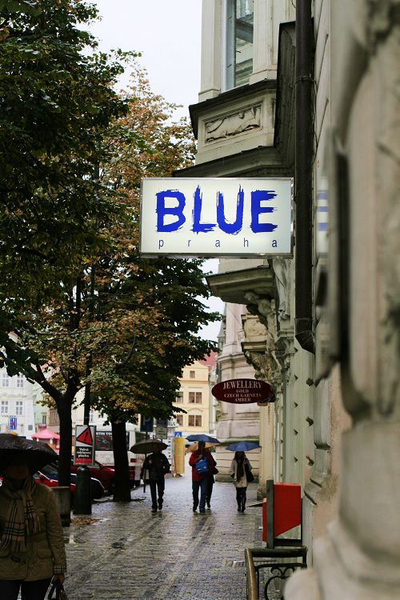
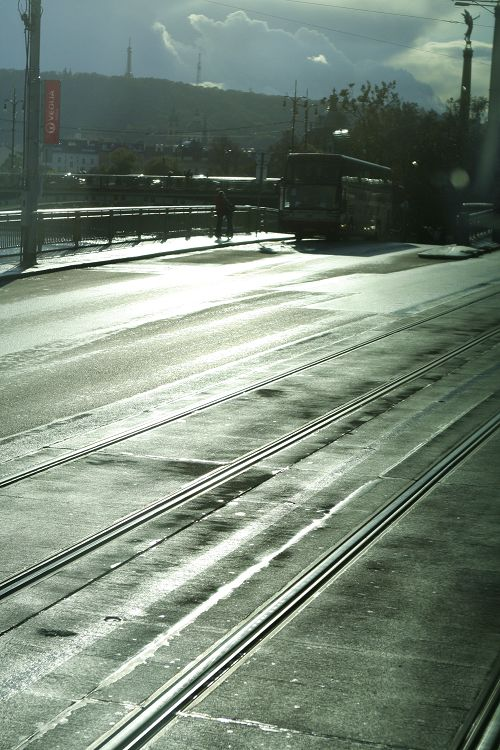

# 爱上布拉格。

周末整理了大部分在布拉格拍摄的照片。  
越理越有些忧郁，越理越兴奋，舍不得睡去。  
  
**爱上照片中的布拉格。**  
  
   
   
   

---

## 评论（10）

**喜刷刷** · 2009-11-09

那样的路真是委屈了高跟鞋了啊，可是真的锻炼了穿高跟鞋的人的平衡能力。等候的人衬得那堵墙好温暖，猜想摸上去也会温温的呢。

**灰子** · 2009-11-09

真是在最美的地方拍出了最美的照片，第一张女人的腿和高跟鞋真是让人不得不去想像这个女人有多优雅和精致。最后一张的油轨马路在逆光下让布拉格多了一份黏稠的情绪。

**itsmin** · 2009-11-09

这个blue容易联想到东欧的吸血鬼。

**小原子** · 2009-11-09

这城市名字听得就很诗情~~布拉格的许愿墙还去的啊？韩剧里“布拉格之恋”老拍那里。

**zq** · 2009-11-09

我看到的是羡慕人家人性化的道路设计，能让精致、优雅的穿高跟鞋的女人那样脚步轻盈，呵呵。

**lilian** · 2009-11-09

哇。。。这钱砸的真值啊~这表现力~

**旗旗** · 2009-11-09

第一和最后一张都很美好

**[Sophie](http://www.flickr.com/photos/morena7/)** · 2009-11-09

你留在南京真是可惜了:) 应该把你派出去环游世界! 用你的眼, 你的心带我们好好看看这个的世界.

**shenwen** · 2009-11-09

终于迎来了布拉格，圣地啊～我等着看这一站呢。有关于卡夫卡的内容吗？

**vfan** · 2009-11-13

blue那家店的东西极其精致好看，但又贵的很。。看得人欲罢不能

