# @Praha-1

**“其实卡夫卡就是布拉格，布拉格就是卡夫卡。布拉格从来没有象在卡夫卡活着的时候那样完美，那样典型，将来也永远不再会有那样的情景出现。作为我们，他的朋友，‘幸福的少数’......我们知道这个布拉格里面即使最小的元素，都被蒸馏到卡夫卡的作品里而无所不在。”**  
--约翰尼斯.乌尔茨蒂尔《卡夫卡的世界》  
  
走过欧洲几个城市之后，布拉格和瑞士一样给我留下深刻印象，世界上没有哪一个城市在这样拥挤又短暂的时空里孕育出象布拉格这么多的文学家。另外比较下来西欧各国人外观上不会有特别明显的差异，但是到了东欧，那种民族化的特征还是能明显感受得到。有人称布拉格为金色布拉格，红色布拉格以及蓝色布拉格，我眼中的布拉格则是灰色的，大概是天天都有阴雨天，当然灰色也有它的美。毫无疑问布拉格的美与多种多样的建筑风格交织成一个浪漫的中世纪之都，许多重要的名胜古迹都在旧城区范围内，从伏尔塔河东侧的火药塔经旧城广场到查理大桥。旧城区是布拉格的精华，这里长年累月挤满了各国来的游客。  
  
我和香港的Esther、sasa登上旧市政厅的塔顶，视野豁然开朗，顺着塔顶走360度将整个旧城区的全貌尽收眼底。这是上塔顶的电梯。  
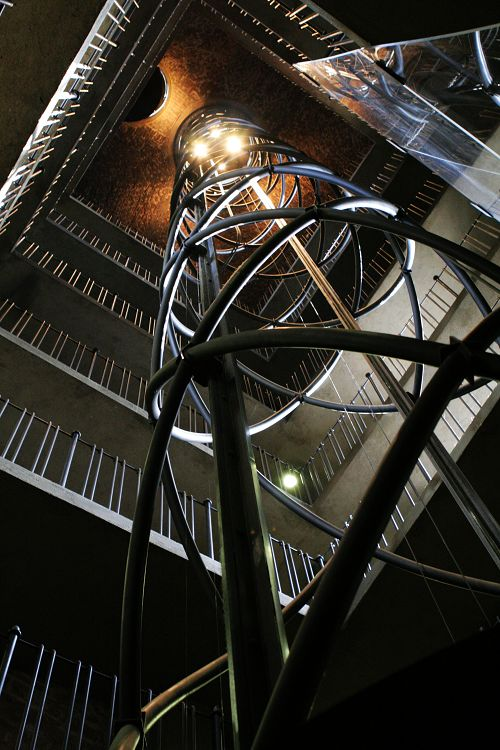  
  
旧市政厅属于布拉格在1945年战火中少数受损建筑中损失最严重的历史文物之一，只有左翼部分建筑得到修复。最吸引游客的是墙上的大型天文钟。天文钟下半部分为特殊的月历钟，最外面以波西米亚人一年四季工作生活的图案表示12个月份，第二层以图案表示12个星座，最里面是布拉格旧城徽记。这个天文钟的特别之处在于除了显示时间，还可以准区模拟出地球、太阳和月亮的轨道。  
  
天文钟的上半部分是时钟，时钟的大圆圈显示一天24小时，兰色为白昼，红色为夜晚。另一个较小的圆圈则显示该时间太阳落在那一个星座，太神奇了。除了这些复杂的构造之外，天文钟上还包括耶稣12门徒在内的活动木偶。  
  
传说旧市政厅前闪烁着太阳月亮和星光的天文钟美丽的背后有着惊人的残酷，为了拥有举世无双的艺术精品，当权者竟下令夺去钟匠的双目。  
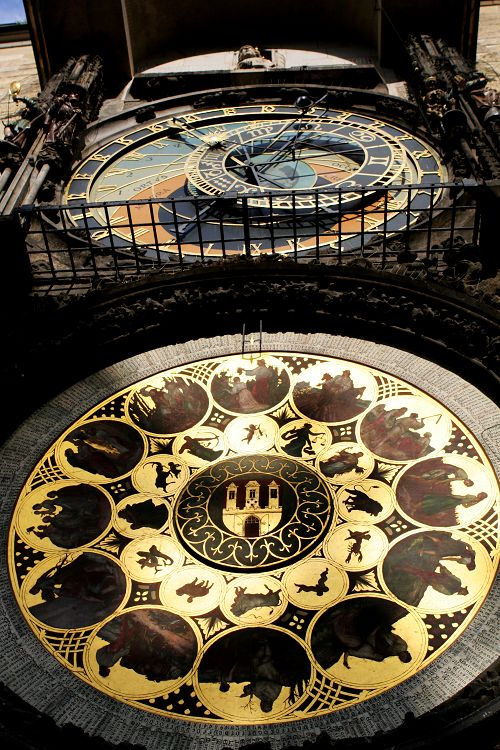  
  
这么多人挤在天文钟前观看钟上的小木偶在整点时的表演，真的蛮多人的。  
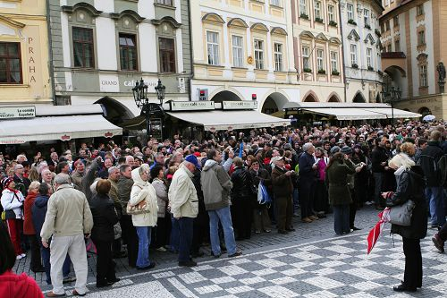  
  
布拉格的天气真是变幻莫测，飘来一片云就下雨，云一过去就天晴，但变化的也忒频繁了，我是跟着撑伞收伞好几回。坐在户外也不会觉得惬意，天气并不暖和，店里会为坐在户外的客人准备一条毯子盖住腿保暖。  
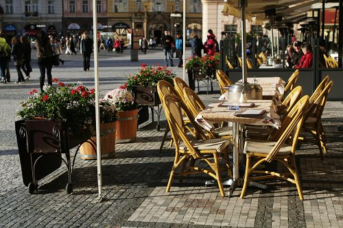  
  
我们仨儿要上旧市政厅的顶层，需要付费的，Esther笑呵呵地在窗口等着换钱，结果我们到了旧市政厅还是没能上去，因为钱不够，按照1.00 EUR = 25 CZK计算，我们提供的欧元换回的克朗应该足够支付门票了，结果只拿到预算的一半。于是折回旧市政厅的兑换点询问，人家说换的数额越大，汇率越划算，数额小是不可能按照25的汇率来换的，我们拿回的克朗是按19。。。虽然捷克加入申根国，货币却还没跟着欧元走，比较麻烦。  
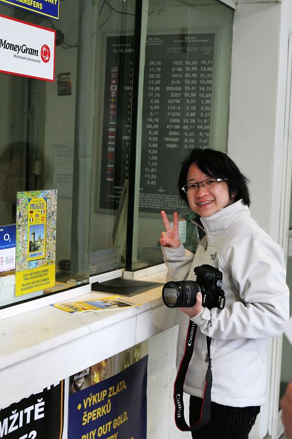  
  
在旧市政厅门前拍摄结婚录影的新人。  
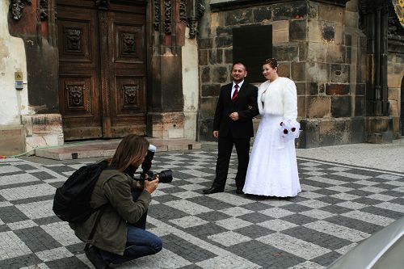  
  
40克郎一只面包圈，干巴巴地挂在寒风中，有欲望吃吗？  
  
热葡萄酒和热巧克力，45克郎一杯，天气冷，买的人还是蛮多的。想起小时侯我外公外婆冬天喝小酒前，会用一种专门烫酒的壶热酒，样子象茶壶，材料象锡之类的金属，壶上雕刻着古香古色的精致图案。这些老物件老习惯都跟着我们的祖辈进坟墓了，大家一股脑儿地追着钞票跑，边跑边扔，根本来不及停下来看看风景整理一下行囊。和香港女孩子相处的短暂日子里，分明感到大陆人活的那个奔放，以及在国内与周围那些满是昂扬斗志自满自大心机复杂的人的相处。。。那个闹心，独独缺少人家身上的随意与善意。香港也是快节奏生活，为什么相对大陆人，人家好象更单纯一些呢？  
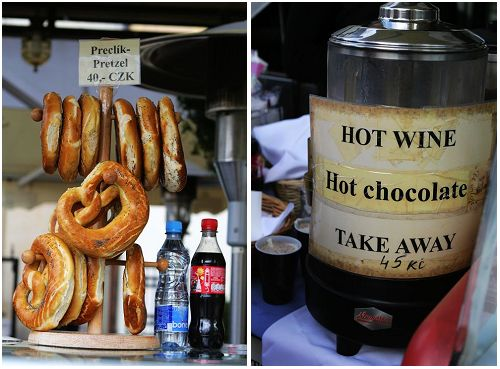  
  
旧城广场上的自行车吧台，有五个座位，游客可以环绕着坐在车上，边喝饮料边欣赏延街景色。只是骑车的工作人员会不会很累呢？  
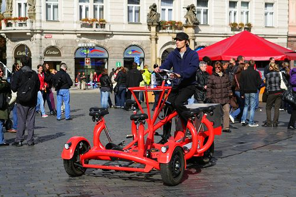   
  
旧市政厅顶层拍摄。  
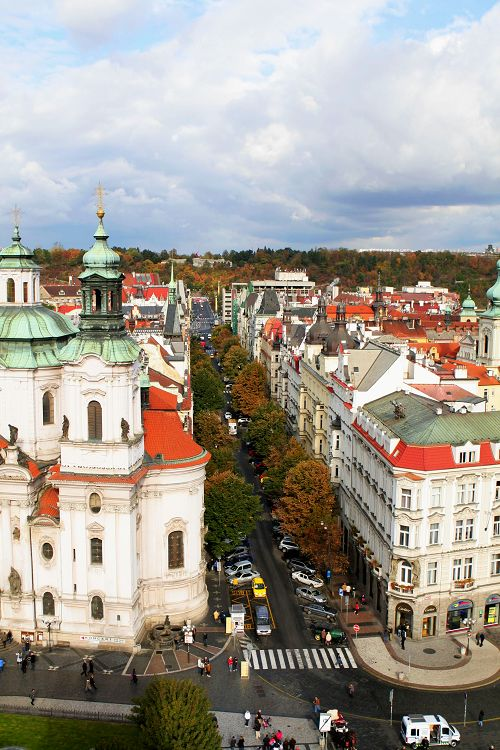   
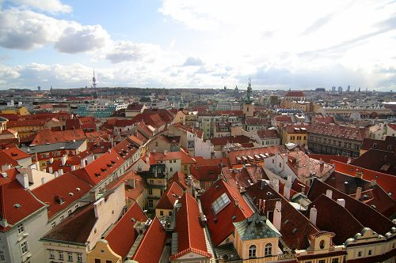   
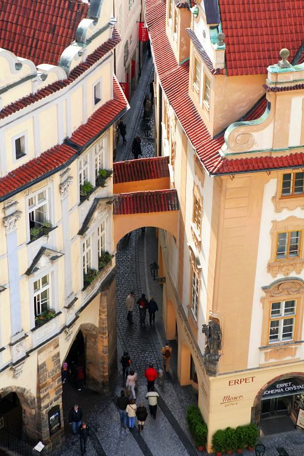   
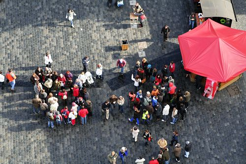   
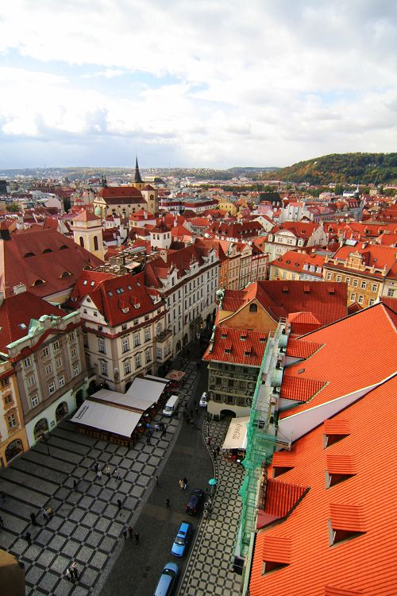  
  
到了布拉格绝不能错过的就是生气蓬勃又赋有古意的旧城广场，环顾四周充满了一套完整的建筑教材：巴洛克、罗马式、洛可可、哥特式等各种形式的建筑，与周围粉色房屋相应成辉。布拉格饱满又沧桑的美让人无法忽视。  
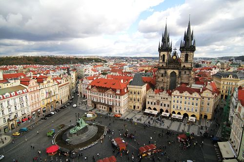  
  
图中右边的建筑就是旧城广场上最醒目的建筑“提恩教堂”，可以说是布拉格的地标之一，有被称作圣母玛利亚教堂。初建于1135年，现在看到的建筑是1365年建造的，以哥特式双塔建筑著称。总高度约80米，是旧城广场上最古老的建筑。1620年后教堂外观和祭坛的装饰增添了不少巴洛克色彩，包括许多著名的耶稣雕塑与绘画。曾经是老城区胡斯教徒聚会的中心，也是当年外国商人来布拉格时做祷告的聚集地。神秘忧郁的皇帝鲁道夫身边著名的丹麦天文学家、星象学家“提霍.布拉赫”就长眠在提恩教堂华丽冰凉的大理石墓碑下。  
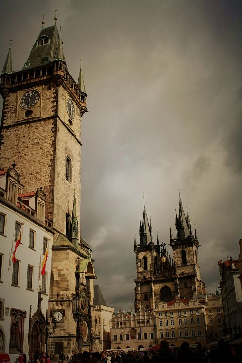  
  
旧城广场上的西克斯特屋在1888年至1889年之间曾是卡夫卡一家人居住的地方。门上刻有“1796”字样，但事实上这座房子建造的年代约在1220年左右。  
  
19世纪的布拉格正处于一个过渡时期，捷克人与德国人之间的斗争已经到了白热化的程度。住在布拉格的许多德国家庭，包括犹太人的家庭都会送孩子去上德语学校，而对面的捷克学校则在校门口拉起横幅“捷克孩子应该上捷克学校！”无论校内还是校外，捷克学生和德国学生，传统的捷克人与德国人之间的斗争从未停止过。  
  
而在卡夫卡看来，捷克语听起来比德语“更能表达心意”。他认为德语从一开始就象一堵墙隔在他与母亲之间。“我们给一个犹太妇女德语的母亲的称呼，却忘记了这样的矛盾--她将如何艰难地深陷于感情的困境。。。。。。用MUTTER来称呼一个犹太母亲，听起来不仅奇怪而且陌生，MAMA其实更适合些。。。。。。我觉得那只会让人想起犹太人聚集地的家庭场景，因为VATER这个词也不等于犹太语中的父亲。”  
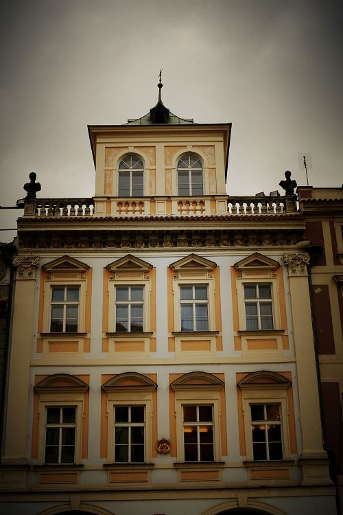   
  
旧城广场上等生意的马夫，行头上蛮职业的样子哦。做什么就要象什么，国内上班不象上班的打扮，有的象是去混夜场，有的象是去购物，有的则穿成运动健将摸样。不知道是个什么形象。去香港明显的感觉是，上班族的正装看上去既大方又端庄简洁。国内人好象根本不在乎职业形象，和企业文化氛围还是有关系的，可能外企会好一些。  
  
从这一方面看中国人还是挺有人权的，想怎么穿就怎么穿，往往站没站像坐没坐像，公共场合下大声喧哗，走路碰撞到别人不是问题，你要嘟囔就是你有问题！公共场合下的眼神更是肆无忌惮，什么礼貌不礼貌的，压根和中国人没关系，我想盯着你看就盯着你看，想抛一个鄙视的眼神随时随地都可以。走一圈下来，感到中国人活得多自在啊，和谁都不见外，什么私人空间？什么尊重？太奇怪的话题了！中国人怎么可能允许你要求这么多呢？！所以说嘛，中国人活得多自由奔放啊！  
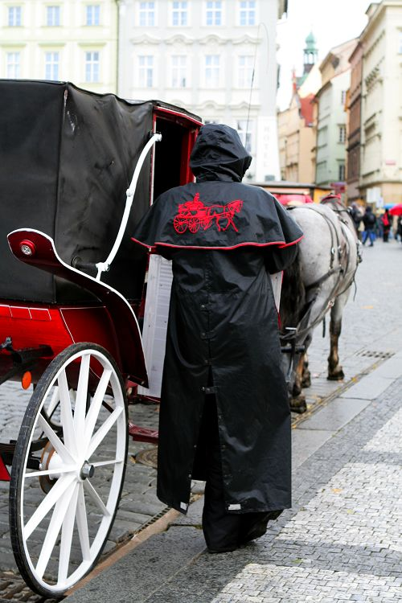

---

## 评论（12）

**喜刷刷** · 2009-11-10

在“自由奔放”那边笑过之后，目光还是会停留在布拉格的路边。也许那些景点就该是那个样子，没什么悬念，反倒是路边拾趣更吸引我，想象置身其中的感觉一定很棒。

**[joanna](http://yanmer.cn/blog)** · 2009-11-10

第一张拍得太震撼了，照片的结构越来越好，让人流口水

**okdata** · 2009-11-11

干净的色彩，画面纯粹，手法用心  
游记已渐变为采风

追着欲望的人看不到风景，确是高举自以为是的火把引领潮流。这样的人拍不出纯粹

小酒壶里盛着随意与善解自乐，嗯，经常想起，过几年订把盘盘

**旗旗** · 2009-11-11

瑰丽，鲜艳，又温柔。。。我怀着满心对美好的感叹睡觉去了～

**[光光](http://gaoguangguang.blogbus.com)** · 2009-11-11

阳光不错哎。拍得真好。我的照片全部黑咕隆咚的，你没拍钟楼上那个拉线小骷髅吗？我好像拍了的。很可爱的。

**Christina** · 2009-11-11

等我拍完那些密密麻麻的人转过去的时候那个木偶已经谢幕了，呵呵~

**[少爷](http://jennyshaoye.blogbus.com/)** · 2009-11-11

照片随便用, 保证不会起诉你侵犯肖像权:)

**shuwua** · 2009-11-11

那张有着变黄、变红的树的照片很美哦。没想到布拉格的屋顶这么红！

**[光光](http://gaoguangguang.blogbus.com)** · 2009-11-12

但是卡夫卡是用德语写作的。他的第一语言是德语。

**Christina** · 2009-11-12

没到塔顶也不知道屋顶是橘红色的，上去一看真是惊讶，也没有想到会是这个颜色。但的确很好看。

卡夫卡从小和父母住在非犹太区，中间搬过好几次家，他们在德国人的生活圈子里又没有归属感。

**onfire518** · 2009-11-13

图片中那个姐姐拿佳能的，相机和镜头是什么型号阿？

**Christina** · 2009-11-13

ESTHER拿的是Canon 500D+18-200的canon头，装备也重要，但更重要的是相机后面的眼睛和头脑。

