# @Praha-2

**这个布拉格不仅让我爱，也让我怕。**  
--摘自1923年10月8日卡夫卡写给小妹奥特拉的信  
  
布拉格不仅以盛大的“布拉格之春”音乐会名扬世界，也是爵士和摇滚乐爱好者向往的“麦迦”，拥有24个公共博物馆和无数的舞台，画廊以及三家歌剧院。其中以伏尔塔瓦河畔的民族大剧院最为壮观（图右最大的深色建筑）。这个完全靠民间两次募捐建造的歌剧院不仅富丽堂皇，也是捷克民族再次崛起的骄傲和象征。民族大剧院对面是索菲岛，卡夫卡曾在那里打过网球。  
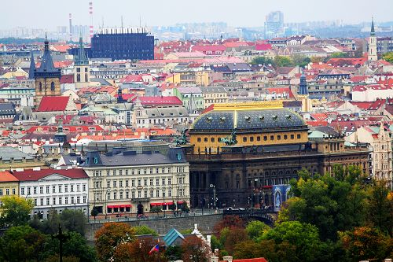  
  
Bohemian（波西米亚）：捷克西部的一个地名，历史上，这个地名与吉普赛人联系在一起。目前，我们讲到波西米亚时，一般用来形容具有游牧民族风格，或意味着浪漫、自由，甚至是颓废。我在布拉格城堡附近拍到这位极具波西米亚着装风格的女子。  
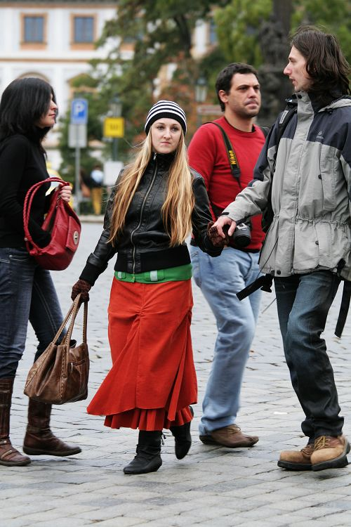  
  
火药塔当年为了连接与卡尔大桥的桥头堡呼应而建造的，随着新城的扩建，火药塔失去了当时建造的意义，这个中世纪没有完成的城堡一度成为弹药仓库，在历史变迁中城头不断变换并增添装饰：左边是波西米亚国王奥托卡，右边是卡尔四世。我和少爷就是约了在这里碰头的，当时天上下着雨，我提前半小时就到了，拍下了城堡前古式兵服打扮的男子。他见我在拍他，于是拿起宝剑做好POSE，这是我拍下的第二张，他真的很高哦~在他的斜对面站着三个现代警察，有意思。  
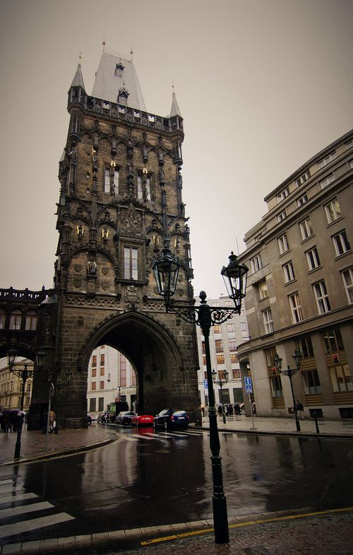   
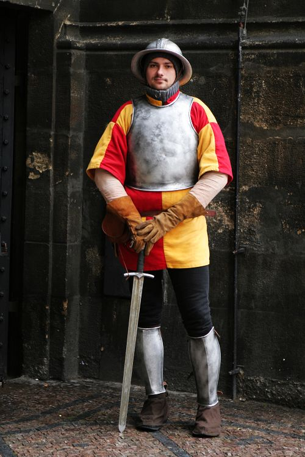  
  
英国女律师“少爷”。  
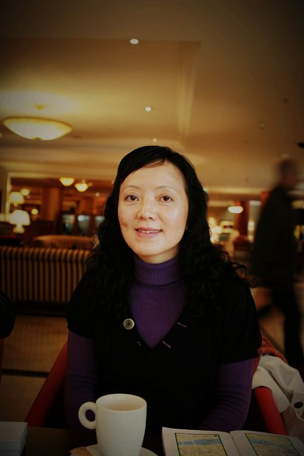  
  
共和广场上最令人瞩目的新市政大会堂，也被称作交际大会堂，在这个繁忙的连接布拉格老城与新城的交通枢纽区域，更加显得庄重典雅。这座建在中世纪王宫旧址上的豪华建筑是布拉格新艺术风格建筑的代表之一，也是1918年捷克斯洛伐克共和国宣告独立主权的新起点。  
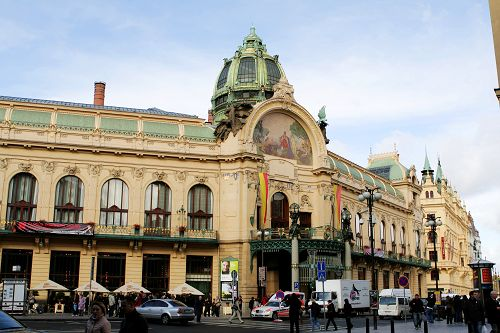  
  
在集市上一眼看到这个女孩子，立刻被吸引了，她的背包上别着一朵红色花朵，在湖蓝色背包的衬映下显得特别好看，那么冷的天，她却穿着黑色薄纱裙，黑色长统袜及黑色浅口鞋，很符合我的审美。她在逆光中甜甜地笑着翻看着自己相机里的照片，圆润又饱满的身材，小小的脚，又可爱又女性味十足，在人群中象一朵盛开的水仙花。这是我在布拉格拍下的最喜欢的一张人像。  
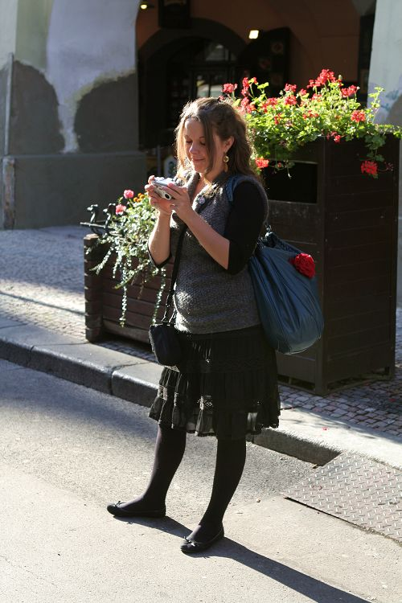  
  
旧城广场ST.NICHOLAS教堂大门的门把手。  
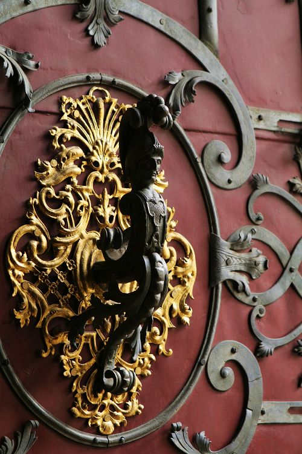  
  
布拉格的第二天和Esther、Sasa结伴多一些，因为我们都好爱摄影。这也是在集市上拍下的逆光中的Sasa。  
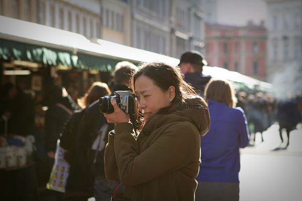  
  
Sasa在四个香港女孩中普通话讲得并不是特别好的一个，但是她非常好学，有一次她对Miranda说：“你是我的老师，你是我的恩人。。。我要向你学普通话。”我们听了之后哈哈哈大笑。可是这四个香港女孩子的英语都很好，其中三个跟随父母早年移民加拿大，现在在香港工作。相处下来感觉她们比大陆的女孩子要单纯一些，应了那句：环境造就人。  
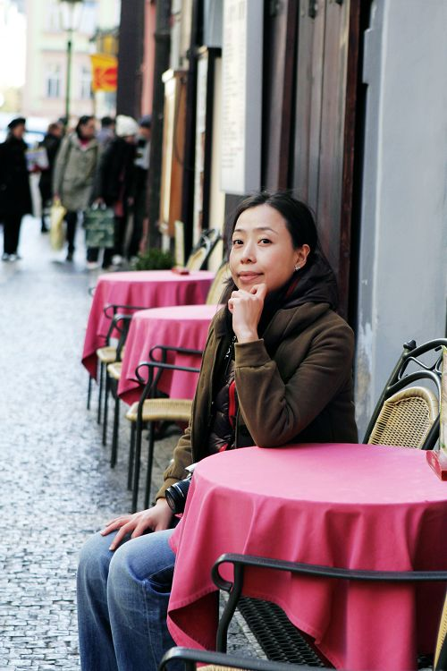  
  
跟朋友谈到这次我的照片不是很多，在为数不多的情况能挑出来自己满意的就更寥寥无几了，我的朋友说：“这就是**摄影师的杯具**。”这是我在一家餐厅门前的留影，摆放菜单的托架好有心思。  
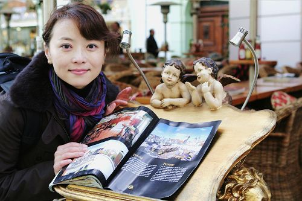  
  
木偶博物馆，这里最受欢迎的剧目是莫扎特的《唐.璜》。  
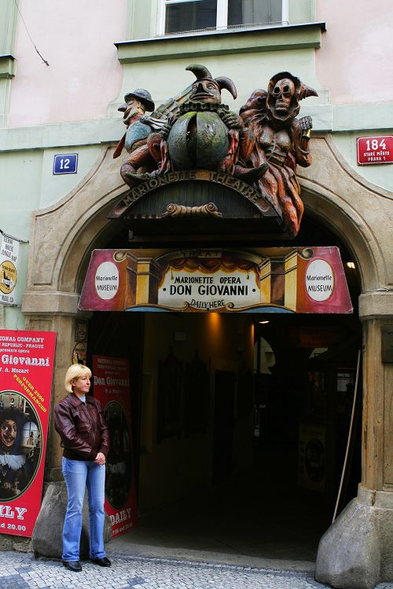  
  
珠宝商店外立面上的木刻，栩栩如生，婀娜摇曳。  
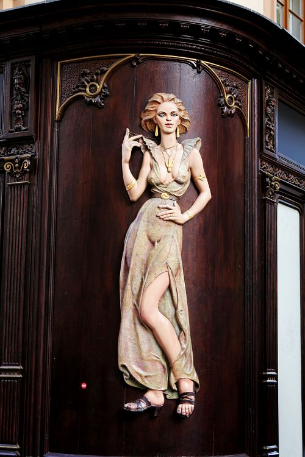  
  
旧城区的一家照相器材店，很老的相机成列在橱窗里出售，很老哦，好奇那些购买老相机的人以及用这些相机拍出来的胶片会是怎样的感觉？  
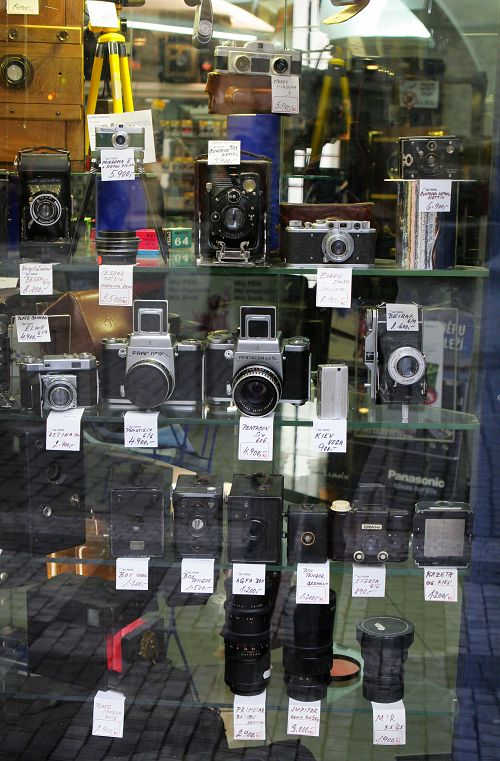  
  
靠近犹太区的这扇朱红色做工考究的木门，并不知道门内的典故。有意思的是它的旁边是供小孩子玩乐的商店。在布拉格旧城区与犹太区随便走走都能发现这类惊叹之处。  
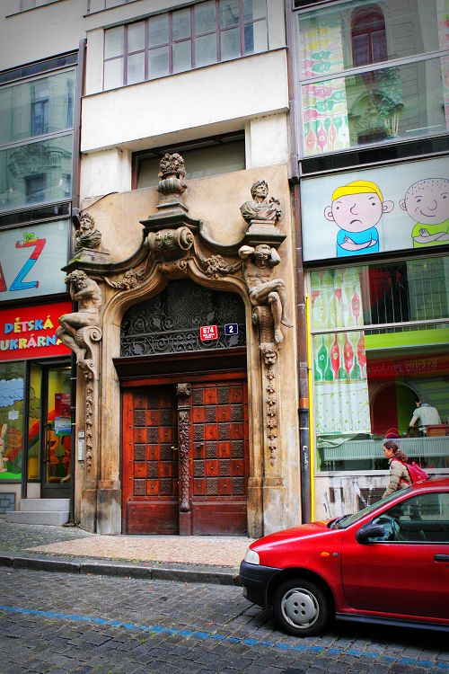  
  
左边女孩子那身打扮我很喜欢，90年代末我也曾有一件差不多款式的黑色小大衣，这件大衣如今还挂在衣橱里，当时也是搭配阔腿羊毛裤，不过不是她这样的浅口鞋，而是到脚踝的黑色平底皮鞋。她在栗色头发上漂染出一些紫色，以及斜挎深咖啡色背包，是我的那杯茶。我最近对咖啡色情有独钟，这可是我以前很不喜欢的颜色呢。她。。。是犹太人吗？  
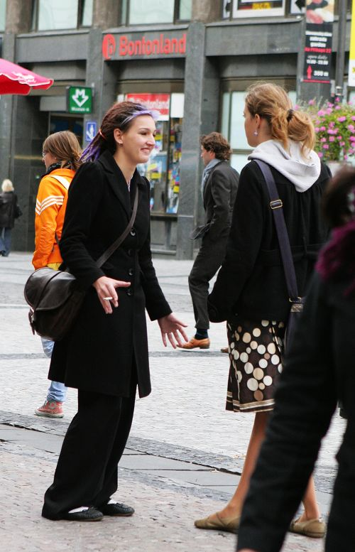

---

## 评论（21）

**大姜炖去** · 2009-11-11

集市上的姑娘侧脸像是梅格瑞恩：）

**[光光](http://gaoguangguang.blogbus.com)** · 2009-11-11

基本上，我觉得你镜头下的布拉格比我真实看到的布拉格要美。颜色在照片上变得鲜艳了，真漂亮。

**Christina** · 2009-11-11

但凡出太阳了景物就好看，不出太阳也灰蒙蒙的。

**[joanna](http://yanmer.cn/blog)** · 2009-11-11

我好像白去了布拉格，脑子里唯一的颜色就是红屋顶。你的片子带来了这么多色彩，赞

**lilian** · 2009-11-11

最近对黑色情有独钟，以前因为怕显老总是刻意回避，现在觉得若在细节上花些小心思会更显气质。

**shuwua** · 2009-11-11

你镜头下的Sasa很美。  
这些相机还好哦，我在北京旧货市场看到的连牙都掉了。

**陈问** · 2009-11-11

我爱那张阴霾天空下的 火药塔！其实整个布拉格系列我都爱，几乎无法区分爱或更爱。

**lusfe** · 2009-11-12

为了证明我看过，所以留下这句话

**美国农民** · 2009-11-12

Very nice pictures. What kind lens did you use? I guess there are some photoshop work to enhance the colors?  
I love those building pictures. You have an architect’s eyes.   
Those close up shots are also very impressive. Some of those pictures can be painted to watercolors.

Love to see some more!

**Christina** · 2009-11-12

天气好的情况下，基本上不需要后期处理，相机本身就可以设置需要的对比度、色彩。但是这次前半段行程很少见阳光，甚至下雨，就需要后期帮忙了。

带了三个镜头去旅行，大部分是用canon24-70mm镜头，一小部分用的“爱死小小白”，为数不多的几张用的广角镜头。

有人喜欢我拍的照片，我很开心呐~

**美国农民** · 2009-11-12

great work! I will talk to you when I come back to Nanjing.

**[Vachette](http://jessicaljw.spaces.live.com/)** · 2009-11-12

从豆瓣九点过来的，很有趣的游记～Same here, 超爱小女孩蓝包上的大红花！

**Pamela** · 2009-11-12

照片很好看~

**[雪芬](http://shirlschong.com)** · 2009-11-13

也是从九点过来，最近都有来看看。我刚从欧洲回来，可是还没去捷克呢。next time.

我想你说的“环境造就人”是指早期移民加拿大的缘故吧？的确，我在西方国家 (澳大利而和加拿大） 生活了一段日子，那里的人是比亚洲简单单纯很多很多！！我住久了，也开始简单起来…

**Christina** · 2009-11-13

欢迎豆瓣的朋友~

**Danielle** · 2009-11-13

你的几个朋友都好美呵,我好喜欢这样的脸孔和眼神```突然间,就爱上这样圆润的东方美了

**onfire518** · 2009-11-13

最近想买个佳能的500d或50d，不怎么该怎么搭配镜头，看姐姐的照片拍的很美，能提点建议吗？

**Christina** · 2009-11-13

拜托直接喊我“茶”或者Christina好了。

看你喜欢拍风景还是拍人像了，户外拍的多可以上Canon24-105mm的头先用着，熟了再慢慢根据需要上广角和长角。

如果拍人像多的话可以上个50mm/F1.4或者F1.8的定焦，以及24-70mm的红圈头。24-70的头还是比较保值的。我说的都是Canon系列的镜头啊~

机身就别考虑500D和50D了，直接上7D或5D MARK II吧，省得将来换来换去损失钱，个人意见，仅供参考！

**[光光](http://gaoguangguang.blogbus.com)** · 2009-11-13

最后那个黑衣style，如果你穿比她好看，我不喜欢她的气质。

**Christina** · 2009-11-13

主要是她的嘴角下垂了，呵呵~就觉得换个表情就完美了。不过我还蛮喜欢她夹着烟的张开五指的那个姿势，蛮有张力滴~

**onfire518** · 2009-11-13

拜托直接喊我“茶”或者Christina好了  
——-我觉得还是喊姐姐比较亲切点，你就容许我这样叫你好了～嘿嘿。要是我有这样漂亮的的亲姐姐该多好阿！

