# @Praha-3

**没有什么会给我带来风险，我只会赢得一切，如果我辞职并且离开布拉格。我一点都没有冒险，因为我在布拉格的生活不会带来任何好处。**  
----摘自1914年7月卡夫卡写给父母的信  
  
出了酒店的那天早晨挺冷的。  
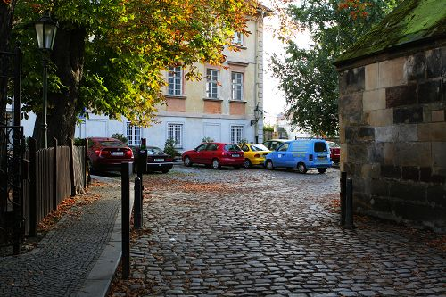   
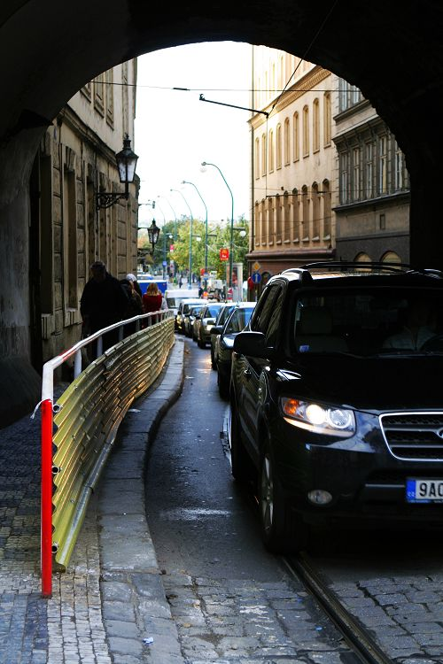   
  
墙壁上记录了布拉格淹水时的水位及年份。起初我将围巾系领子里面，之后系到领子外面以保证领子上的毛护着脸颊，可以想象出来有多冷吗？就是风吹到脸上会有轻微的疼痛感。  
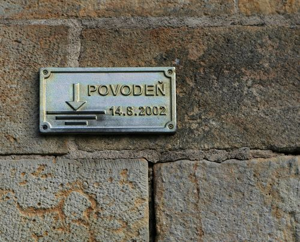   
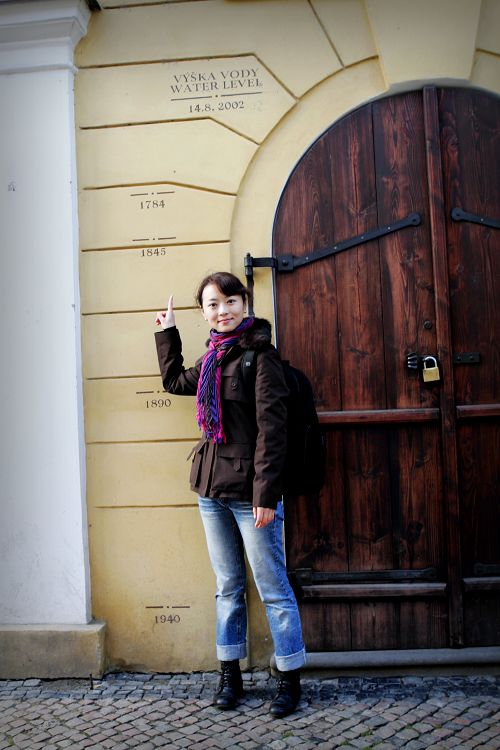  
  
河岸边新式建筑的居民区。  
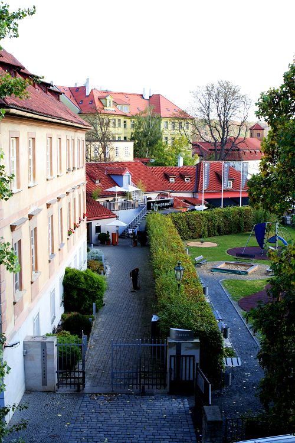   
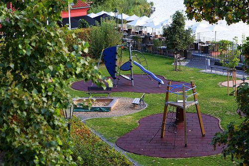  
  
布拉格是欧洲城市里优越公交系统之一，百年前上百公里的电车轨道现已扩展到五百公里覆盖全城，比地铁还方便，重要景点都停。  
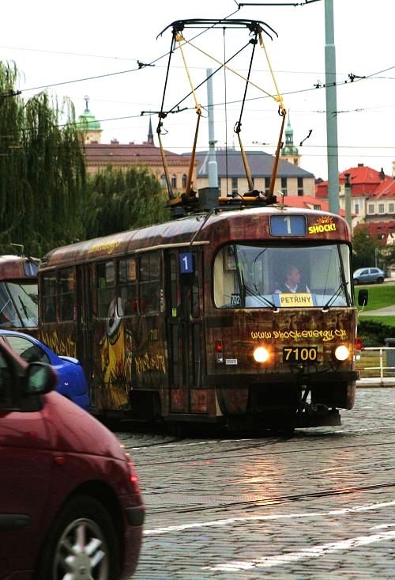   
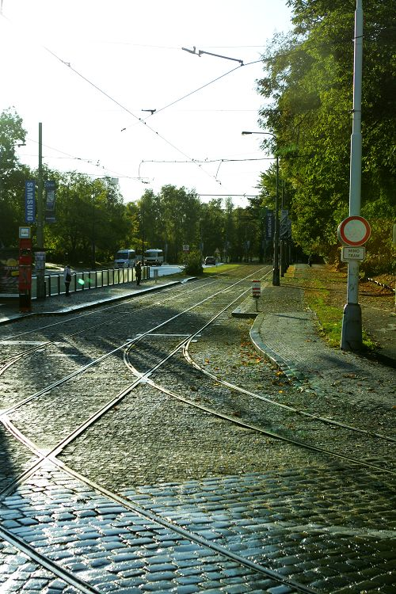  
  
我们仨儿乘坐的SKODA公司的老爷车，和我父亲年龄差不多大的汽车哦~  
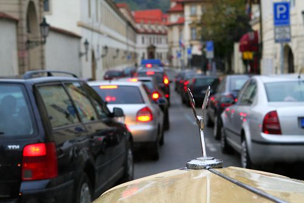  
  
老爷车真的很老，方向灯用这个橘黄色扇形标志代替，需要的时候它就弹出来，左拐就弹左边的，右拐就弹右边。  
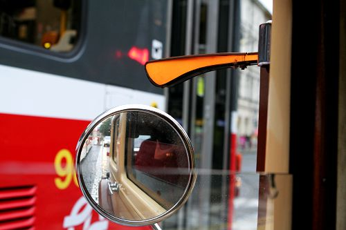  
  
很朴素简单的操控台，小小的雨刮器就在驾驶员前方，需要手动才能颤抖地刮一下，并且那个好象被挤压过发出尖叫声的喇叭让我们片刻错愕才明白过来。  
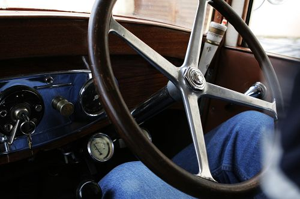   
  
我们乘坐的老爷车外观，急忙中Miranda和司机师傅都算错了钱，到了晚上才发现少付钱了，于是用酒店的电话打过去。。。老人家居然还没发现。这一个电话花了约9个欧元。Miranda说早知这样不如用手机打得了。  
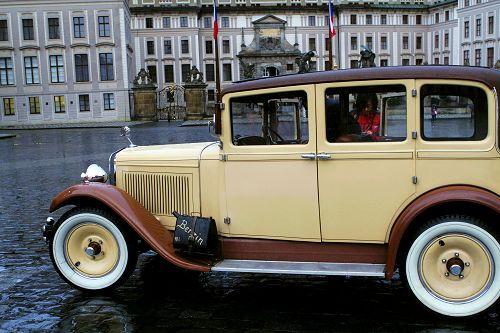  
  
位于伏尔塔瓦河左岸的布拉格城堡，从9世纪开始，就是布拉格王室所在地。几个世纪以来经过多次扩建，目前有1座宫殿、3座教堂和1间修道院，还有花园等其他建筑。目前，这里是捷克总统办公的地点，所以又称总统府。这是位于布拉格城堡的地面，多种石材拼接而成。  
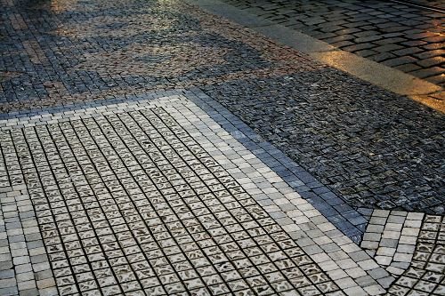  
  
这座具有地标意义的Katedrala sv Vita（圣维塔大教堂）修建了近700年，中间换了多位建筑师，整座教堂基本上就是历代建筑风格展示。塑造该教堂主要形貌的有两位建筑师：Matthias of Arras与继任的Peter Parler。对于当初决定兴建“圣维塔大教堂”的查理四世皇帝而言，这座布拉格最大的教堂确实让他名垂青史。  
  
在《审判》中卡夫卡描绘了布拉格圣维塔大教堂里“异常微弱的烛火，使得原本的黑暗更黑暗。”这座标志着布拉格城市象征的哥特式建筑，不仅是皇帝曾经登基加冕的大教堂、世界信徒顶礼膜拜的圣地之一，也是皇家贵族最后的栖息地。  
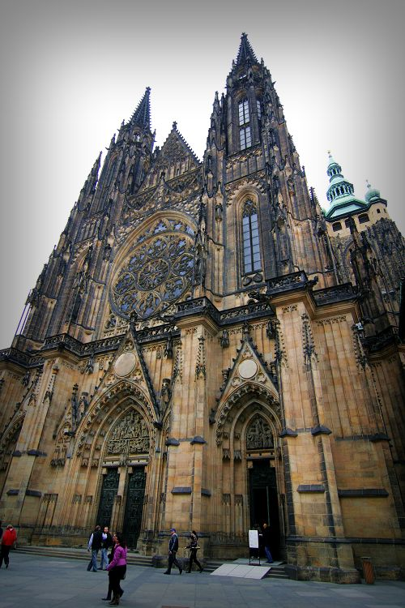   
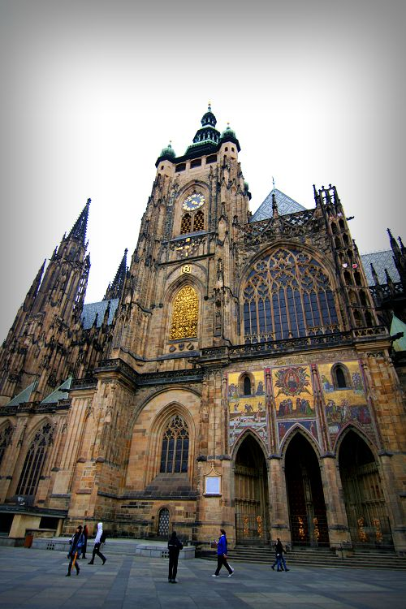   
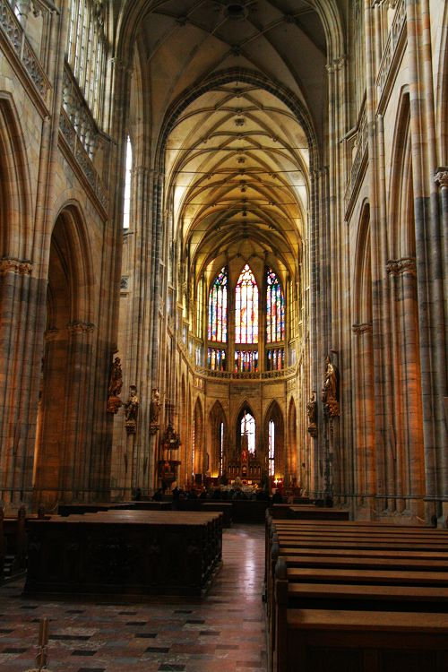   
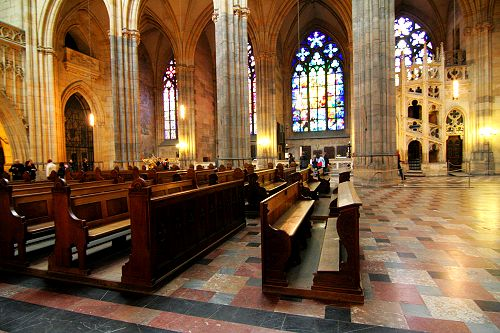   
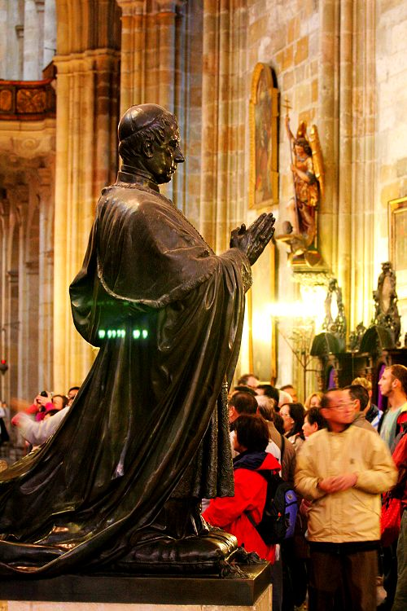   
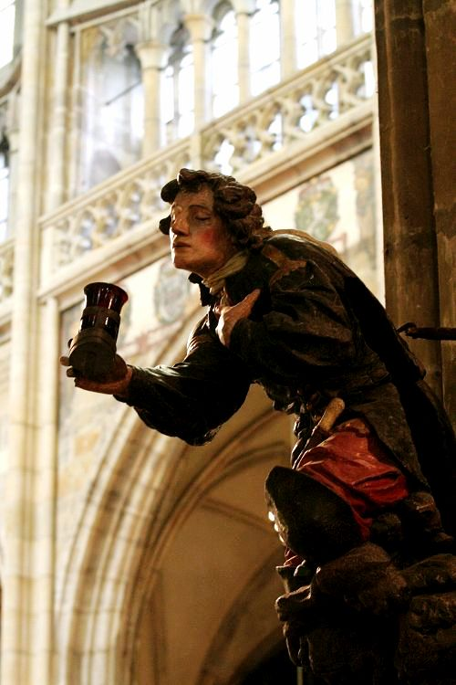   
  
教堂内的彩色玻璃窗，很多呢，不一一展示了。  
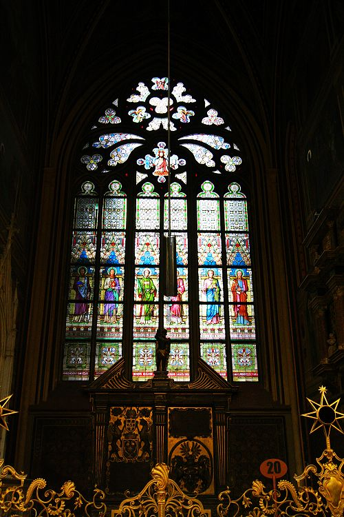   
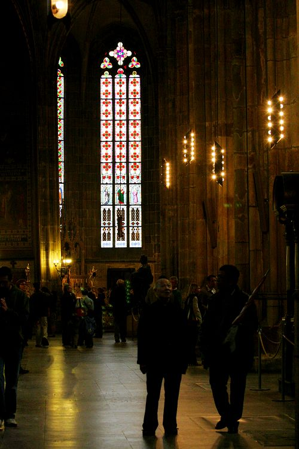   
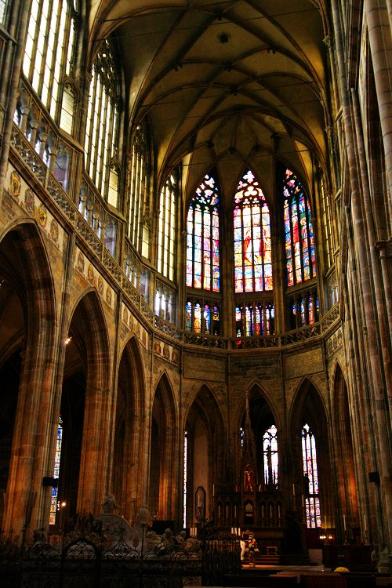   
  
反正很多到布拉格的人会去看总统府士兵换岗，我们也看了，也和大家一样拍了拍。真蛮奇怪的，总统办公的地点和大教堂在一起，咱们中央领导办公的地儿是万万不会和旅游景点搁一块儿的，并且让你直接站在豪无围挡的总统府楼下那么近。捷克总统府从外面看还真是质朴。  
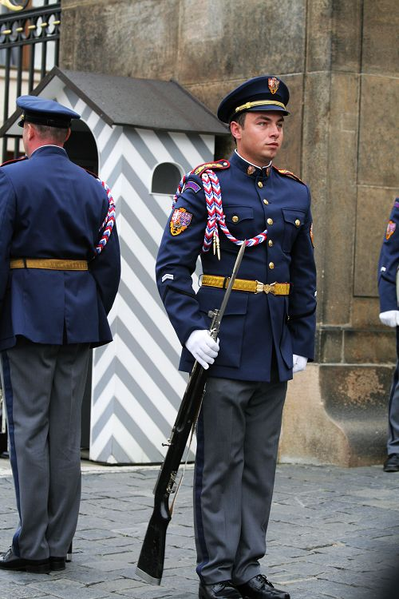   
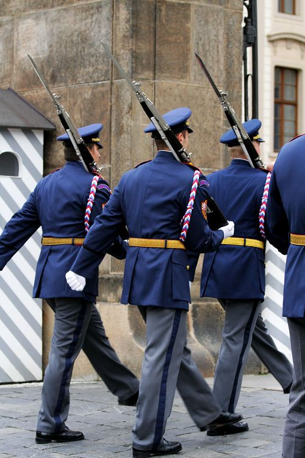

---

## 评论（8）

**Anyayaya** · 2009-11-14

好像记错了吧。是斯柯达，现已被大众收购。fiat是意大利的。。。

**Christina** · 2009-11-14

对对对，马上改。维也纳马车是FITA公司的，呵呵~

**喜刷刷** · 2009-11-14

总统府的士兵怎么那么朴素啊，我喜欢火药塔那边的士兵，那银靴子好帅！

**starsdown** · 2009-11-15

中南海边上还围着故宫，北海还有国家大剧院呢，只是隔着围墙看不到而已……

**cherry** · 2009-11-15

很喜欢这异国风情。

**[joanna](http://yanmer.cn/blog)** · 2009-11-15

俺在这里和兵拍过照:-)  
快快写游记哈，好期待呢。想看你的瑞士路线，我正在计划黄金线

**chris** · 2009-11-15

教堂让人惊叹~

**Christina** · 2009-11-15

瑞士几乎写了大半，你可以找前面的记录看~剩下部分等布拉格之后写。

