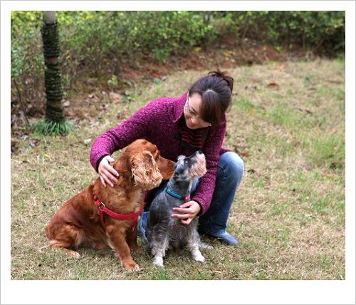
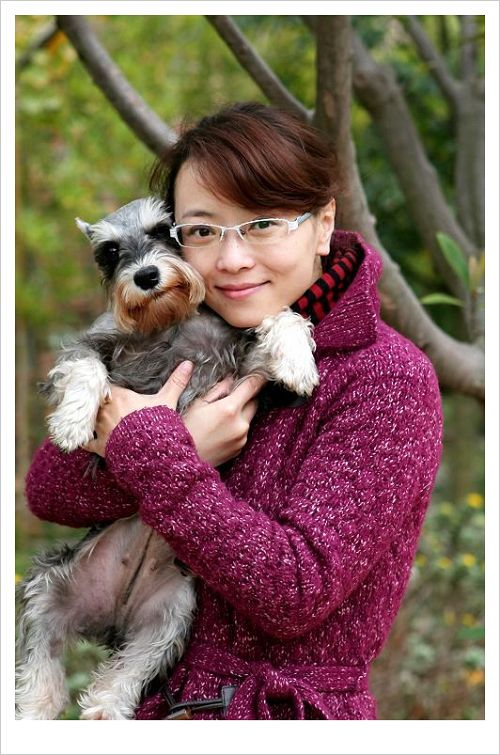
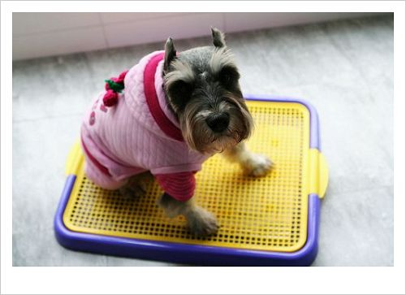
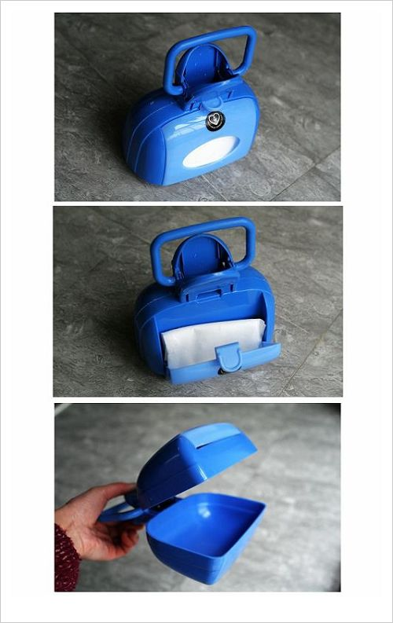
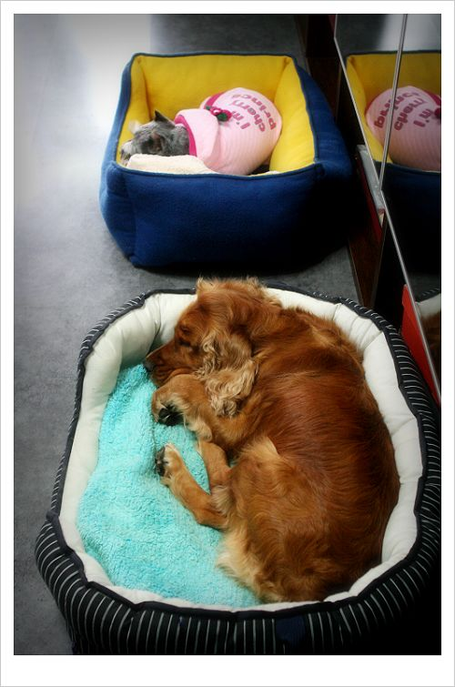

# 嗲*狗

[**土豆**](http://lifetea.org/article/2481/#comment)大概是我见过的最嗲的狗了，只要给它好脸色它就会趴在我腿上要我抱，极其粘人。来我家第一周，每天回家就是它的大小便等着我去打扫，当时我真觉得自己精力不够用快撑不住了。  
  
土豆特象一只兔子，无论上楼下楼还是奔跑。散步时它会象兔子一样蹦蹦跳跳“嗖”的一下就被淹没在草丛里了。Luke受土豆活泼性格的影响比过去活跃许多。星期六的早晨乘来维修的工人还没到，带它们俩出来散步，天气几乎到了零度，穿了长毛衣还是觉得有些冷，昨天我还穿着短裙配Maxmara渐变色的半截羊毛袜上班，人人见了都说“你身体真好”，有那么冷吗？不过公司的中央空调这周已经开了。  
   
  
  
网格状可以避免狗狗的爪子沾上自己的小便，液体会漏到网格下的托盘里，托盘里面可以放尿垫起除臭作用，勤清理的话也可以不放，清理时别嫌麻烦戴上塑胶手套比较好。购买狗厕所要注意狗狗的重要和狗厕所的载重要合适，否则狗狗站在上面会将网格踩扁了。还有，公狗狗需要一根立柱，最好再带三面围档。  
  
见过会上马桶的猫，但目前还没见过会上马桶的狗。以及那些从小开始驯养的狗狗卫生习惯当然会比较好，可是象土豆这样成天养在笼子里的赚钱机器，估计它原先的主人是无暇去培训它这些的，它的习惯就是在笼子里吃喝拉撒睡，现在改的确很困难。哪怕是盲目的希望，也要支撑着驯养它，和Luke一样每天散步时外出便便，或者在这个狗厕所上解决。  
  
  
以及，这个拾便器真的很方便也很卫生，前面可以摆放卫生纸或塑料袋，将纸或塑袋盖在狗狗的便便上，用拾便器夹起丢进垃圾桶。建议养狗的人手一只，和狗狗外出散步时携带。  
  
  
有时遇到一些狗狗主人听他们讲自己爱宠的故事，他们会允许狗狗和自己一起睡觉、在一个桌子上吃饭，上床上沙发。。。我爱狗狗，但不是一个溺爱狗狗的主人，甚至有时候还很严厉，当然这些习惯是我无法接受的！它们必须睡在各自的窝里，各用各的食盆，Luke刚来我家时也曾允许它上沙发睡觉，后来发现这是非常不好的习惯，这会让主人回家后更加忙碌于打扫卫生，对家具用品也有一定的磨损。经过一段时间调教，Luke知道不能再上沙发睡觉了。土豆刚来的第一周跳沙发跳桌子，被我一巴掌打下来，从此长了记性。自从Luke前一周拉肚子挂水之后，我也开始定点喂食，并且注意不给太油腻的食物。作为爱狗养狗的人，让爱宠守规矩对双方都有益而无害。  
  
刚从宠物店洗澡回来的它们，睡得很酣呐。土豆今天得到一件过冬的新衣服，因为它身上的毛实在太少了。  

---

## 评论（19）

**[少爷](http://jennyshaoye.blogbus.com/)** · 2009-11-14

这条狗真不错,为什么会被遗弃呢.想不通

**Christina** · 2009-11-14

也许就是随地大小便把大人们逼疯了吧？

我觉得过去的一周，我回家尽量不去做别的事，就盯着它，观察它什么时候大小便，好在第一时间告诉它该在哪里方便。我也快被逼疯了！

**shuwua** · 2009-11-14

两个女的嗲死了。土豆正在进步，加油啊！

**喜刷刷** · 2009-11-14

你终于把这个形容词用在别人身上啦，我轻松了～从照片上看，豆豆真的好依恋你，倒是luke这个没良心的，眼睛都不知道逛到哪边去了。

**陈问** · 2009-11-15

训练一只成年狗上厕所，很难。特别是以茶又急又快的狮子座性格来看，……土豆真是幸运，碰上全天下最好狮子座主人了 ：P

**[光光](http://gaoguangguang.blogbus.com)** · 2009-11-15

好乖的小狗，小狗能象猫那样上厕所吗？

**[joanna](http://yanmer.cn/blog)** · 2009-11-15

土豆是母的？和luke在一起没事？？  
像我以前的狗，天生就会坐在门口叫唤你，放他出去小便的狗，应该是极品了吧？！

**Jingtao** · 2009-11-15

可以show一下狗厕所吗?

**陈问** · 2009-11-15

好吧，我承认我对外外是属于溺爱型的。不过我家的狗在饮食方面，好像做的比你要严格哎。。

**Christina** · 2009-11-15

我开始学习你定点喂食啦：P

**旗旗** · 2009-11-15

土豆穿上新冬装好可爱哇。。。宠爱而不溺爱，说的很在理呢

**[光光](http://gaoguangguang.blogbus.com)** · 2009-11-16

好喜欢这篇啊，小狗们太乖啦！比人乖。我没见过美国人用那个捡狗屎的工具，他们一般就拿个塑料袋，隔着塑料袋捡。我觉得要是小狗能自己捡狗屎就好了。要不你给土豆戴个纸尿布，这样只用换尿布就可以了。

**Christina** · 2009-11-16

认识一个朋友是生产降解塑料的商人，用这种材料做的狗粪袋只要两年就自行化解了，环保材料。

以前我也用塑料袋，可是碰触到便便的温度和手感让人毛孔紧缩，还是这个方便又轻松，哈哈哈~

**mandy** · 2009-11-16

狗狗做着幸福的好梦 ~~

**锦衣** · 2009-11-17

我家的白色京吧戈登小同学9岁半了,打小就会自己上狗笼子里便便,从没人教过它,实在是太牛了.

**Christina** · 2009-11-17

那你运气好，遇到一条讲究卫生又聪明的狗狗~

**锦衣** · 2009-11-18

:)  
狗狗给我们带来的快乐远比我们给予它们的多.  
这些年了,我还是会时常惦念你的妞妞

**Christina** · 2009-11-18

干吗提伤心事？差点让我在办公室里飙泪。。。。

**锦衣** · 2009-11-19

真对不起!  
自己想哪儿说哪儿了.  
我错了……

